# 0829｜页面驻留：置换、工作集与缺页代价

> 这组题直接分成两截：
> 前面是**快速拿分题**，缺页中断特性、工作集模型与抖动成因，看准结论秒出答案；
> 后面是**耗时攻坚题**，CLOCK 算法多轮指针扫描与脏位写回开销计算，草稿纸排好页面队列，一步步推演。

---

## 一、 快速拿分题（缺页机制与工作集，抓准特征）

### 01 · 2011-28
> *缺页处理是由硬件异常引出的内核操作，操作系统要找空闲页框、读磁盘把页调进来，并修改页表状态位。*
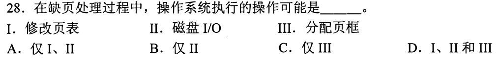

### 02 · 2011-29
> *发生系统抖动是因为活跃进程太多把内存榨干了，最根本有效的急救措施是挂起或撤销部分进程以腾出页框。*
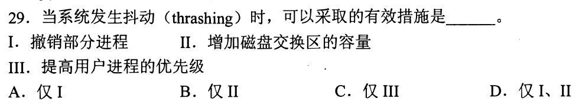

### 03 · 2012-24
> *子程序调用只存返回地址 PC；中断和异常处理是强行打断，操作系统必须把程序状态字 PSW 和 PC 一同封存。*

### 04 · 2013-30
> *发生缺页只是页面暂时不在内存里，调进来即可，绝对不是地址越界的错误，千万别当成越界中断处理。*

### 05 · 2014-32
> *多道程序度提升会让 CPU 利用率上升，但一旦超过拐点，每个进程分到的页框不够，就会全面抖动导致利用率跳水。*

### 06 · 2015-29
> *C 语言二维数组在内存里是按行紧挨着存放的，外层按列遍历会导致每一次循环都在大跨步缺页，性能极慢。*
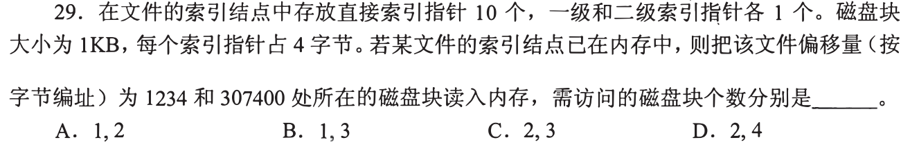

### 07 · 2016-26
> *固定分配局部置换给每个进程定死物理页数；可变分配全局置换最灵活，缺页时可以直接从系统空闲池抓取页框。*
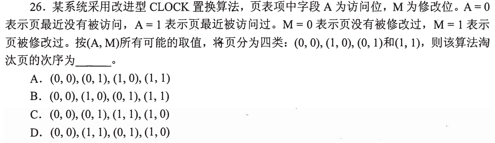

### 08 · 2016-29
> *工作集是进程在滑动时间窗口内实际访问的页面集合，操作系统分配的驻留集必须大于工作集才能压住缺页率。*
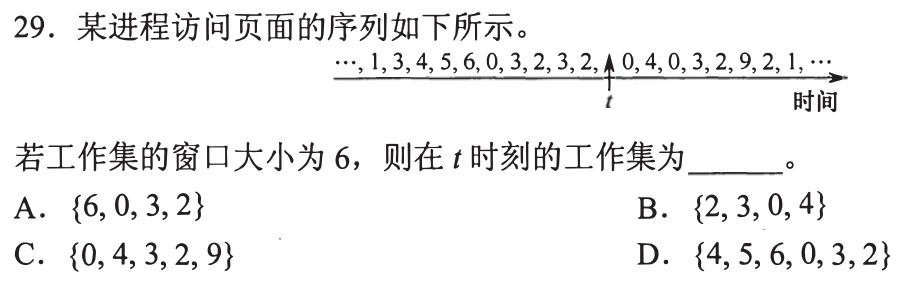

### 09 · 2020-28
> *缺页中断发生在 CPU 执行指令的过程中，而且一条涉及跨页操作数的复杂指令可能会连续触发两次缺页异常。*
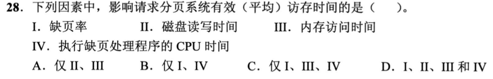

### 10 · 2026-30
<!-- 2026 压轴题位，已在 paper_html/408-2026.html 就绪 -->

---

## 二、 耗时攻坚题（置换模拟与脏页代价，纸上排队）

### 11 · 2010-29
> *模拟 FIFO 和 LRU：草稿纸一列一列画，命中时 LRU 要把该页提到最新，FIFO 纹丝不动。*
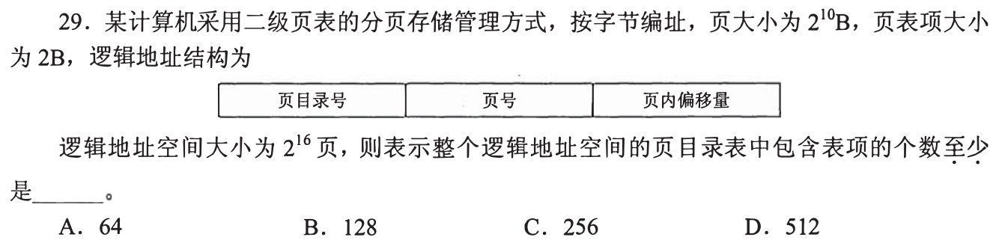

### 12 · 2014-30
> *简单 CLOCK 算法：指针像时钟一样转圈扫访问位，碰到 1 清 0 继续走，碰到第一个 0 的页直接淘汰出局。*
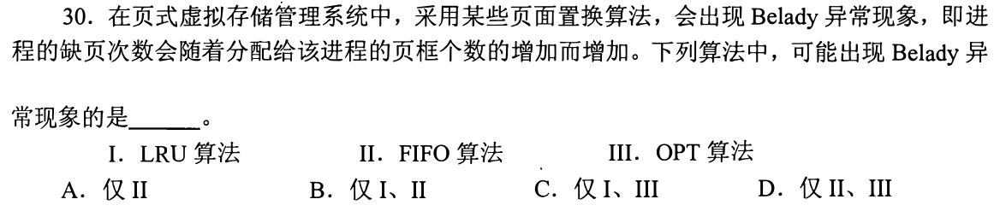

### 13 · 2019-29
> *脏位 Dirty bit 的致命代价：没修改过的干净页直接丢弃覆盖即可，被修改过的脏页必须多做一次写盘 I/O 才能腾地方。*
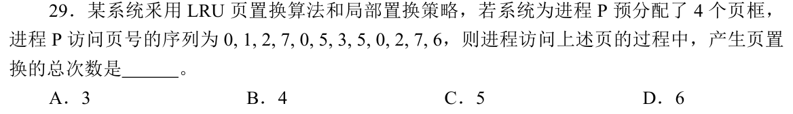

### 14 · 2021-28
> *有效访存时间算清加权：缺页率虽然只有百分之零点几，但乘上毫秒级磁盘 I/O 会急剧拖慢整个系统。*
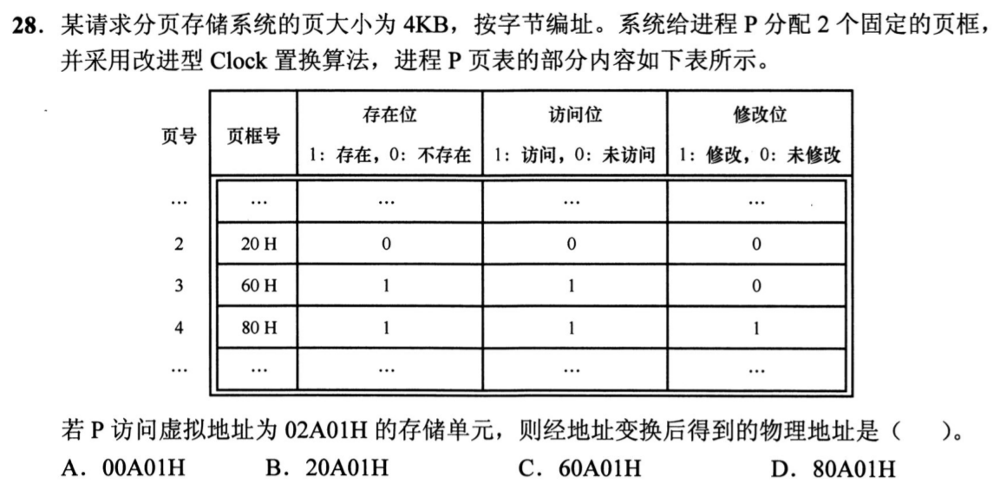

### 15 · 2021-29
> *LRU 命中不缺页但会改变栈内相对顺序，FIFO 命中连碰都不碰队列。*
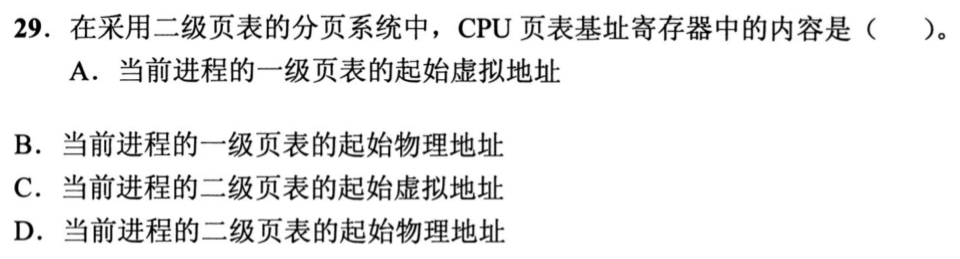

### 16 · 2022-29
> *缺页异常处理完成后，返回的是刚刚那条由于缺页而没执行成功的指令重新执行，千万别当成执行下一条。*
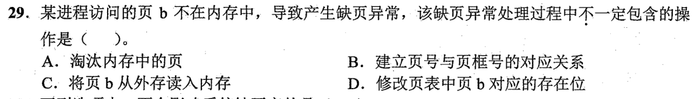

### 17 · 2022-30
> *工作集窗口太小抓不住真实局部性，窗口太大又会白白占用过多宝贵的物理页框，必须动态微调。*
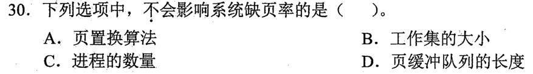

### 18 · 2023-25
> *改进型 CLOCK 四轮扫描：第一轮找 (0,0)，第二轮找 (0,1) 并把访问位置 0，算清楚指针一共扫了几轮。*
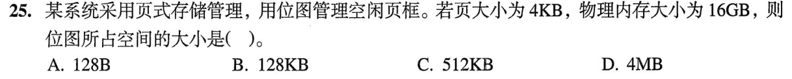

### 19 · 2023-28
> *二级页表缺页可能连环触发：顶级页表项缺页先去外存读一次页表，目标数据页缺页又要再去外存读一次数据。*
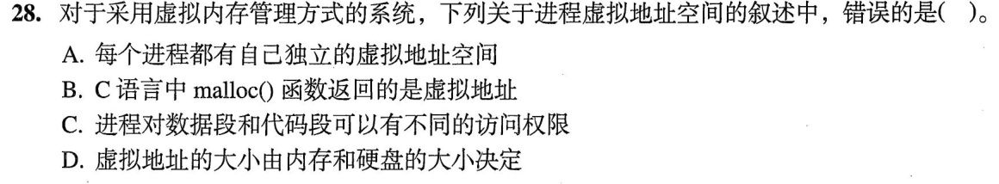

### 20 · 2024-25
> *缺页开销估算：把每秒缺页次数乘上每次调入调出的数据量，算算磁盘通道带宽是不是已经被打满了。*
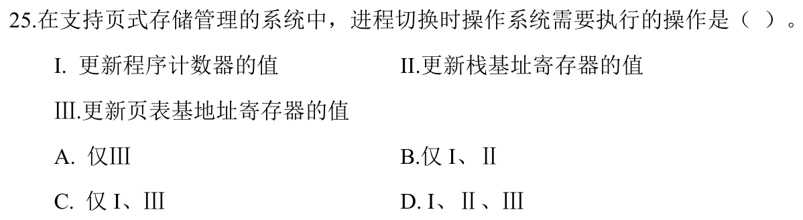

### 21 · 2025-26
> *页缓冲队列：被淘汰的脏页不急着单次写盘，挂在修改页链表上，等攒够一批或者磁盘空闲时集中刷盘。*
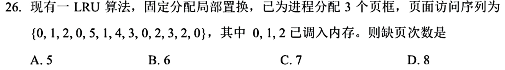

### 22 · 2025-27
> *长访问序列下的置换模拟，注意把冷启动的前几次固定缺页先剔除出来，再按规则推演后面的动态替换。*

### 23 · 2025-30
> *最新压轴。多核环境下的页面局部置换与动态工作集调整，兼顾各进程独立缺页率与系统总吞吐。*
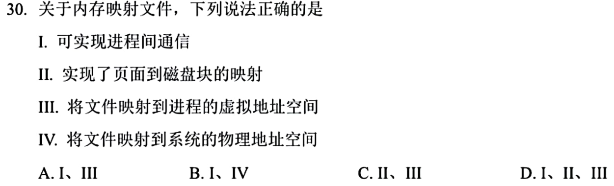

### 24 · 2026-29
<!-- 2026 压轴题位，已在 paper_html/408-2026.html 就绪 -->
