# 0830｜文件路径：名字、索引、数据块与共享

> 这组题直接分成两截：
> 前面是**快速拿分题**，硬链接软链接区别、FCB 读写与文件删除动作，1 分钟稳稳拿分；
> 后面是**耗时攻坚题**，多级索引 inode 最大文件长度计算与路径逐级访盘次数，老老实实按层级算清楚。

---

## 一、 快速拿分题（链接、FCB与目录操作，直击本质）

### 01 · 2009-30
> *硬链接删除原文件只是引用计数减 1，只要计数不为 0 文件就安好；软链接只存个路径，原文件一删它立马报废。*

### 02 · 2010-31
> *现代目录项只存文件名和 inode 编号，把尺寸权限塞进 inode，目录体积缩小几倍，查找扫盘快得多。*

### 03 · 2011-30
> *连续分配支持随机访问但有外部碎片；隐式链接只支持顺序访问；索引分配两者兼备但开销大。*
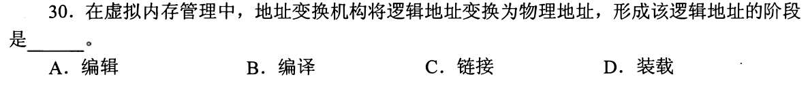

### 04 · 2012-32
> *硬链接是指向同一个 inode 节点，引用计数加 1；软链接是新建一个独立文件存放目标路径。*
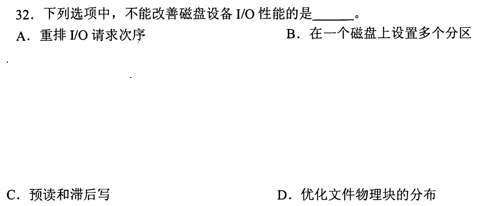

### 05 · 2013-23
> *删除文件是干掉该文件的目录项和数据块，绝不会把上级目录文件夹也顺带删了。*

### 06 · 2013-24
> *光盘这类只读介质做一次性写入，连续分配连续存放寻道开销最小，随机跳转播放性能最强。*

### 07 · 2013-26
> *单个文件最大长度只跟直接/间接地址项个数和盘块大小有关，跟磁盘上总共有多少个 inode 毫无关系。*

### 08 · 2014-29
> *open 系统调用不读文件数据！它只是把磁盘上的 FCB 读进内核的打开文件表，返回一个文件描述符。*
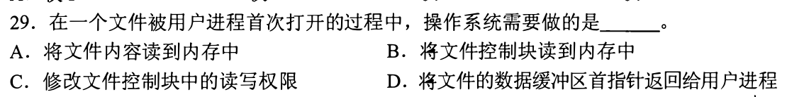

### 09 · 2017-26
> *口令保护防君子不防小人，访问控制列表 ACL 粒度最细，能精确控制每个用户的读写执行权限。*
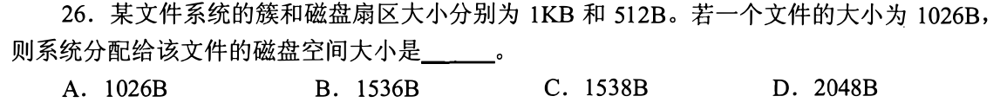

### 10 · 2019-26
> *文件逻辑块号转换为物理块号，连续分配只需起始物理块号加上逻辑块号，一步直达。*
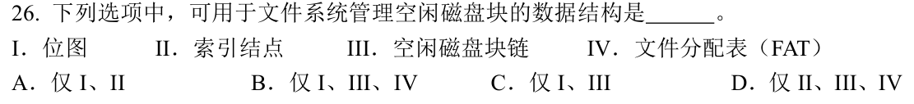

### 11 · 2020-23
> *通用无环图目录共享文件，任何一边修改内容，另一边完全可见，因为指向同一份物理块。*
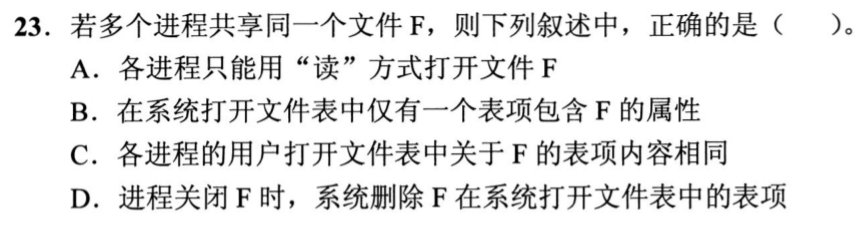

### 12 · 2024-26
> *文件系统格式化时写入引导块、超级块、空闲块位图和 inode 表，数据区全置空闲。*

---

## 二、 耗时攻坚题（索引计算与目录跨盘推演，层层拆解）

### 13 · 2009-31
> *FAT 文件分配表把链表指针全集中在内存表中，查找物理块不用来回读磁盘，速度远超隐式链接。*
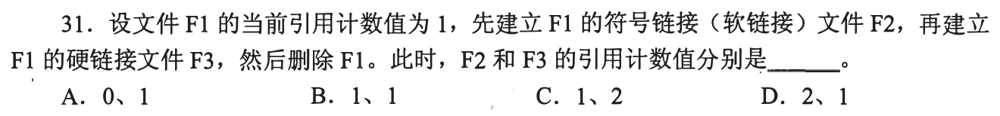

### 14 · 2010-30
> *UNIX 混合索引算最大文件长度：直接项 + 一级间接乘块容纳数 + 二级间接乘块容纳数平方，算准字节与块转换。*
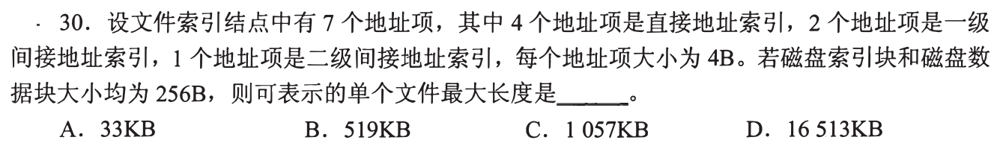

### 15 · 2011-31
> *分清系统打开文件表与进程打开文件表：读写偏移量在系统级打开表项中，文件描述符在进程表。*
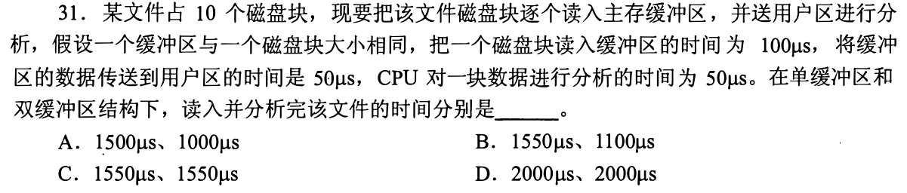

### 16 · 2015-29
> *多级索引访问特定偏移的数据，必须老老实实算跨过了几级索引，算清总共需要几次磁盘 I/O。*
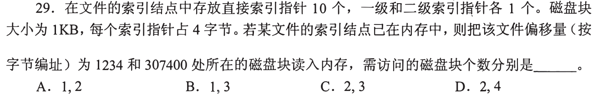

### 17 · 2015-30
> *位示图盘块分配：用字节数和位偏移计算具体行号列号，注意编号从 0 还是从 1 开始的致命陷阱。*
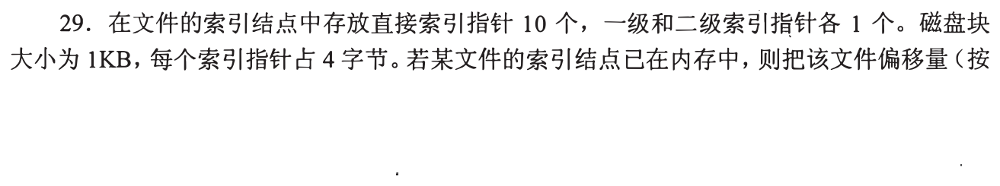

### 18 · 2015-31
> *软链接跨文件系统共享，访问时必须先查自身 inode，读出路径文本，再走一遍全路径解析。*
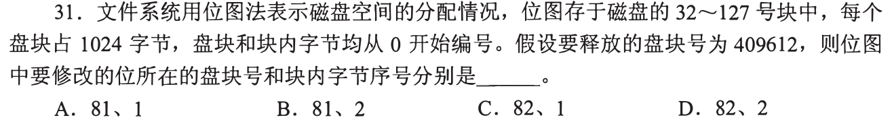

### 19 · 2017-29
> *给出一个具体的文件相对路径，从当前目录开始数跨越了多少个目录文件，算准访盘次数。*
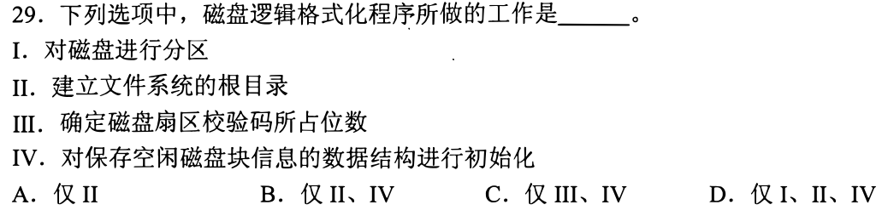

### 20 · 2017-31
> *变长记录文件建立索引表，索引项由主键和记录指针构成，查索引折半二分法算开销。*
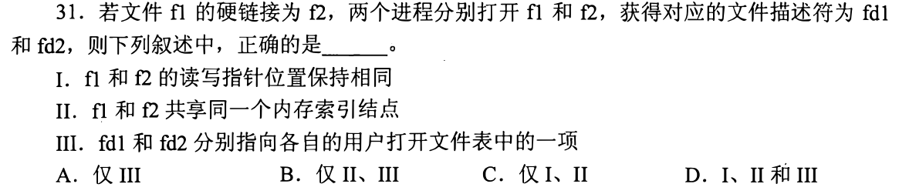

### 21 · 2018-31
> *文件被多个进程同时打开时，各自维护各自的读写指针，但共享系统打开文件表中的 inode 副本。*
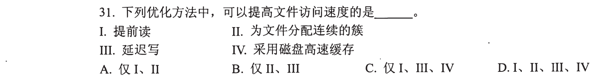

### 22 · 2019-31
> *根据 inode 的间接寻址结构计算访问某字节需要读几块盘，直接项 0 次额外寻址，一级间接多读 1 块。*
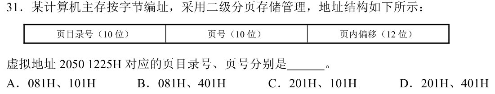

### 23 · 2020-30
> *磁盘空闲块管理成链表法 vs 位示图法，位示图可常驻内存且支持多块连续分配，扩展性更好。*
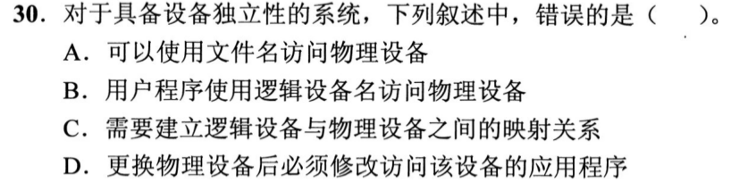

### 24 · 2020-31
> *目录文件也是普通文件，目录项随着文件增删会动态扩充物理盘块，删空后可以回收。*
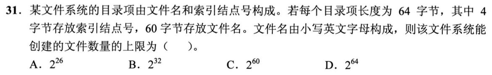

### 25 · 2021-30
> *三级索引块结构深度推演，算特定大文件写入追加一字节时需要新分配几个索引块。*
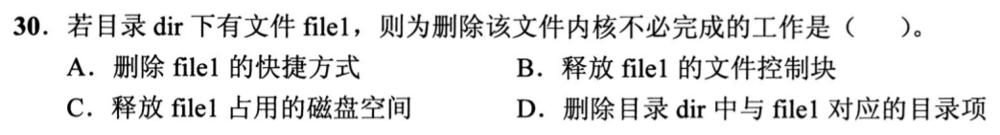

### 26 · 2023-31
> *基于 inode 结构读取指定字节跨块边界，若正好卡在直接块与一级间接块交界处，需要两次读盘。*
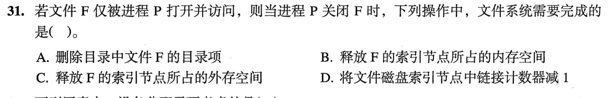

### 27 · 2024-29
> *硬链接删除与更新，注意引用计数由 2 变 1 时不释放物理块，只有减到 0 才真正擦除位图。*

### 28 · 2025-28
> *文件缓存系统 Page Cache 与脏页延迟写回，调用 fsync 强制落盘的耗时评估。*
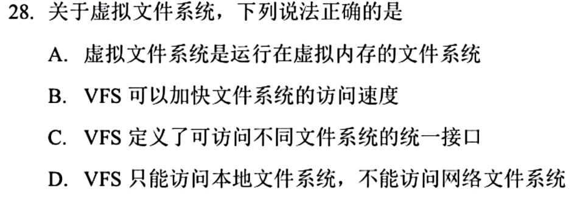

### 29 · 2025-29
> *新型日志文件系统 Ext4/Btrfs 日志区与元数据一致性保护。*

### 30 · 2025-31
> *混合多级索引极限寻址范围，注意 64 位系统中盘块指针由 4 字节扩充为 8 字节带来的块容量缩水。*
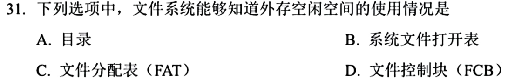

### 31 · 2025-32
> *最新压轴。分布式或现代本地文件系统的原子重命名与目录树遍历开销。*
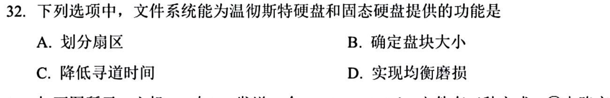
