# 0831｜设备服务：缓冲、磁盘与请求调度

> 这组题直接分成两截：
> 前面是**快速拿分题**，SPOOLing、I/O软件四层与通道概念，看清层次直接选；
> 后面是**耗时攻坚题**，磁盘调度寻道距离、单双缓冲区处理时间与旋转交替编号，老实画图列式，切忌心算手滑。

---

## 一、 快速拿分题（层次与设备分类，一眼秒杀）

### 01 · 2009-29
> *SPOOLing 假脱机技术把独占设备在逻辑上改造为共享设备，输入井和输出井是其核心。*
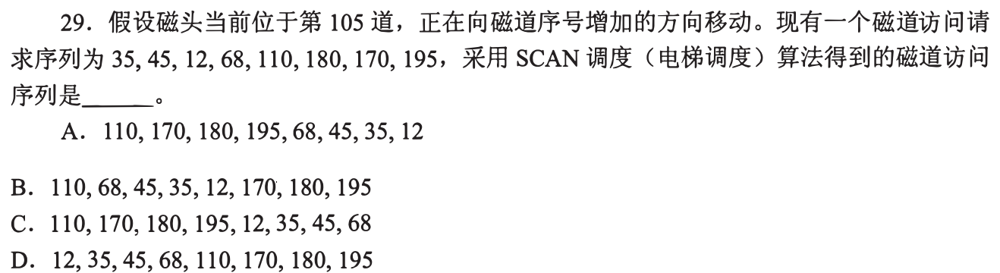

### 02 · 2012-26
> *I/O 软件自顶向下四层：用户层软件 $\to$ 设备独立性软件 $\to$ 设备驱动程序 $\to$ 中断处理程序。*
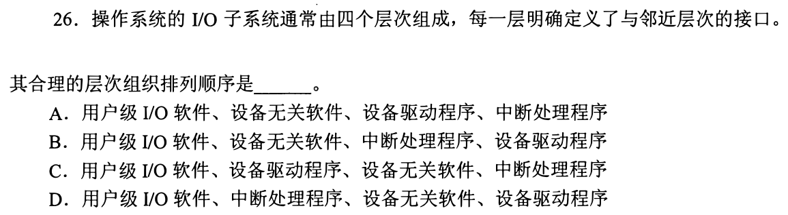

### 03 · 2013-20
> *RAID 提高可靠性靠镜像和奇偶校验，条带化只是把数据切开放入不同盘提高读写速度，跟可靠性无关。*
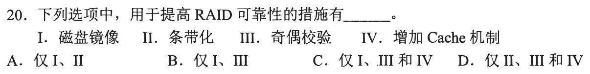

### 04 · 2013-31
> *要想系统吞吐量高，I/O 繁忙型进程必须给高优先级，早点让它发出 I/O 请求，CPU 和外设才能同时跑起来。*
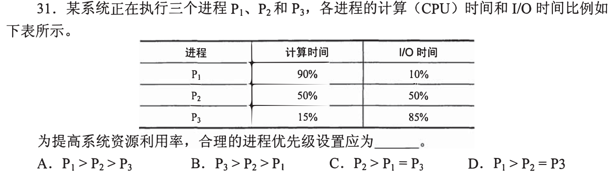

### 05 · 2014-26
> *读盘完成由磁盘中断打断 CPU，操作系统把数据搬完后，必须把该进程从阻塞态改为就绪态。*
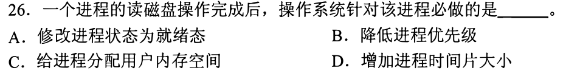

### 06 · 2014-31
> *管道是半双工单向流动的，读空写满都会阻塞，读端写端全关才算遇到 EOF。*
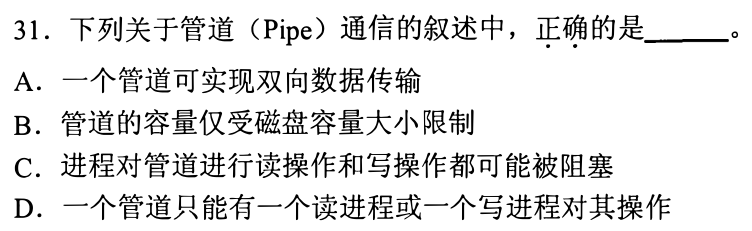

### 07 · 2016-24
> *通道是具有通道指令的硬件微处理器，接管主机与外设之间的数据传输，比中断型更省 CPU。*
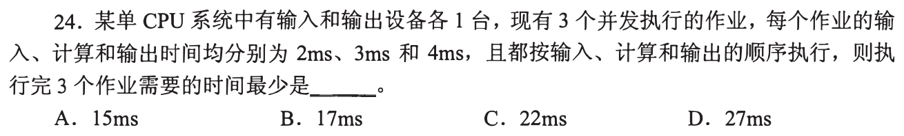

### 08 · 2017-28
> *设备控制器中有控制寄存器、状态寄存器和数据寄存器，CPU 读写这些寄存器来发号施令。*
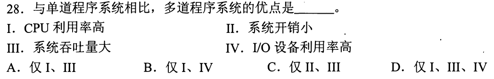

### 09 · 2018-27
> *DMA 控制器传输单位是数据块，在数据块全部传送完毕时才向 CPU 发一次中断信号。*
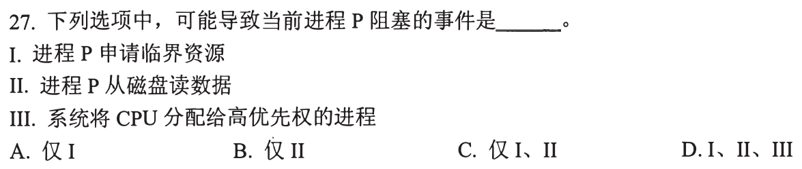

### 10 · 2026-31
<!-- 2026 压轴题位，已在 paper_html/408-2026.html 就绪 -->

---

## 二、 耗时攻坚题（时延计算与调度模拟，列式推演）

### 11 · 2009-32
> *磁盘调度手算磁道距离：FCFS 按序走，SSTF 贪心找最近，SCAN 电梯到顶折返，别算错距离相加。*
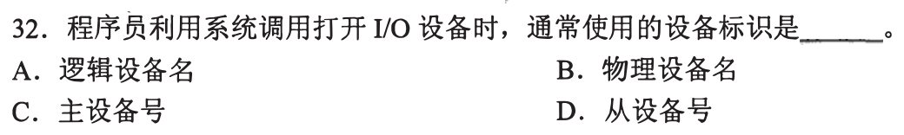

### 12 · 2010-32
> *单缓冲与双缓冲时间推导：单缓冲处理一块需 $\max(T, C) + M$，双缓冲流水线需 $\max(T, C, M)$，公式别记混。*
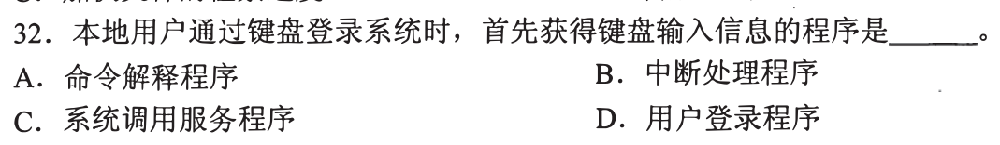

### 13 · 2012-28
> *用户进程发起 read 系统调用，数据若不在内存则阻塞自己让出 CPU，驱动发命令，传完硬件中断唤醒。*
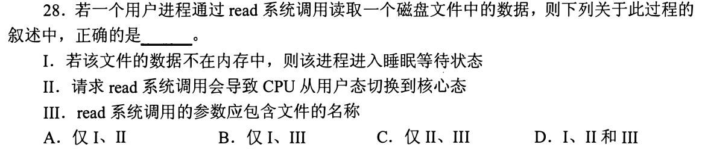

### 14 · 2013-21
> *读磁盘平均时间四部曲：寻道时间 + 旋转半周延迟 + 扇区传输时间 + 控制器延迟，单位换算成毫秒。*
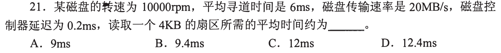

### 15 · 2014-27
> *位图大小计算：总容量除以簇大小算出总簇数，1 簇占 1 位，总位数转成字节再转成盘块数。*
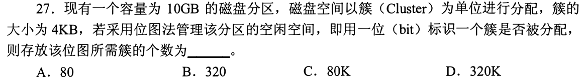

### 16 · 2015-20
> *7200rpm 算平均旋转等待：每分钟 7200 转，一转 8.33ms，半转就是 4.17ms，再加上寻道时间。*
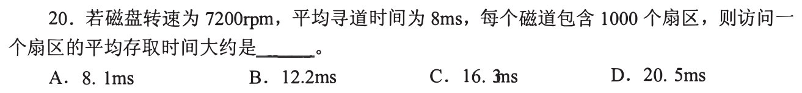

### 17 · 2015-32
> *SCAN 电梯调度要看清当前移动方向！如果往内侧走，必须先走到内侧最深处再回头向外，绝不半路折返。*
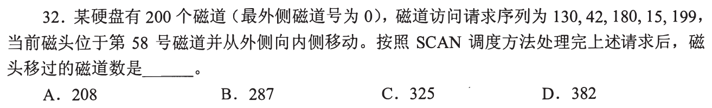

### 18 · 2016-31
> *旋转延迟优化：顺序读取物理相邻扇区，CPU 处理需要时间，扇区交替编号（错位排列）可以避免转一整圈才能读下一块。*
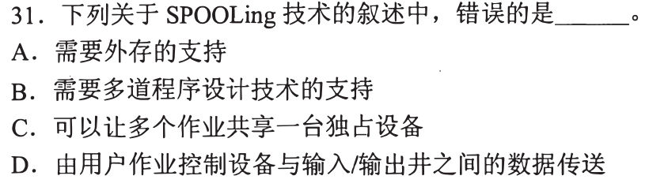

### 19 · 2017-32
> *C-SCAN 循环单向扫描，从内向外扫完后直接快速跳回最外侧，返回途经的磁道不提供任何服务。*
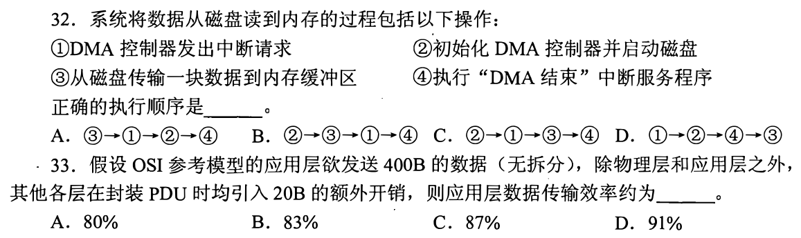

### 20 · 2018-30
> *单缓冲区两进程连续读入处理，分析时间重叠区域，画流水线时序图最稳当。*
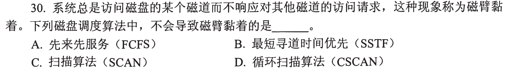

### 21 · 2019-20
> *磁盘阵列 RAID 0/1/5 空间利用率与容错性能：RAID 5 留一块校验盘空间，利用率为 $(N-1)/N$。*
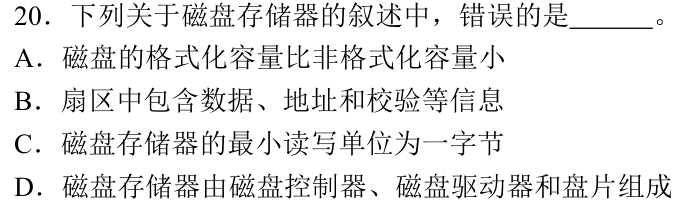

### 22 · 2021-26
> *设备分配中的死锁防范与设备独立性概念，分清逻辑设备名与物理设备名映射表 LUT。*
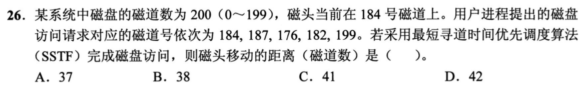

### 23 · 2022-32
> *中断驱动与 DMA 的底层性能极限对比，计算高吞吐量下中断响应时间是否会压垮总线。*
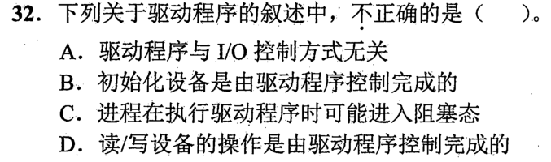

### 24 · 2023-32
> *多级磁盘调度算法在突发密集请求下的响应饥饿，LOOK 算法只到最后一个请求位置就折返。*
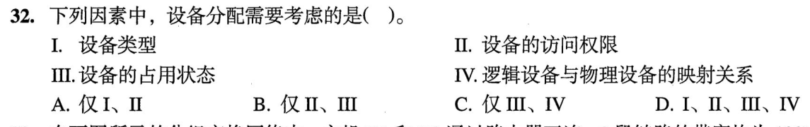

### 25 · 2024-31
> *复杂多任务流水线双缓冲利用率推导，代入周期时间找瓶颈工序。*
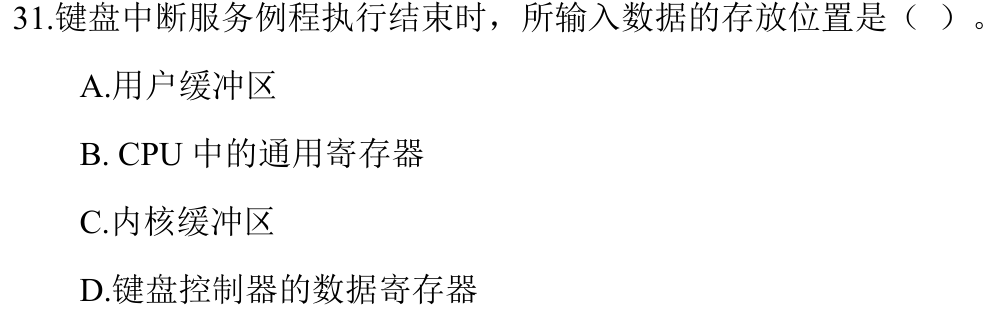

### 26 · 2024-32
> *现代固态硬盘 SSD 闪存特性：页读写、块擦除、写放大与磨损均衡。*
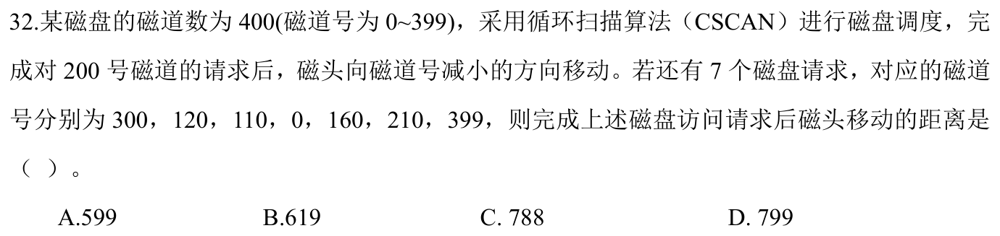

### 27 · 2026-32
<!-- 2026 压轴题位，已在 paper_html/408-2026.html 就绪 -->
