# 0901｜分层路径：数据穿过网络时每层做什么

> 这组题直接分成两截：
> 前面是**快速拿分题**，考查各层核心职责与基础服务模型，概念清楚直接秒杀；
> 后面是**耗时攻坚题**，涉及分组交换时延、流水线转发与多跳封装开销，草稿纸画清时间轴，算准最后几跳的转发时延。

---

## 一、 快速拿分题（扫一眼定答案）

### 01 · 2009-33
> *端到端服务自下而上第一个是传输层，网络层及以下全都是逐跳的“结点到结点”。*
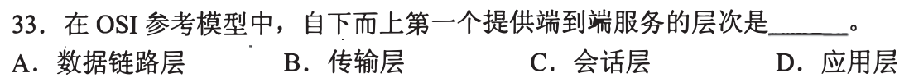

### 02 · 2010-33
> *网络体系结构是抽象的“各层做什么、遵循什么协议”，绝不包括协议内部的具体代码或电路实现细节。*
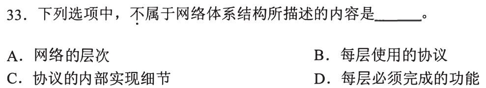

### 03 · 2011-33
> *IP 协议就是典型的“尽力而为”（Best-effort），提供无连接、不可靠的数据报服务。*
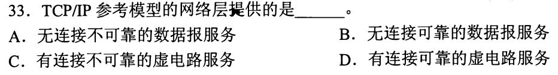

### 04 · 2012-33
> *ICMP 报文要装在 IP 数据报的数据部分传输，直接为 ICMP 提供服务的就是 IP。*
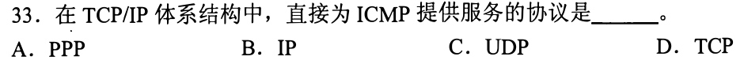

### 05 · 2012-35
> *以太网 MAC 协议只管差错校验、丢弃坏帧，不确认不重传，提供的是无连接不可靠服务。*
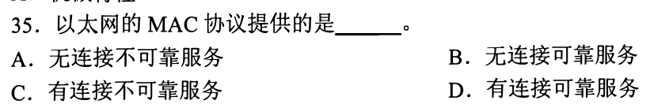

### 06 · 2020-33
> *看图说话：两端有来有回的箭头交互和先后触发顺序，体现的就是时序和语义。*
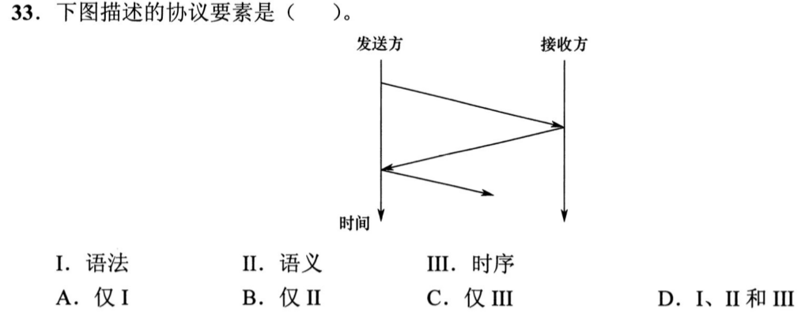

### 07 · 2021-33
> *传输层的直接下层就是网络层，网络层的核心看家本领就是路由选择与分组转发。*
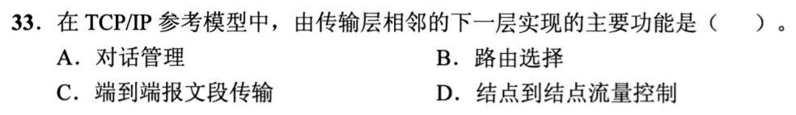

---

## 二、 耗时攻坚题（画出时序图，算准流水线）

### 08 · 2010-34
> *分组交换流水线经典：整段数据在源端连续发送完，再加上最后一个分组穿过中间路由器的存储转发时延。*
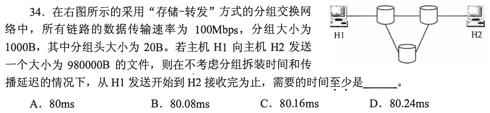

### 09 · 2013-35
> *报文交换是整块大石头滚过去，每个路由器都要完整存下再转；分组交换是切片流水线推进，看清中转路由器的个数。*
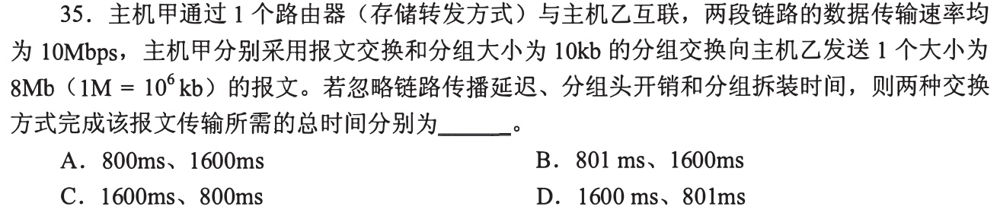

### 10 · 2016-33
> *综合网络拓扑分析：集线器纯物理层放大共享，交换机隔离冲突域，跨路由器才需要网络层参与封装与解封装。*
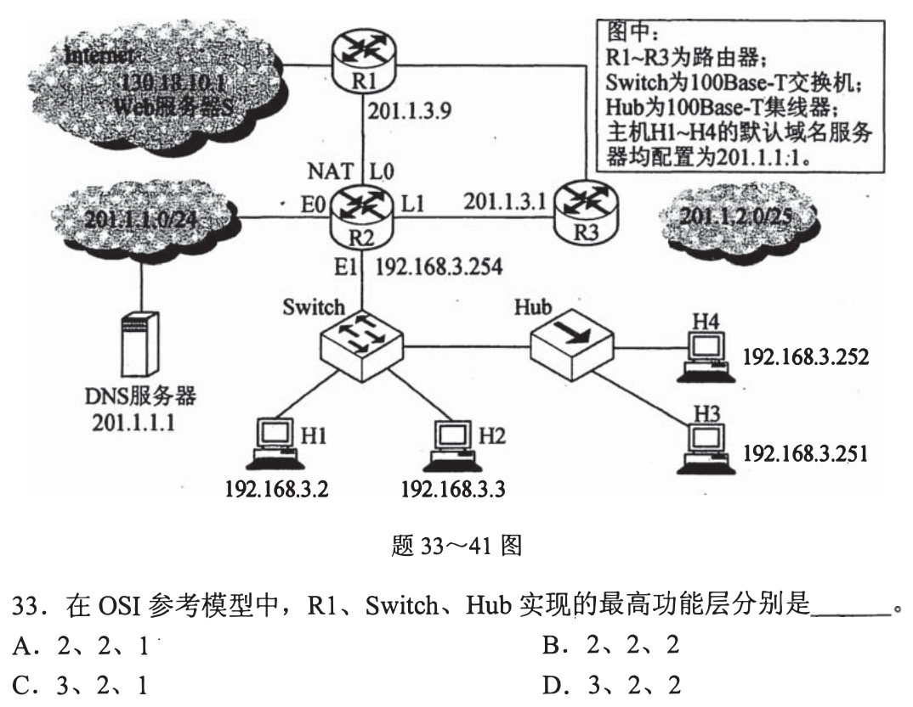

### 11 · 2017-33
> *各层封装开销：看清排除物理层和应用层后剩下 5 层，每层老老实实加 20B 首部，有效数据除以总数据量即效率。*
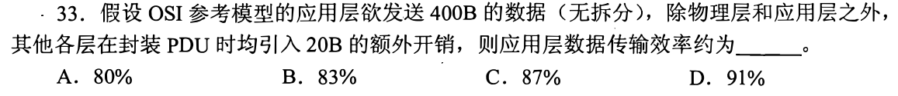

### 12 · 2023-33
> *题目给出时延带宽积，先反推出单向传播时延，别忘了首端发送时延加上路由器的最后转发时延。*
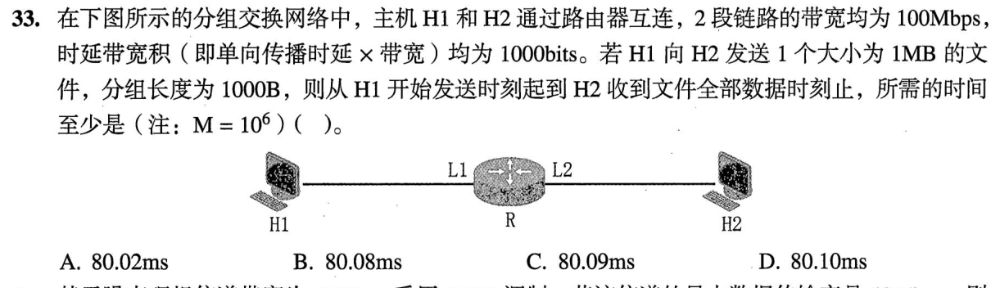

### 13 · 2024-33
> *寻找多路径的瓶颈带宽：找准每条可行路径上的卡脖子链路，再把各条独立流的最大吞吐量累加起来。*
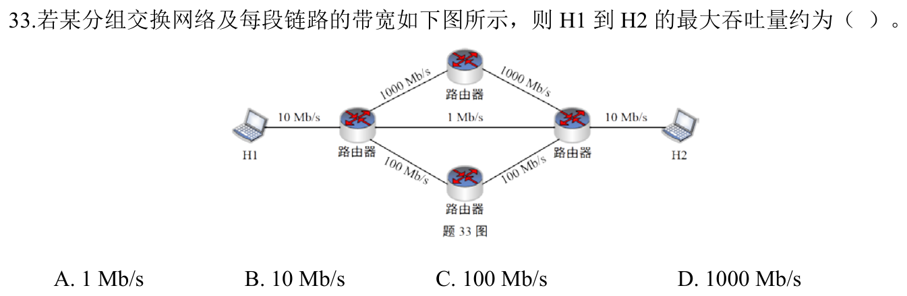

### 14 · 2025-33
> *最新压轴。电路交换要加上呼叫建立时延，报文交换逐跳串行转发，分组交换流水线并发，列齐公式比大小。*
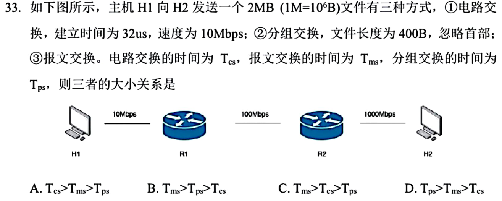

### 15 · 2026-33
<!-- 2026 压轴题位，已在 paper_html/408-2026.html 就绪 -->
