# 0902｜信号与速率：带宽怎样限制可传数据

> 当前显示 **7 题**（2020—2026 年）；**8 题暂缓**，原文保留在文件末尾的 HTML 注释中，未删除。

## 当前题单（2020—2026）

### 01 · 2020-34
> *虚电路是面向连接的分组交换，动态按需共享链路，无需像电路交换那样预先硬性预分配全部带宽。*
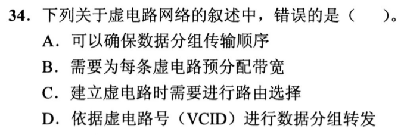

### 02 · 2021-34
> *差分曼彻斯特编码顺着波形逐位切分：位开始处有跳变表示 0，无跳变表示 1。*
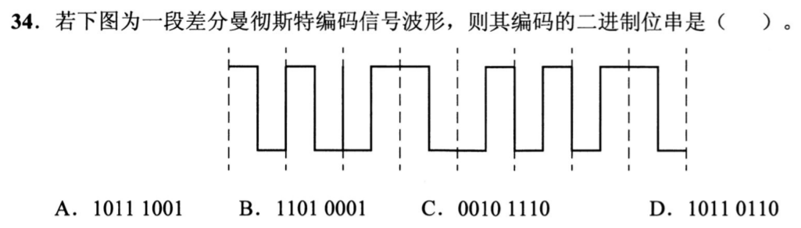

### 03 · 2022-34
> *4 阶幅值调制（ASK）每个码元携带 2 比特，无噪声极限速率就是 $2W \times 2 = 4W$。*
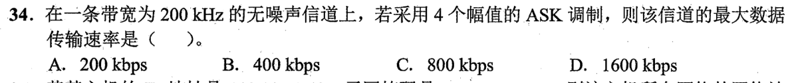

### 04 · 2023-34
> *理想信道 $W = 4\text{ MHz}$，波特率极限 $8\text{ MBaud}$，已知速率 $48\text{ Mbps}$ 反推每码元 6 比特，对应 QAM-64。*
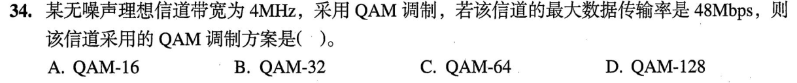

### 05 · 2024-34
> *频移键控（FSK）用不同频率表示 0 和 1，显然需要 2 个不同频率的载波信号。*

### 06 · 2025-34
> *码字两两比对求最小海明距离 $d=4$，按 $d \ge k+1$ 检错 3 位，按 $d \ge 2k+1$ 纠错 1 位。*
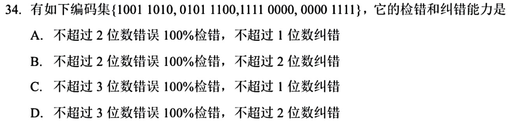

### 07 · 2026-34
> *首先通过香农公式 $C = B \log_2(1 + S/N)$ 计算信道最大数据传输速率（信噪比 1023 即 $1+1023=1024=2^{10}$），再计算 1500 B 分组的发送时延。*
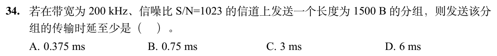

## 暂缓题目

以下题目仅暂时不处理；完整题目条目保留在 Markdown 源文件的 HTML 注释内，预览不显示题目。

<!-- 暂缓题：2011-34；暂时不处理，未删除。
### 01 · 2011-34
> *四相位调制每个码元携带 $\log_2 4 = 2$ 比特，比特率除以 2 就是波特率。*
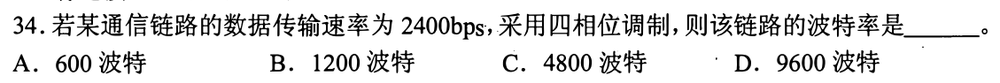
-->

<!-- 暂缓题：2013-34；暂时不处理，未删除。
### 02 · 2013-34
> *曼彻斯特编码每周期中心必有电平跳变，由跳变方向（高到低或低到高）直接译出比特流。*
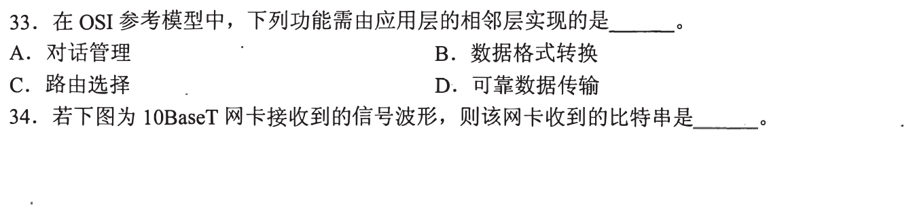
-->

<!-- 暂缓题：2014-35；暂时不处理，未删除。
### 03 · 2014-35
> *信号在介质中的物理传播速度由材质决定，根本不影响信道的理论数据传输速率。*
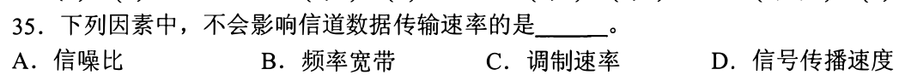
-->

<!-- 暂缓题：2015-34；暂时不处理，未删除。
### 04 · 2015-34
> *曼彻斯特看中心跳变，差分曼彻斯特看边界跳变（前半周期是否有跃迁区分 0 和 1）。*
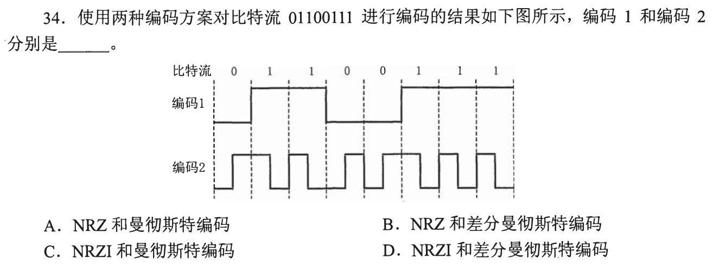
-->

<!-- 暂缓题：2018-34；暂时不处理，未删除。
### 05 · 2018-34
> *物理地址（MAC 地址）是数据链路层的概念，物理层接口特性只管机械、电气、功能和过程。*
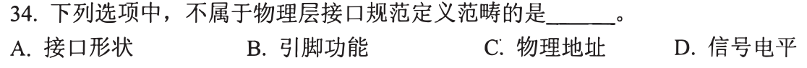
-->

<!-- 暂缓题：2009-34；暂时不处理，未删除。
### 09 · 2009-34
> *奈氏准则：无噪声信道最大码元速率 $2W = 6\text{k Baud}$，4 相位 $\times$ 4 振幅 $= 16$ 种状态带 4 比特，相乘得出速率。*
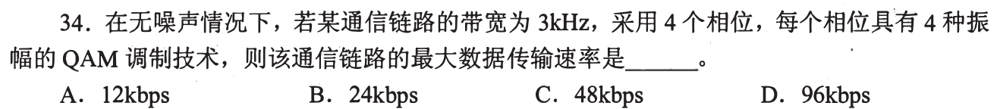
-->

<!-- 暂缓题：2016-34；暂时不处理，未删除。
### 10 · 2016-34
> *香农定理结合实际折算：$30\text{ dB}$ 即信噪比 1000，算准理论极限 $C = W\log_2(1+S/N)$ 后，再乘 30% 实际比例。*
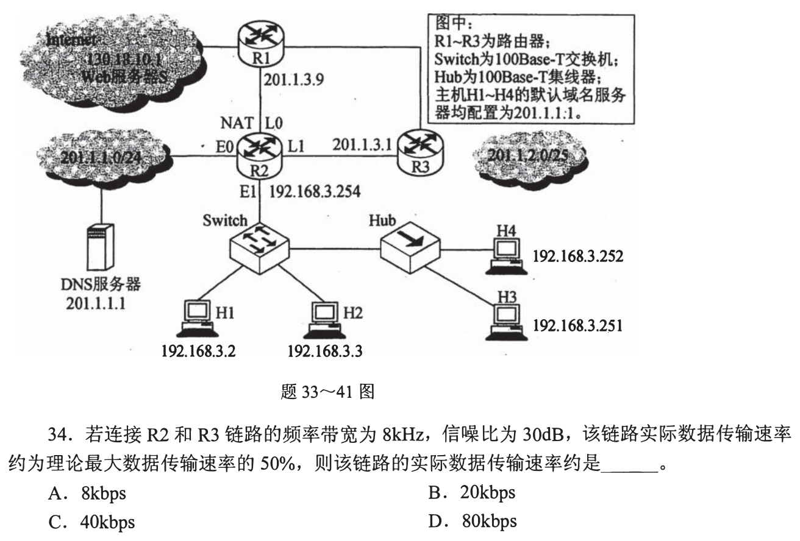
-->

<!-- 暂缓题：2017-34；暂时不处理，未删除。
### 11 · 2017-34
> *奈氏与香农联立：无噪声速率不小于 $30\text{ dB}$ 极限，$2W\log_2 V \ge W\log_2(1+1000)$，直接解出电平状态数 $V$。*
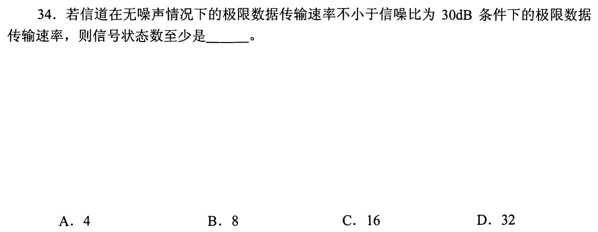
-->
