# 0903｜链路可靠性：帧、窗口与重传状态

> 这组题直接分成两截：
> 前面是**快速拿分题**，滑动窗口尺寸与序号范围的边界约束，记住不等式直接出答案；
> 后面是**耗时攻坚题**，停等、GBN 与 SR 的信道利用率计算和时序推演，时间轴画准 RTT，算清分子分母。

---

## 一、 快速拿分题（扫一眼定答案）

### 01 · 2009-35
> *GBN 累积确认：收到 3 号帧确认说明 0～3 均已成功，超时只需重传尚未确认的 4～7 号共 4 帧。*
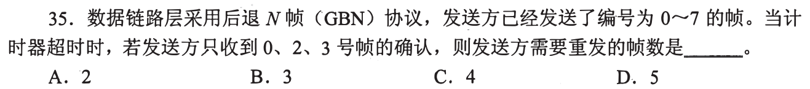

### 02 · 2011-35
> *SR 选择重传只重传超时或出错的帧：1 号已确认，0 和 2 超时，各管各重传，需要重传 2 帧。*
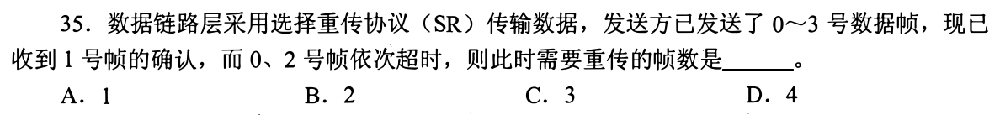

### 03 · 2014-37
> *CDMA 码片正交性：把接收向量与各站向量做内积（点乘），结果为 1 发 1，为 -1 发 0，为 0 未发送。*
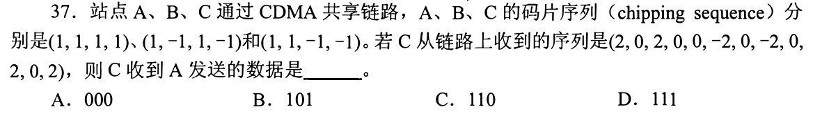

### 04 · 2019-35
> *滑动窗口最大接收窗口：SR 必须满足 $W_T + W_R \le 2^n$。序号 3 比特共 8 个，$W_T=5$ 时 $W_R \le 3$。*
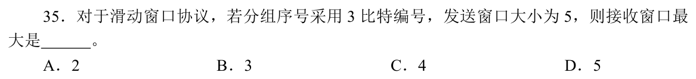

### 05 · 2022-33
> *相邻结点间（逐跳）的流量控制由数据链路层实现，端到端的流量控制由传输层实现。*
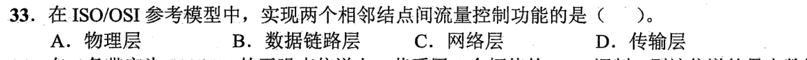

### 06 · 2023-37
> *CRC 校验检验：收到的比特串直接模 2 除以生成多项式，余数全为 0 说明传输未发生错误。*
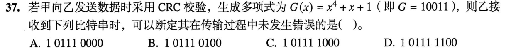

---

## 二、 耗时攻坚题（画准往返时延，理清利用率）

### 07 · 2012-36
> *信道利用率达 100% 要求发送窗口铺满一个往返周期：算准发送时延与确认时延，再反推序号比特数。*
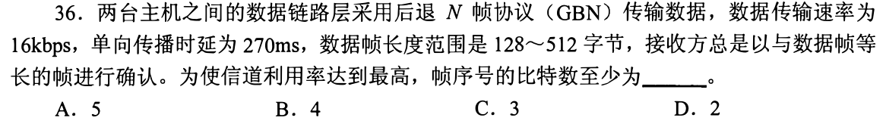

### 08 · 2014-36
> *GBN 窗口足够大时受限于链路带宽：算清发送一个窗口所需时间与 RTT 关系，求最大平均传输速率。*
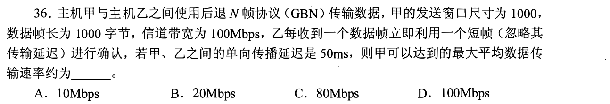

### 09 · 2015-35
> *高时延卫星链路：单向 250ms 往返 500ms，利用率 $\ge 80\%$ 要求窗口发送时延占总周期 80% 以上，反推序号位数。*
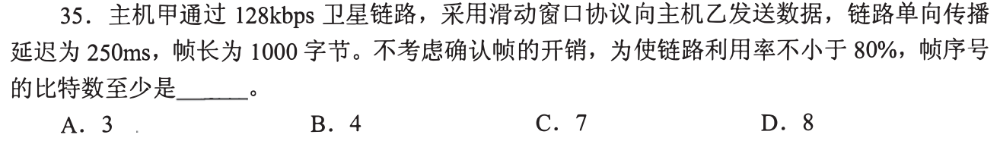

### 10 · 2018-36
> *停等协议利用率公式：发送时延 / (发送时延 + 2 $\times$ 单向传播时延) $= 40\%$，代入速率直接解方程求帧长。*
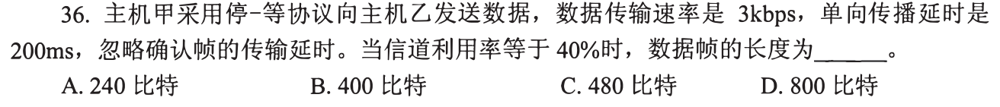

### 11 · 2020-36
> *停等协议双向时延开销：发送时延加上确认帧时延与双向往返时延，分子分母代准求最大利用率。*
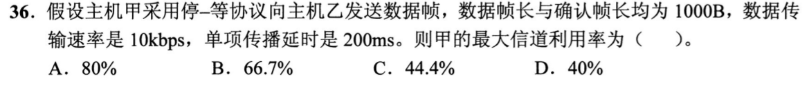

### 12 · 2023-35
> *停等、GBN 和 SR 窗口上限对比：停等窗口为 1，GBN 发送窗口最大 $2^n-1=7$，SR 窗口为 $2^{n-1}=4$，窗口越大利用率越高。*
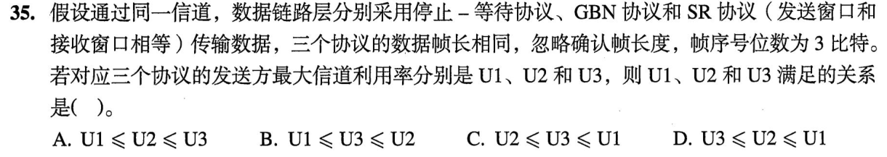

### 13 · 2024-37
> *SR 滑动窗口时序图推演：结合 3 比特序号空间与独立 ACK 推进，看清超时重传时刻与窗口右移时新发出的帧号。*
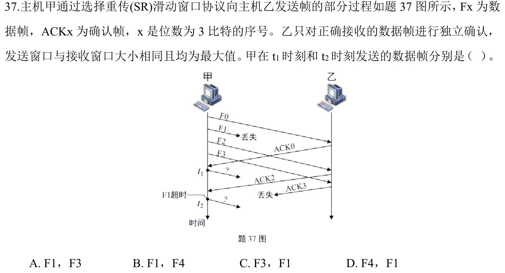

### 14 · 2026-35
<!-- 2026 压轴题位，已在 paper_html/408-2026.html 就绪 -->
