# 0904｜局域网转发：介质竞争、MAC与交换机

> 这组题直接分成两截：
> 前面是**快速拿分题**，冲突域/广播域划分与交换机端口自学习，盯着设备类型扫一眼秒出；
> 后面是**耗时攻坚题**，CSMA/CD 争用期与退避算法、CSMA/CA 帧间时延计算，列准往返传播时间，退避范围别写错。

---

## 一、 快速拿分题（扫一眼定答案）

### 01 · 2009-36
> *以太网交换机工作在数据链路层，转发决策严格依据以太网帧首部的目的 MAC 地址。*
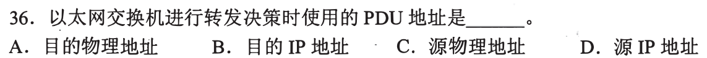

### 02 · 2010-38
> *集线器和中继器连冲突域都隔不开，交换机和网桥隔绝冲突域，只有路由器能隔绝广播域（抑制广播风暴）。*
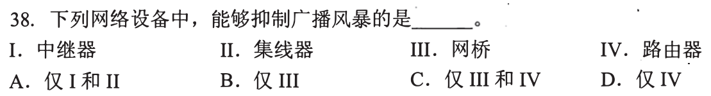

### 03 · 2011-36
> *无线信道无法边发边听做冲突检测，IEEE 802.11 的 CSMA/CA 必须对正确接收的数据帧显式回送 ACK 确认。*
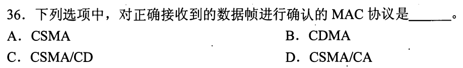

### 04 · 2013-36
> *争用型协议（CSMA、CSMA/CD）都有可能发生碰撞冲突，信道划分协议（TDMA/FDMA/CDMA）完全无冲突。*
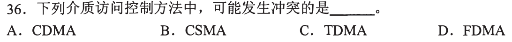

### 05 · 2014-34
> *交换机自学习源 MAC 记端口，转发查目的 MAC：查不到就向除输入端口外的所有端口广播，查到了就单播。*
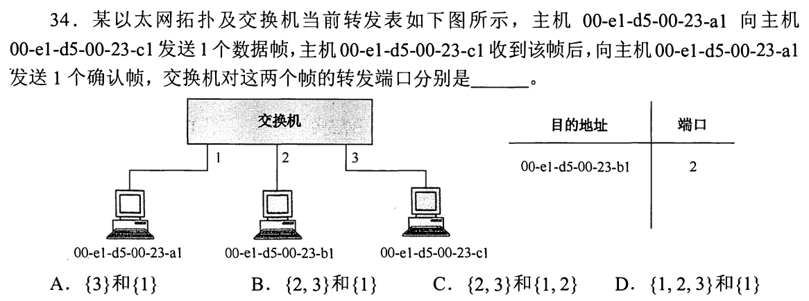

### 06 · 2015-36
> *CSMA/CD “边发边听”只适合有线介质，无线信号衰减大且隐藏终端多，根本无法可靠检测冲突。*
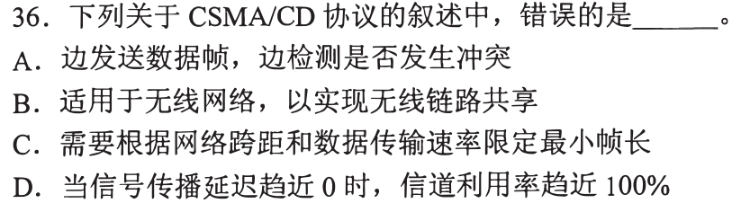

### 07 · 2015-37
> *交换机本质就是多端口网桥，每个端口独立成一个冲突域，但所有端口默认在同一个广播域内。*
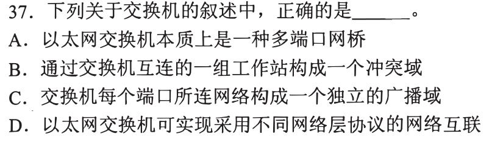

### 08 · 2020-35
> *数网络边界：集线器连在一起算一个冲突域，交换机每个端口算一个冲突域，路由器每个接口算一个广播域。*
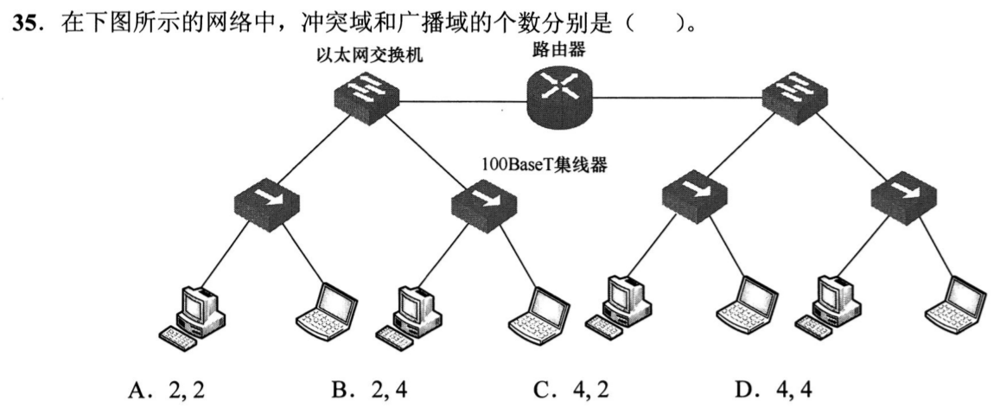

### 09 · 2022-37
> *SDN 架构分工明确：控制器向底层交换机下发流表走南向接口，向上层业务提供北向接口。*
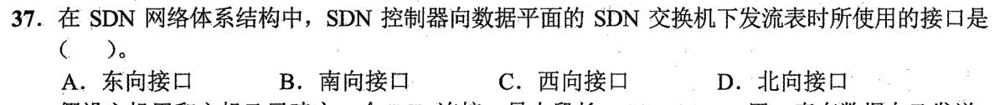

### 10 · 2024-35
> *VLAN 划分隔离广播域：不同 VLAN 之间没有三层路由器协助，ARP 广播根本穿不过去，ARP 表里绝不会有对方。*
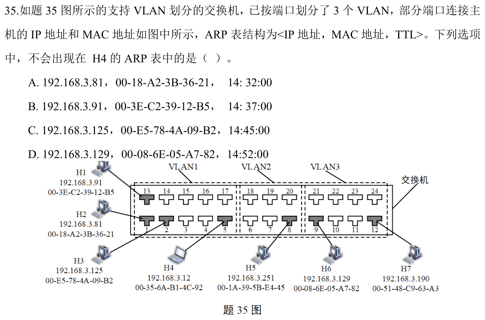

---

## 二、 耗时攻坚题（算准争用期，推演时间轴）

### 11 · 2009-37
> *CSMA/CD 最小帧长与跨距绑定：最小帧长发送时延 $\ge$ 争用期 $2\tau$；帧长减少 800bit，往返传播时间相应缩短，站点距离必须缩短。*
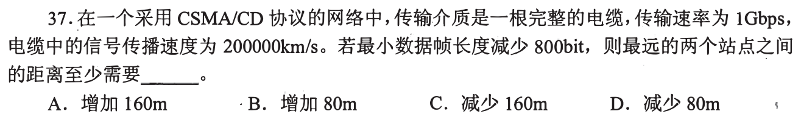

### 12 · 2013-38
> *直通交换机不等整帧收完，读出 6 字节（48 bit）目的 MAC 地址就立刻启动转发，除以速率算出理论最小转发时延。*
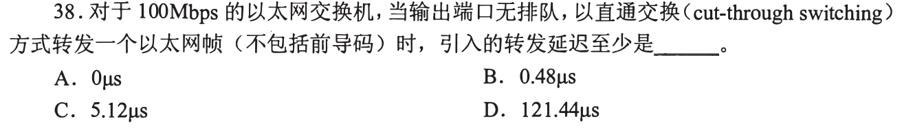

### 13 · 2016-36
> *交换机自学习动态演进：分析连续多个数据帧进出过程，判定交换表从空到有、哪些帧会被泛洪扩散。*
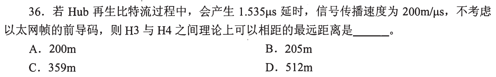

### 14 · 2018-37
> *跨路由跨交换通信全流程：IP 数据报源目 IP 全程不变，每跨越一段链路，以太网帧的源目 MAC 地址彻底换一套。*
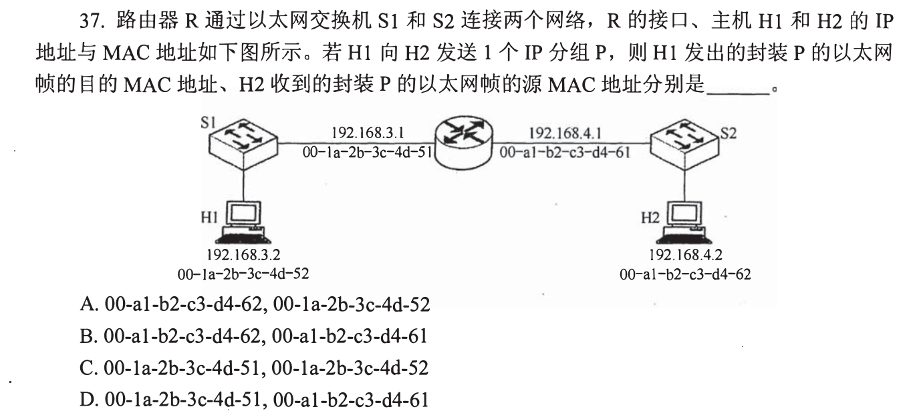

### 15 · 2019-36
> *已知最小帧长和传输速率，求单向最大传播延迟：帧传输时延等于争用期 $2\tau$，直接除以 2 得到单向最大传播时延。*
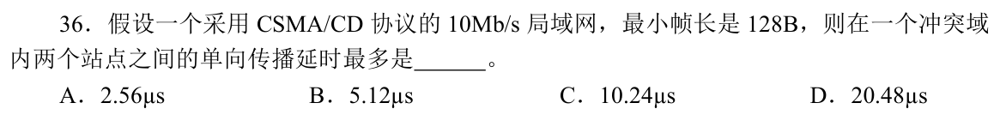

### 16 · 2020-37
> *802.11 帧间间隔（IFS）长度排序：SIFS < PIFS < DIFS，发送普通数据帧前必须等待最长的 DIFS 并在退避后发送。*
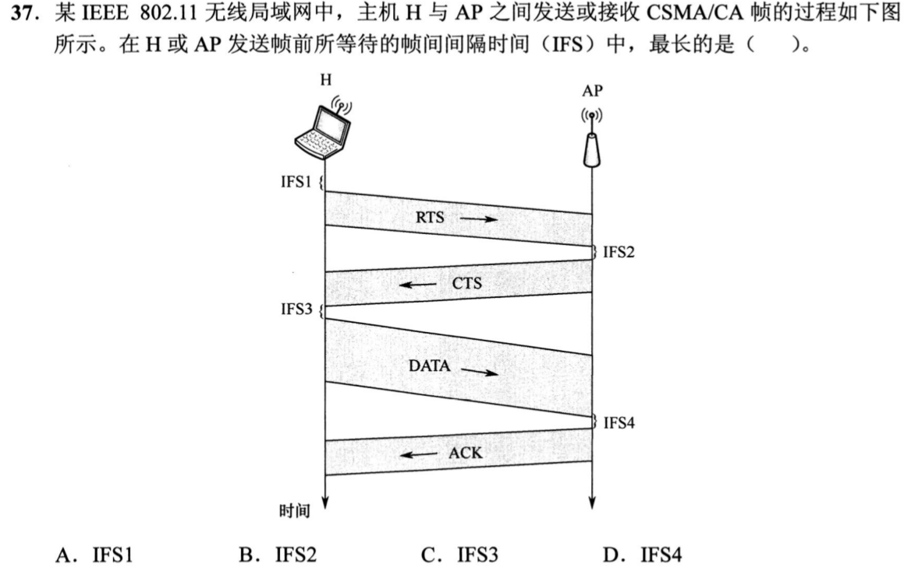

### 17 · 2023-36
> *二进制指数退避算法：发生 4 次冲突，$k = \min(4, 10) = 4$，退避随机数 $r \in [0, 2^4-1] = [0, 15]$，最大等待时间即 $15 \times 51.2\,\mu\text{s}$。*
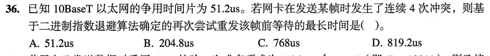

### 18 · 2024-36
> *802.11 CSMA/CA 信道预约与 NAV 向量：看清 RTS/CTS 握手时延与 SIFS 帧间隔，算准从开始预约到释放信道的保护时间。*
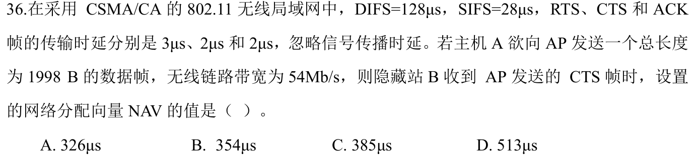

### 19 · 2025-35
> *冲突 11 次截断退避：冲突次数超过 10 时上限锁死在 $k = 10$，随机数取值范围 $[0, 1023]$，算准最大退避时间。*
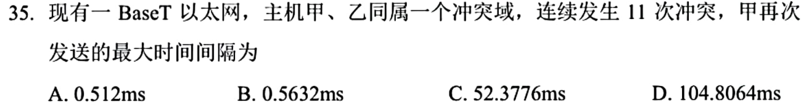

### 20 · 2026-36
<!-- 2026 压轴题位，已在 paper_html/408-2026.html 就绪 -->
