# 0905｜网络地址：子网、分片与可达范围

> 这组题直接分成两截：
> 前面是**快速拿分题**，地址分类、特殊 IP（广播/私网）与 IPv6 概念，看清掩码直接锁定；
> 后面是**耗时攻坚题**，可变长子网划分（VLSM）与 IP 分片计算，把关键八位拆成二进制算清起止边界。

---

## 一、 快速拿分题（扫一眼定答案）

### 01 · 2011-38
> */30 子网主机位只有 2 位，共 4 个地址，扣除网络地址和广播地址，最多只能给 2 台主机分配。*
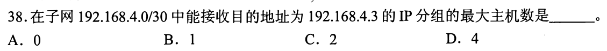

### 02 · 2012-39
> *定向广播地址是主机号全 1：掩码 255.255.252.0 对应 /22，后 10 位全置 1 即为本子网广播地址。*
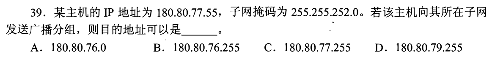

### 03 · 2017-36
> *全 0 地址 `0.0.0.0` 只能作为没有 IP 时的源地址（如初次 DHCP），绝不能当作数据包的目的地址发送。*
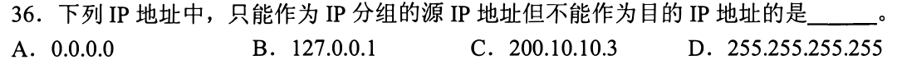

### 04 · 2022-35
> *求网络地址：IP 与掩码按位与，掩码 192 即高两位为 11，第三字节 72 与 192 相与立刻出网络号 64。*

### 05 · 2023-38
> *NAT 路由器转发到外网时，源 IP 必定被替换为 NAT 路由器的公网出接口 IP。*
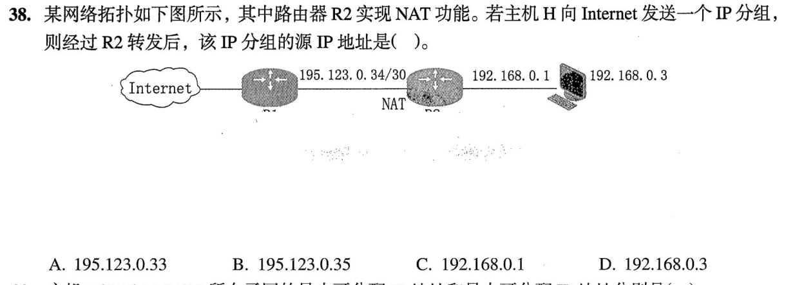

### 06 · 2023-40
> *IPv6 地址空间是 128 位，IPv4 是 32 位，地址空间是 $2^{128-32} = 2^{96}$ 倍而不是 96 倍；IPv6 基本首部固定 40B 不可变。*
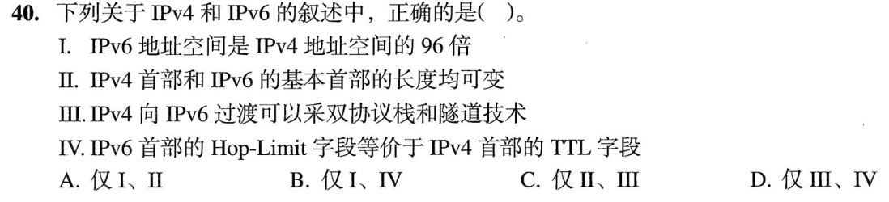

### 07 · 2025-36
> *DHCP 交互：主机初次发送 REQUEST 必须用广播（目的 IP `255.255.255.255`），向局域网告知自己选中的 Offer。*
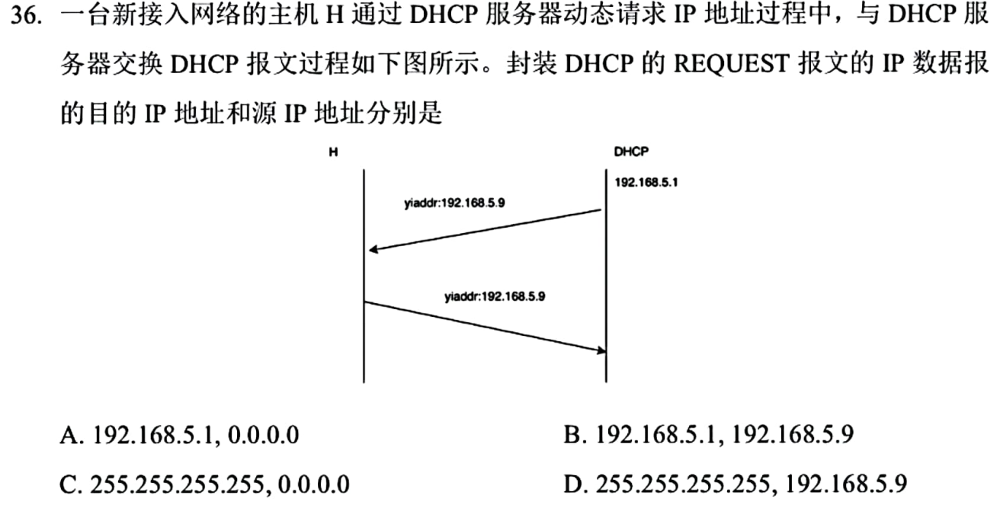

---

## 二、 耗时攻坚题（拆开关键八位，划清网段边界）

### 08 · 2010-37
> *定长子网划分：/24 借 5 位到 /29（掩码 248），可划分 $2^5=32$ 个子网，每子网 8 个地址除去首尾剩 6 个可用。*
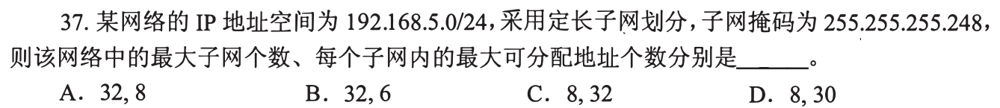

### 09 · 2011-37
> *汇聚多条子网路由：提取几个目的子网的最长公共前缀，算出 CIDR 汇总路由及下一跳地址。*
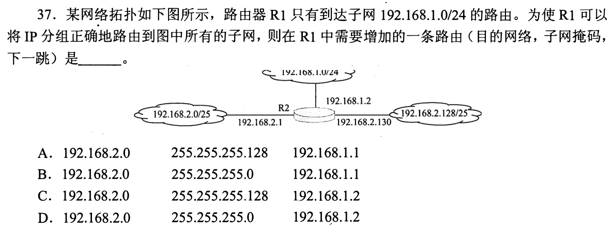

### 10 · 2016-39
> *结合拓扑分析 IP 配置冲突：看清各主机与路由器端口是否处于同一子网，检验默认网关与广播地址有效性。*
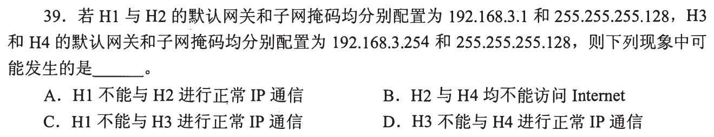

### 11 · 2017-38
> */16 划分为 128 个相同子网：$128 = 2^7$，网络号借 7 位变 /23，主机位剩 9 位，每个子网可用地址为 $2^9 - 2 = 510$ 个。*
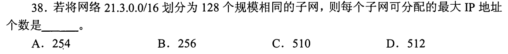

### 12 · 2019-37
> *CIDR 不等长划分子网：为划分出 5 个子网，先切 4 块再把其中一块细分，求可能的最小子网最大可分配地址数。*
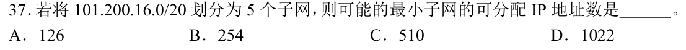

### 13 · 2021-35
> *二叉树拆分 CIDR 子网块：已知一个 /26 占用后半段区间，排查剩余子网切分，前缀覆盖范围不能重叠冲突。*
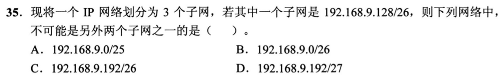

### 14 · 2022-36
> *排查拓扑中主机 IP 配置错误：算清网段的网络地址和广播地址，主机与网关必须在同一子网且不能设为首尾保留地址。*
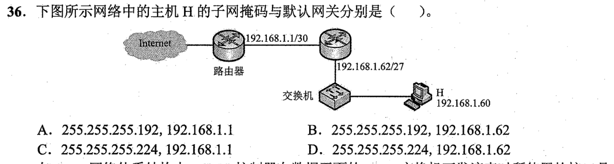

### 15 · 2023-39
> *168.16.84.24/20：前缀 20 位，第三字节块大小为 16，网络区间为 80.0～95.255，去掉全 0 网络和全 1 广播即可用范围。*
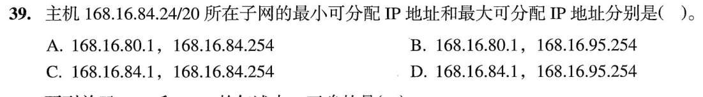

### 16 · 2026-39
> */22 均分为 32（$2^5$）个子网，每个子网掩码增加 5 位变为 /27。根据给定 IP 地址计算第三、第四字节所在的子网边界。*
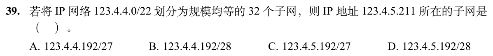
