# 0906｜控制转发路径：ARP、路由协议与下一跳

> 这组题直接分成两截：
> 前面是**快速拿分题**，路由协议报文封装层次与 ICMP 差错类型，记住协议栈位置秒杀；
> 后面是**耗时攻坚题**，最长前缀匹配查表、距离向量迭代与 IP 分片偏移，草稿纸列清二进制，别把片偏移单位搞丢。

---

## 一、 快速拿分题（扫一眼定答案）

### 01 · 2010-35
> *RIP 距离矢量包含 `<net1, 16>`，在 RIP 中 16 表示无穷大（不可达），说明到达该网络不可达。*
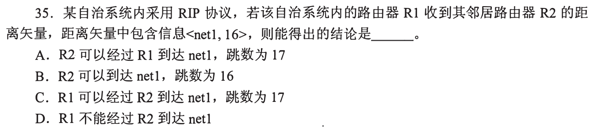

### 02 · 2010-36
> *路由器因拥塞丢弃分组时，早期规范可向源主机发送 ICMP 源点抑制报文（告知源端主动降速）。*
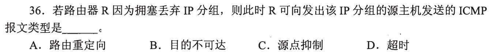

### 03 · 2017-37
> *协议封装层级死记：RIP 是应用层基于 UDP（520），OSPF 直接基于网络层 IP（协议号 89），BGP 是应用层基于 TCP（179）。*
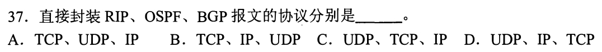

### 04 · 2025-37
> *NAT 转发 UDP：内网 IP 转为公网 IP 时，IP 首部的源 IP 必定修改，UDP 首部的源端口号和校验和也随之重新计算。*
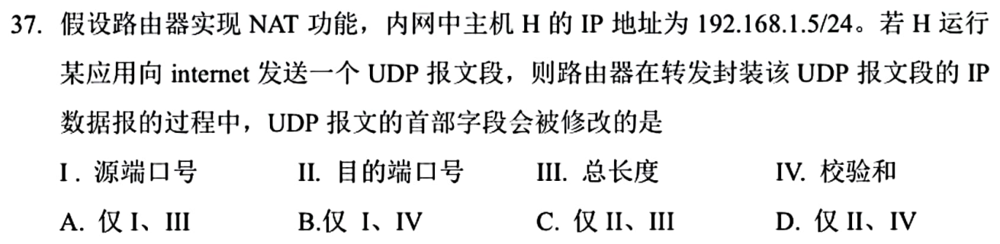

### 05 · 2026-38
> *OSPF 是基于链路状态的内部网关协议（IGP），通过将自治系统（AS）划分为骨干区域 Area 0 和非骨干区域来减小路由更新泛洪开销。*
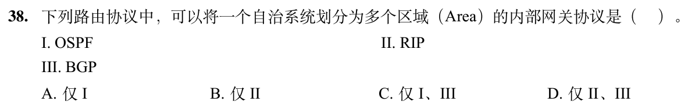

---

## 二、 耗时攻坚题（最长匹配查表，迭代距离向量）

### 06 · 2015-38
> *最长前缀匹配原则：目的地址与路由表中多条前缀匹配时，坚决走子网掩码最长的那一条接口。*
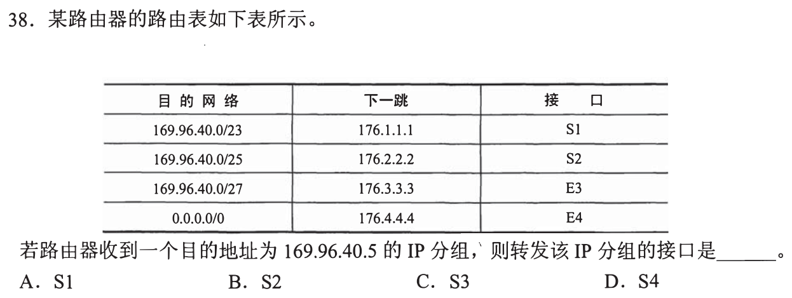

### 07 · 2016-37
> *拓扑综合路由分析：根据默认网关和路由表，确定跨网段分组发送时的下一跳路由器 IP 与目的 MAC。*
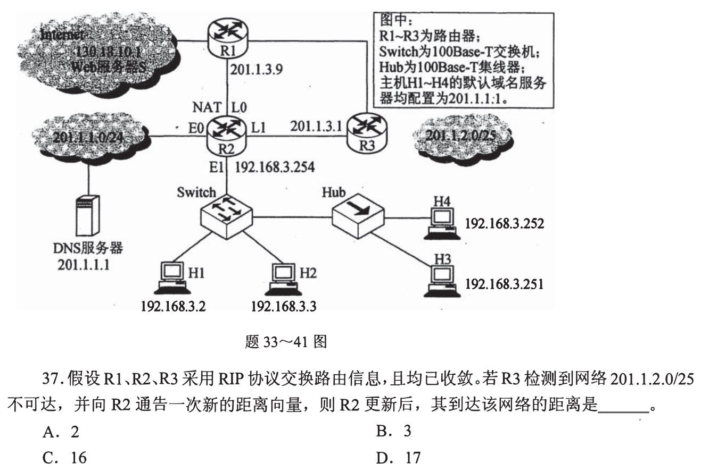

### 08 · 2018-38
> *CIDR 路由汇聚：把 4 条 /21 路由的目标地址写成二进制展开，提取最长公共前缀聚合为一条超网路由。*
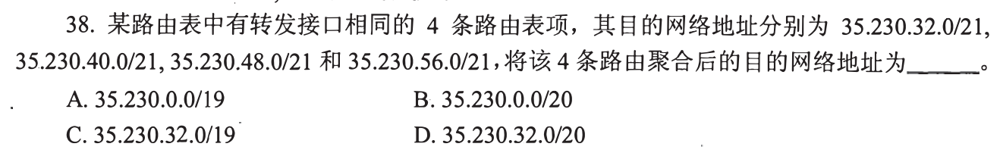

### 09 · 2021-36
> *IP 分片计算：MTU=800B，扣除 20B 首部有效载荷最大 780B，必须向下取整到 8 的整数倍 776B，算准各片的 MF 和片偏移。*
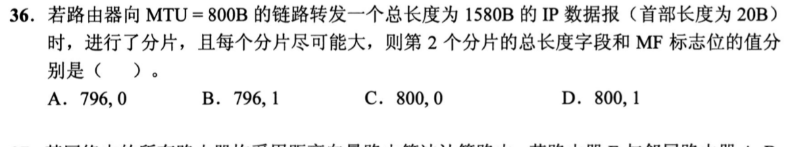

### 10 · 2021-37
> *距离向量（Bellman-Ford）路由更新：将邻居发来的距离向量各加一跳链路费用，与当前向量逐项比对取最小。*
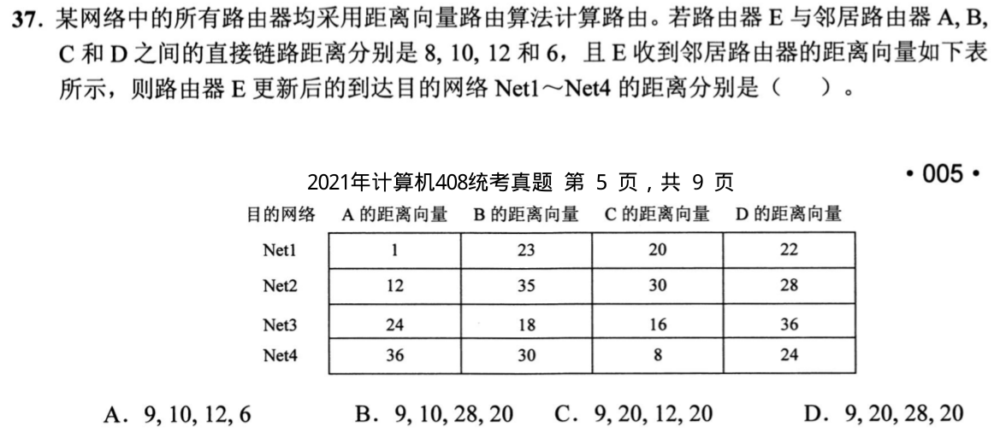

### 11 · 2026-37
> *链路断开触发链路状态更新与 Dijkstra 重新计算。求聚合后路由项数：找出相同下一跳接口的目的网段，利用 CIDR 进行超网合并。*
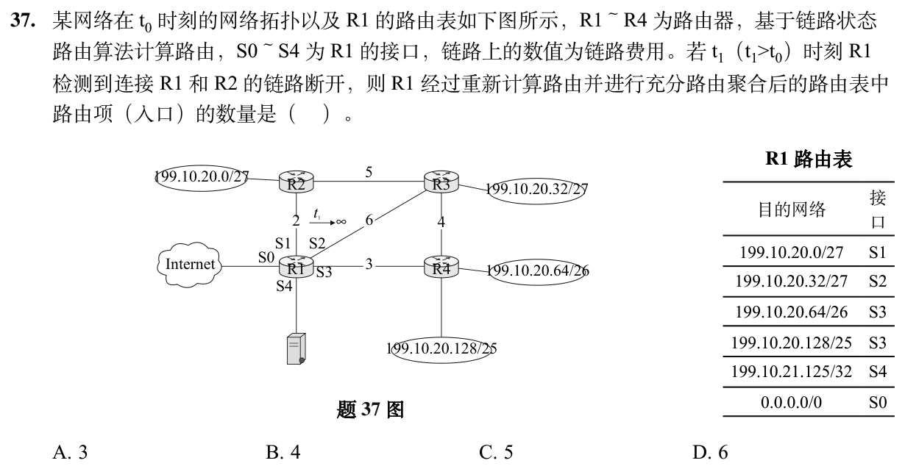
