# 0907｜端到端状态：TCP序号、窗口与拥塞

> 当前显示 **11 题**（2020—2026 年）；**13 题暂缓**，原文保留在文件末尾的 HTML 注释中，未删除。

## 当前题单（2020—2026）

### 01 · 2020-38
> *慢开始加拥塞避免的最长时间：如果门限 ssthresh 很低，很早转入加法递增，算清从 8KB 加到 32KB 最多要花几个 RTT。*
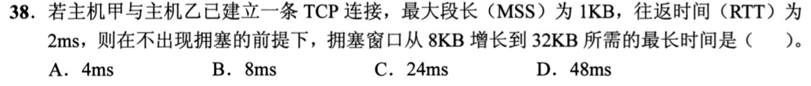

### 02 · 2020-39
> *序号开销：SYN 和 FIN 各消耗 1 个序号，应用层数据长度等于 FIN 段序号减去 SYN 段序号再减 1。*
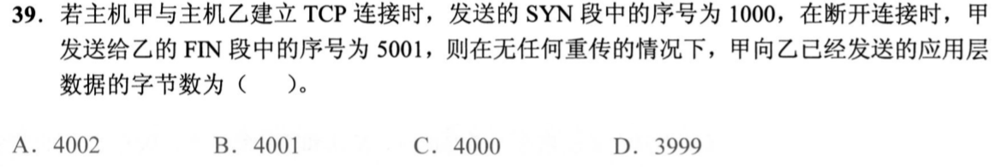

### 03 · 2021-38
> *TCP 四次挥手状态变迁：主动关闭方收到对方的 FIN 并发出 ACK 后，进入 TIME_WAIT 状态等待 2MSL 后关闭。*
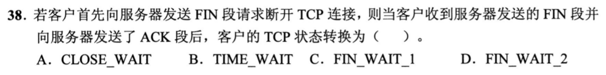

### 04 · 2021-39
> *传输有效效率：比较 12B 数据封装在 UDP（首部 8B）和 TCP（首部 20B）时的有效载荷百分比。*
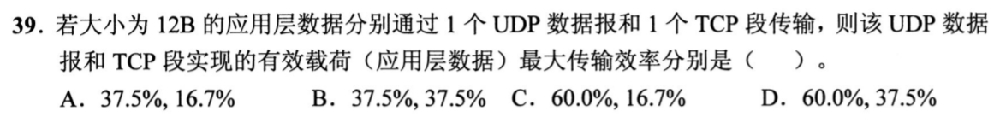

### 05 · 2021-40
> *滑动窗口前沿与后沿推演：根据收到的 ack_seq 和 rwnd，精准划定发送方允许继续发送的序号区间 [seq_start, seq_end]。*
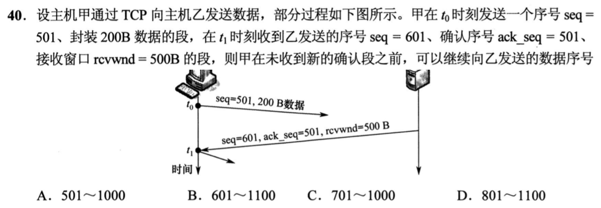

### 06 · 2022-38
> *超时后拥塞窗口恢复周期：16KB 超时，门限 ssthresh 设为 8KB，cwnd 置 1KB，慢开始到 8KB 再加法递增到 16KB，数清 RTT 步数。*
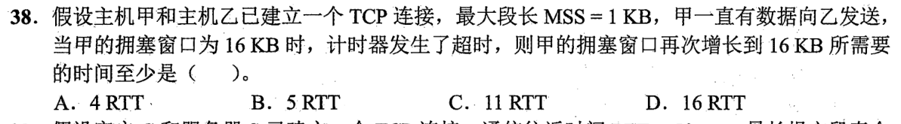

### 07 · 2022-39
> *TIME_WAIT 2MSL 计时：主动断开方必须等待 2MSL（最长报文段寿命）确保网络中残留分组消失，算清总耗时。*
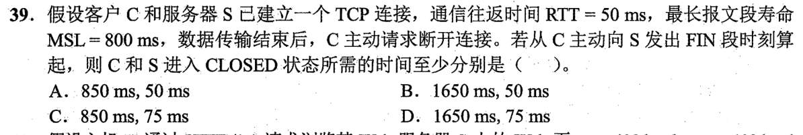

### 08 · 2024-38
> *大文件发送时的拥塞窗口动态演进：结合 MSS 与初始门限，按 RTT 递推每个往返发送和确认的分组数。*
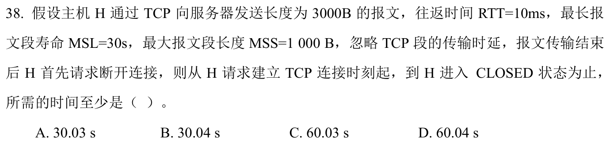

### 09 · 2024-39
> *UDP 校验和计算：16 位二进制反码求和，中间累加溢出加到低位，最后结果整体取反码。*
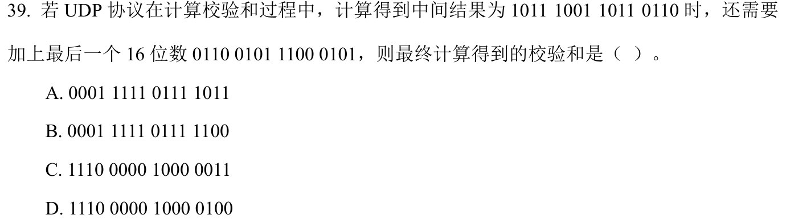

### 10 · 2025-38
> *TCP 综合发送窗口状态判定：根据拥塞窗口与收到的接收窗口通告，扣除已发出且未确认的段，算清还能新发几个段。*
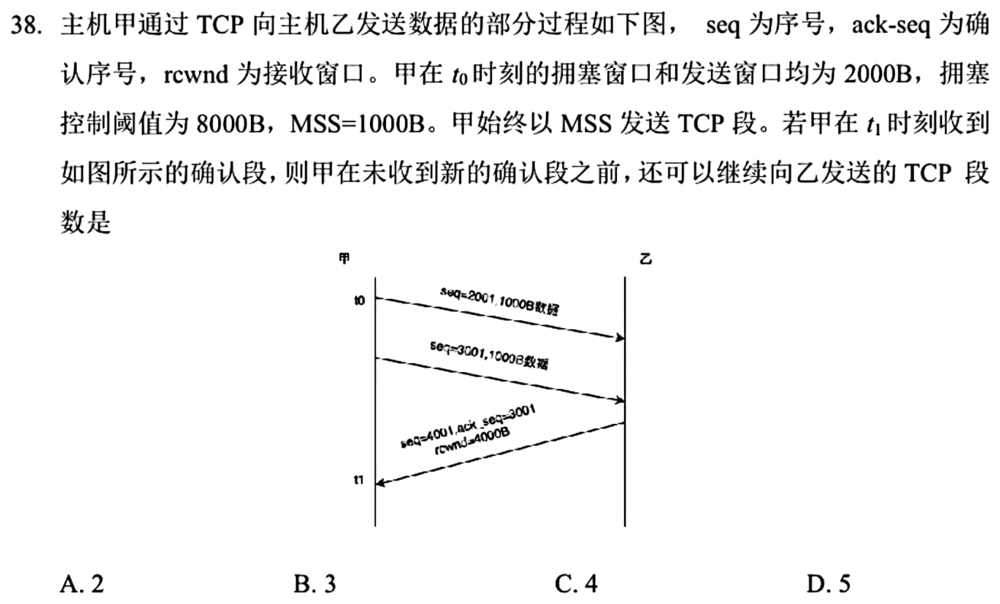

### 11 · 2025-39
> *往返时延开销：UDP 只需 1 个 RTT（发请求收响应），TCP 必须先 1 个 RTT 三次握手再发请求，共需 2 个 RTT。*
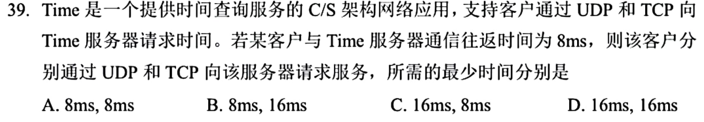

## 暂缓题目

以下题目仅暂时不处理；完整题目条目保留在 Markdown 源文件的 HTML 注释内，预览不显示题目。

<!-- 暂缓题：2009-38；暂时不处理，未删除。
### 01 · 2009-38
> *TCP 确认号是期待对方发送的下一个字节序号：首段 300B，次段 500B，起始 seq=200，累积确认回 200+300+500=1000。*
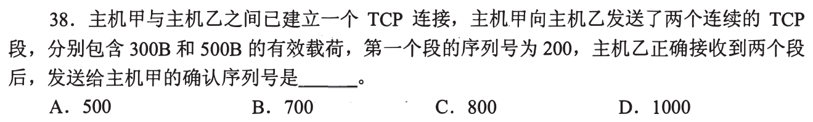
-->

<!-- 暂缓题：2011-39；暂时不处理，未删除。
### 02 · 2011-39
> *二次握手：服务器必须把 SYN 和 ACK 同时置 1，ack 为 client_seq + 1，同时确定自己的初始序号。*
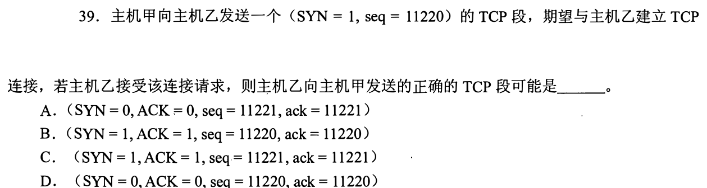
-->

<!-- 暂缓题：2011-40；暂时不处理，未删除。
### 03 · 2011-40
> *TCP 累积确认：发了 3 段，第 2 段丢失只收到第 1 和第 3 段，ACK 只能确认为收到连续字节的下一号，即第 2 段开头。*
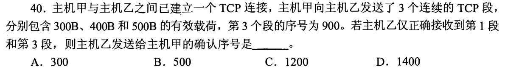
-->

<!-- 暂缓题：2013-39；暂时不处理，未删除。
### 04 · 2013-39
> *互相回复 TCP 段：收到 seq=1913, ack=2046, len=100，回送的 seq 必须等于对方的 ack 2046，ack 等于对方 seq+len=2013。*
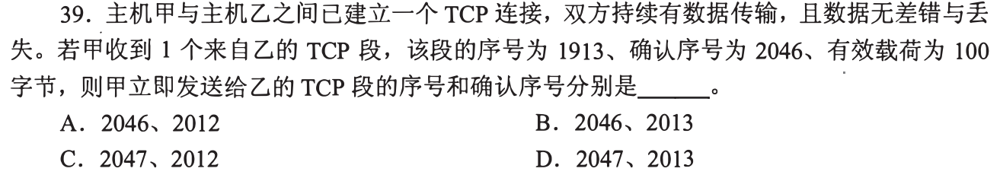
-->

<!-- 暂缓题：2014-39；暂时不处理，未删除。
### 05 · 2014-39
> *UDP 概念：无连接不可靠，通过端口提供复用/分用，校验和只能检错不能纠错，不保障可靠传输。*
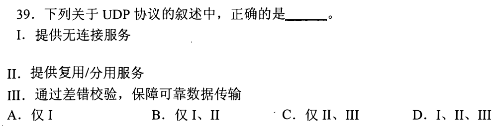
-->

<!-- 暂缓题：2018-39；暂时不处理，未删除。
### 06 · 2018-39
> *UDP 和 TCP 解复用（分用）给对应的应用层进程，严格依据报头中的目的端口号。*
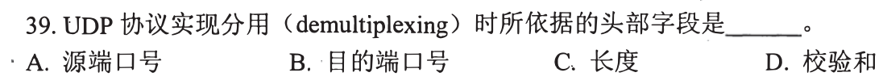
-->

<!-- 暂缓题：2019-39；暂时不处理，未删除。
### 07 · 2019-39
> *三次握手第三次握手：客户端发送确认段，ack 序号等于服务端 SYN 段序号加 1。*
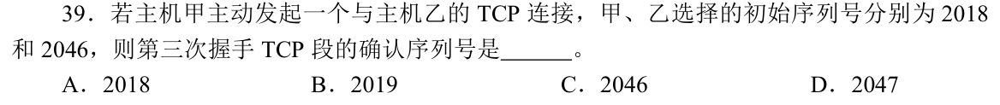
-->

<!-- 暂缓题：2009-39；暂时不处理，未删除。
### 13 · 2009-39
> *拥塞控制超时重传：16KB 超时后门限降为 8KB，拥塞窗口置 1KB，经历 1->2->4->8 指数慢开始，再加法拥塞避免。*
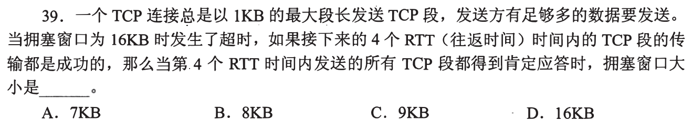
-->

<!-- 暂缓题：2010-39；暂时不处理，未删除。
### 14 · 2010-39
> *发送窗口受双重制约：发送窗口 $= \min(\text{cwnd}, \text{rwnd})$，扣除已发送未确认字节，求还能发送的最大字节数。*
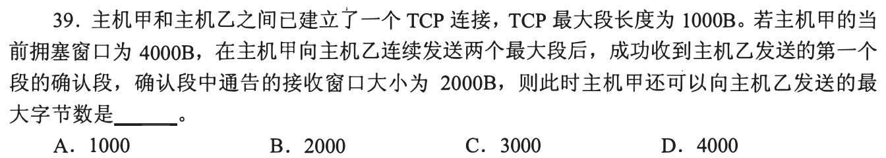
-->

<!-- 暂缓题：2014-38；暂时不处理，未删除。
### 15 · 2014-38
> *拥塞窗口与接收窗口共同限速：超时后门限折半，慢开始翻倍增长，达到接收窗口 10KB 后不再增长，稳定发送。*
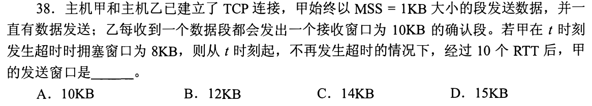
-->

<!-- 暂缓题：2015-39；暂时不处理，未删除。
### 16 · 2015-39
> *接收方不取数据缓存填满：每收到数据接收窗口 rwnd 逐渐减小，发送窗口随之收缩直至为 0。*
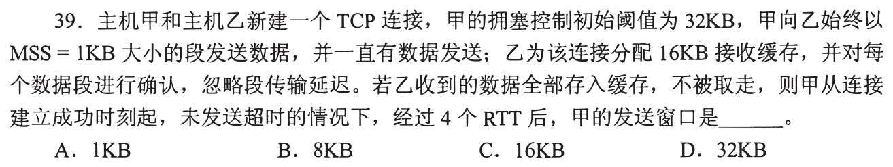
-->

<!-- 暂缓题：2017-39；暂时不处理，未删除。
### 17 · 2017-39
> *从连接建立到发送窗口达到 32KB：慢开始阶段每个 RTT 翻倍（1->2->4->8->16->32），算准需要经过几个 RTT。*
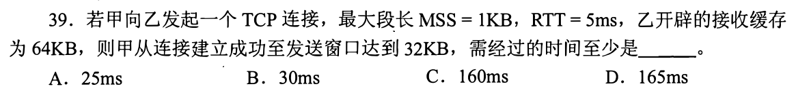
-->

<!-- 暂缓题：2019-38；暂时不处理，未删除。
### 18 · 2019-38
> *TCP 快速重传机制：收到 3 个冗余重复 ACK 时触发快速重传，看清时间轴上第 4 次收到相同 ack_seq 时的重传时刻。*
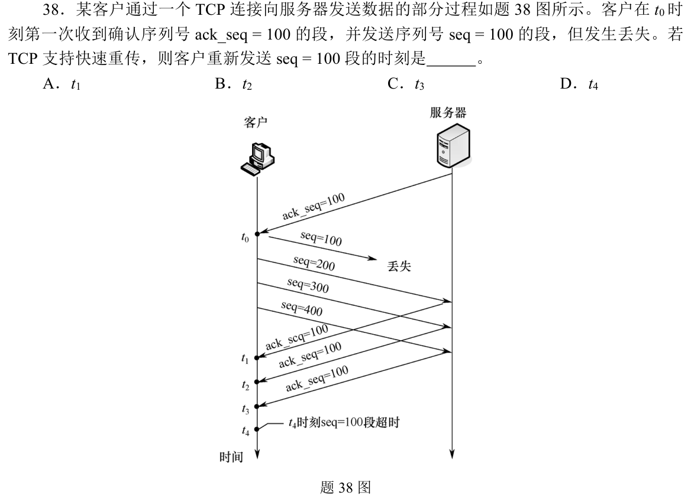
-->
