# 0908｜应用会话：DNS、Web、邮件与文件传输

> 这组题直接分成两截：
> 前面是**快速拿分题**，FTP 双连接、DNS 递归/迭代模型与邮件协议分工，弄清谁推谁拉直接秒杀；
> 后面是**耗时攻坚题**，HTTP/1.0 与 1.1 的 RTT 时延开销计算，理清 DNS 解析、TCP 握手与并发请求条数。

---

## 一、 快速拿分题（扫一眼定答案）

### 01 · 2009-40
> *FTP 架构：控制连接端口 21 负责传输命令并保持全会话，数据连接端口 20 负责传输文件，传完即关。*
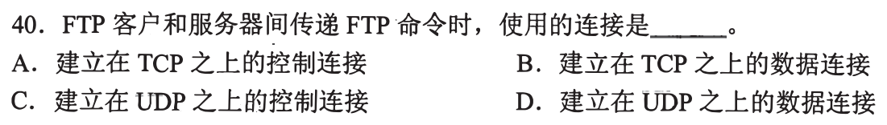

### 02 · 2010-40
> *递归 vs 迭代：递归查询是找人全权代办到底（本地域名服务器只向根发一条递归请求）；迭代查询是自己拿着线索逐级问。*
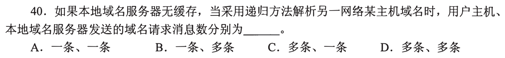

### 03 · 2012-40
> *邮件协议分工：用户发邮件给发件服务器用 SMTP，服务器之间中继用 SMTP，收件人从服务器收邮件用 POP3/IMAP。*
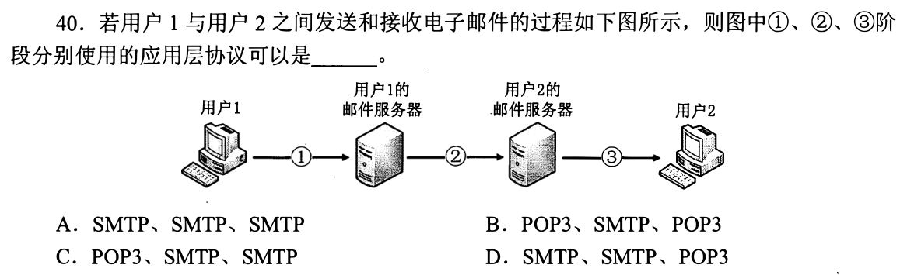

### 04 · 2013-40
> *SMTP 特点：基于 TCP，只传输 7 位 ASCII 文本，只能用于向邮件服务器推邮件，不能拉邮件。*
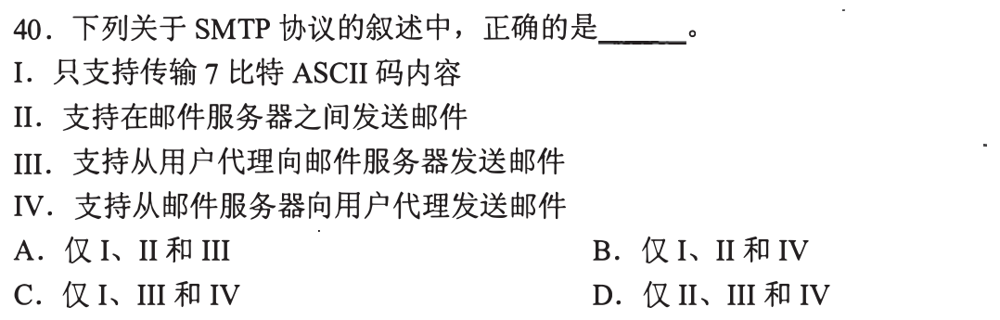

### 05 · 2014-40
> *浏览器打开网页协议全景：输入 URL 先用 DNS，再 TCP 握手，HTTP 传输，底层用 ARP 找网关，绝不可能用到发邮件的 SMTP。*
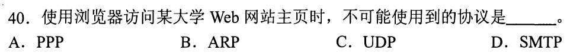

### 06 · 2015-33
> *POP3 协议用于用户代理从邮件服务器读取邮件，必须建立在传输层可靠的有连接服务（TCP）之上。*
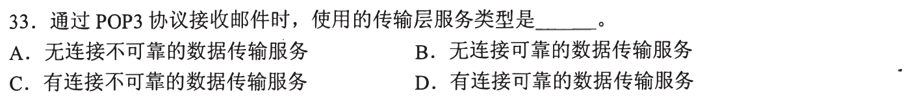

### 07 · 2015-40
> *HTTP 报文分析：`Connection: Close` 表示非持久连接，`Cookie` 用于跟踪会话，看懂请求行与首部行语义。*
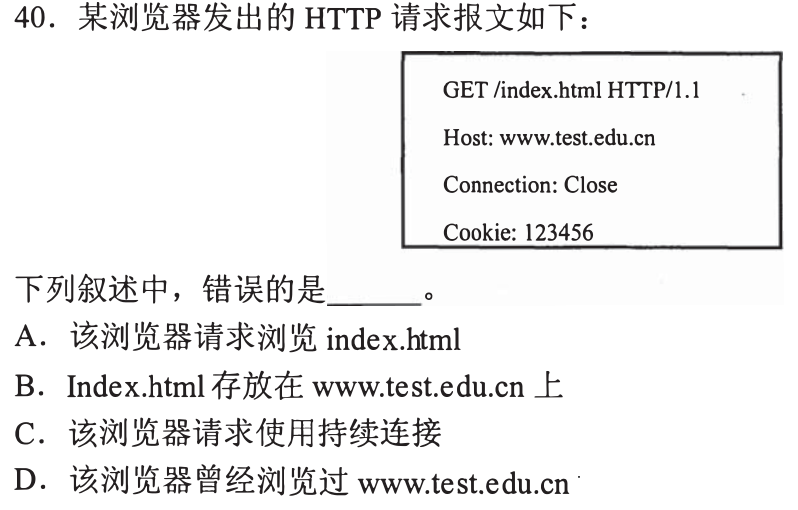

### 08 · 2017-40
> *FTP 主动模式连接建立：客户端主动连服务器 21 端口建立控制连接，服务器从 20 端口主动连客户端建立数据连接。*
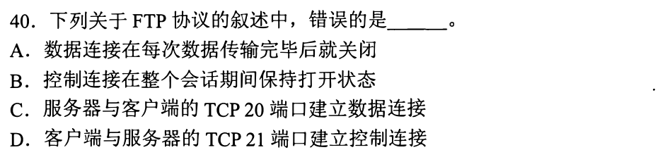

### 09 · 2018-33
> *DNS 查询报文短小且要求低时延，默认使用传输层 UDP 53 端口；主从服务器区域传送才用 TCP。*
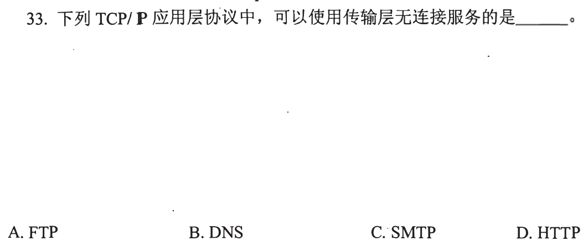

### 10 · 2018-40
> *SMTP 最早设计仅支持 ASCII 文本直接传输，图像、音频或可执行文件必须经 MIME 编码转为 ASCII 字符。*
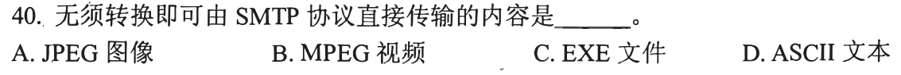

### 11 · 2019-40
> *C/S 架构中客户端之间不直接通信，必须通过中心服务器；P2P 架构对等协作，节点越多分发大文件反而越快。*
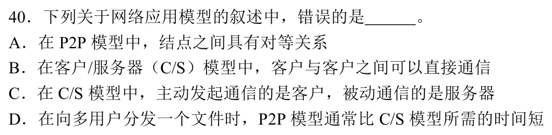

### 12 · 2025-40
> *POP3 协议功能边界：只支持从服务器拉取邮件，不支持发邮件；支持在同一条 TCP 连接中收取多封邮件。*
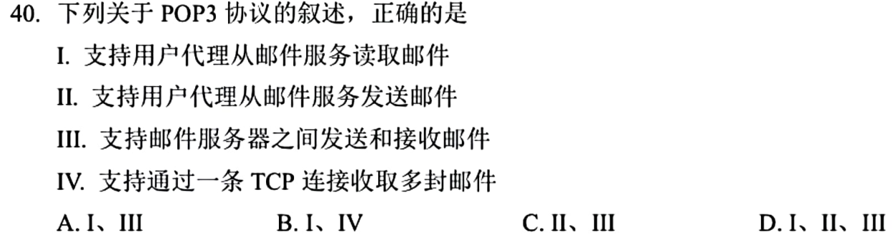

---

## 二、 耗时攻坚题（理顺往返时延，数清握手轮次）

### 13 · 2016-38
> *综合拓扑中主机初次访问外网 Web 站点：从无 ARP 缓存、无 DNS 缓存开始，数清沿途经历了几次 ARP 查询与 DNS 解析。*
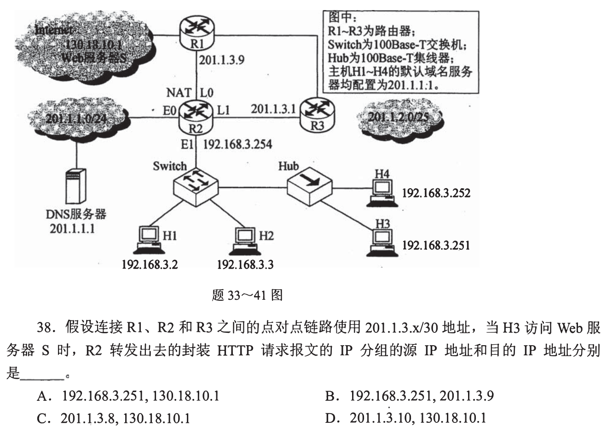

### 14 · 2016-40
> *算清打开网页全过程发出的以太网帧数：从网关 ARP 请求、DNS 查询、TCP 握手到 HTTP GET，一步一印数仔细。*
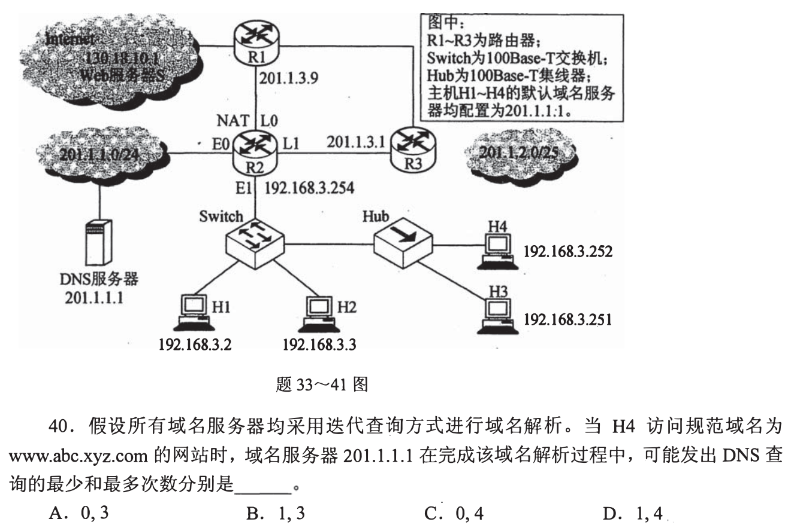

### 15 · 2020-40
> *本地域名服务器递归+根服务器迭代：算清 DNS 查询所花的最少/最多 RTT，加上 TCP 握手与 HTTP 请求 RTT，求总时延区间。*
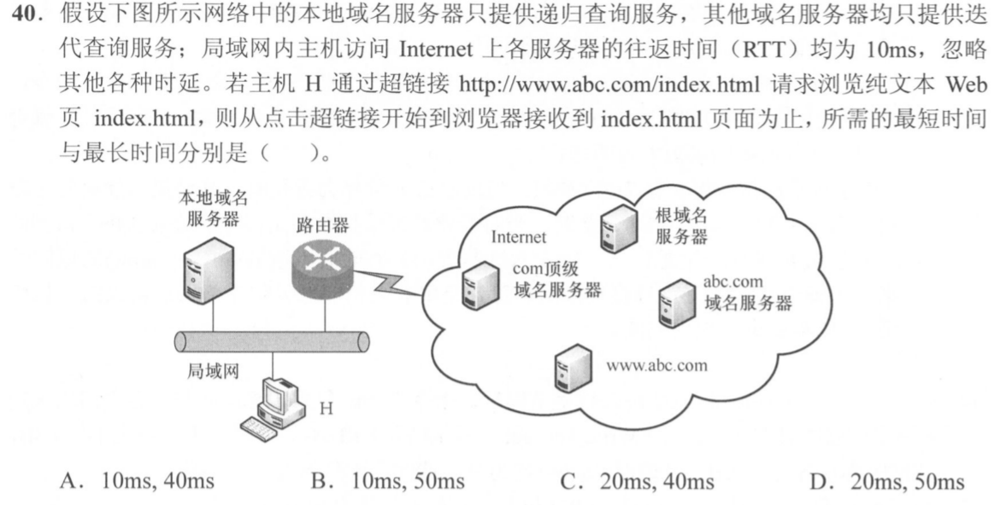

### 16 · 2022-40
> *HTTP/1.1 持久连接时延计算：1 次 TCP 握手，1 个 RTT 拿到 html 页面，再用流水线并发请求后续内嵌对象。*
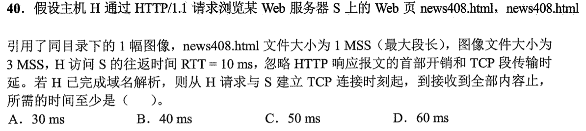

### 17 · 2024-40
> *HTTP/1.0 非持久非并行连接：每个对象都需要单独建立 TCP 连接（1 RTT）并请求内容（1 RTT），7 个内嵌图片要算清总 RTT。*
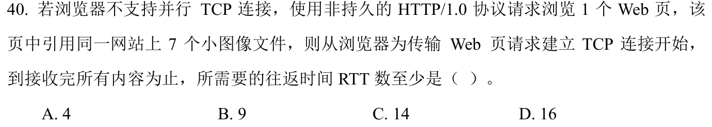

### 18 · 2026-40
<!-- 2026 压轴题位，已在 paper_html/408-2026.html 就绪 -->
