# 0914｜线性结构：数组与链表大题

> 当前显示 **4 题**（2020—2026 年）；**8 题暂缓**，原文保留在文件末尾的 HTML 注释中，未删除。

## 当前题单（2020—2026）

### 01 · 2020-41
> *三序列距离最小。三指针推进，想不透原理就写常规两重甚至三重循环，保底拿基础分，绝不死磕 20 分钟。*
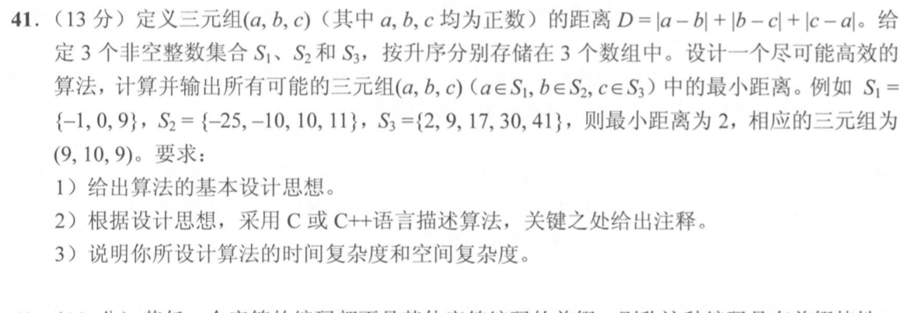

### 02 · 2022-42
> *看清题意——明确要求不写代码！只简述大顶堆思想和复杂度，别自己加戏猛写代码。*
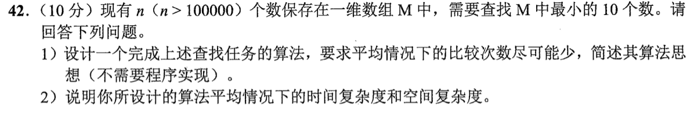

### 03 · 2025-41
> *最新压轴。多条件联合控制，先用常规逻辑把框架搭出来稳住盘面。*
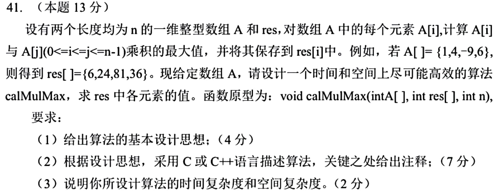

### 04 · 2026-41
> *二叉搜索树（BST）算法设计大题。树上查找与关键字修改：写出递归或非递归遍历查找算法，并在更新关键字后注意维持 BST 的有序性。*
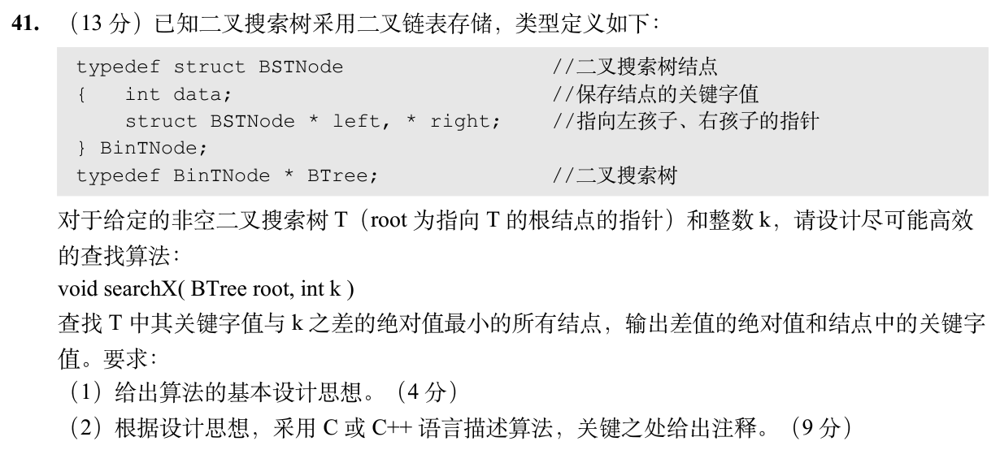

## 暂缓题目

以下题目仅暂时不处理；完整题目条目保留在 Markdown 源文件的 HTML 注释内，预览不显示题目。

<!-- 暂缓题：2009-42；暂时不处理，未删除。
### 01 · 2009-42
> *双指针同向走固定间隔，或者老实数两遍总长度，标准基础分。*
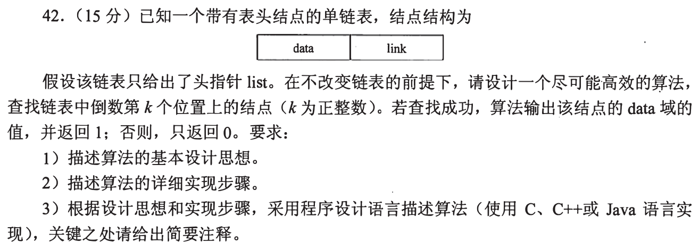
-->

<!-- 暂缓题：2010-42；暂时不处理，未删除。
### 02 · 2010-42
> *经典循环移位，三步翻转法或额外开个小数组暂存，基础套用。*
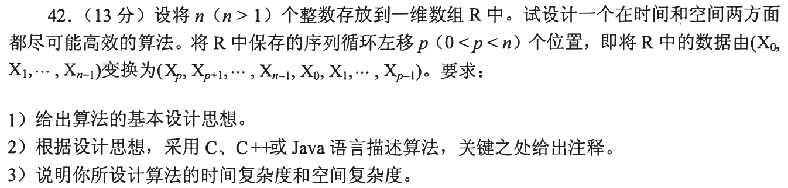
-->

<!-- 暂缓题：2015-41；暂时不处理，未删除。
### 03 · 2015-41
> *看到 $|data| \le n$ 直接开个辅助数组打标记，一趟走完去重，送分题。*
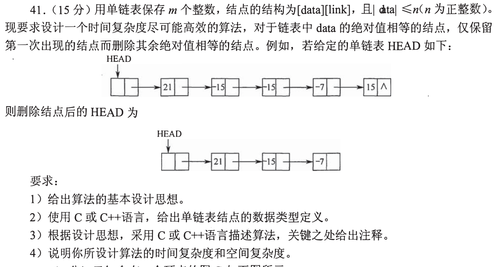
-->

<!-- 暂缓题：2019-42；暂时不处理，未删除。
### 04 · 2019-42
> *单链表实现队列，只设一个尾指针，考的是基础结构连接，不考复杂算法。*
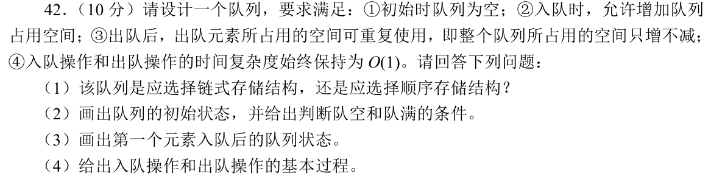
-->

<!-- 暂缓题：2012-42；暂时不处理，未删除。
### 06 · 2012-42
> *两序列找中位数。折半查找很容易写错边界；双指针各走一步归并到一半虽然普通，但最稳最快能拿 90% 分数。*
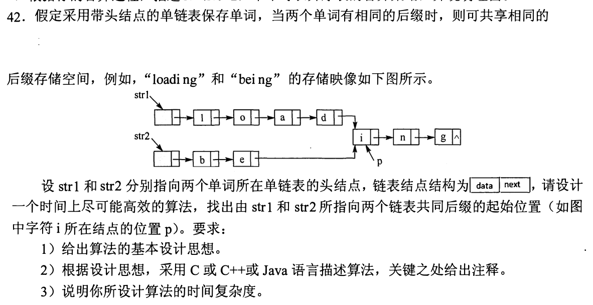
-->

<!-- 暂缓题：2013-41；暂时不处理，未删除。
### 07 · 2013-41
> *找过半的主元素。两两抵消的投票法最快；想不出就直接排序看中间数，拿大头分收手。*
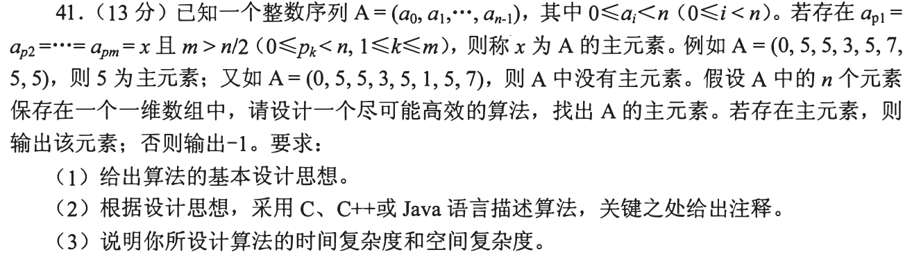
-->

<!-- 暂缓题：2018-41；暂时不处理，未删除。
### 08 · 2018-41
> *找没出现的最小正整数。原地打标记极难一次写对，时间紧直接开辅助数组打标记，扣两分但省下 15 分钟。*
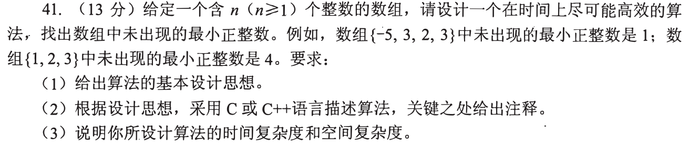
-->

<!-- 暂缓题：2019-41；暂时不处理，未删除。
### 09 · 2019-41
> *链表前后折叠重排。找中点、倒置后半段、交织合并，连环三步，很容易在指针边界断开处卡壳。*
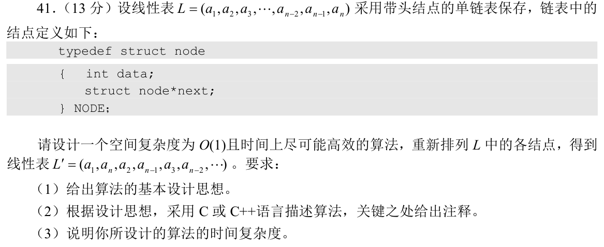
-->
