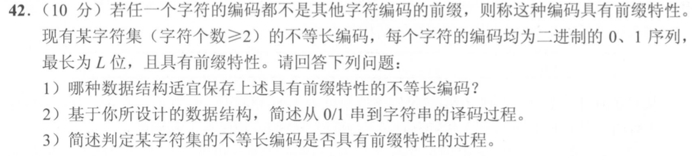
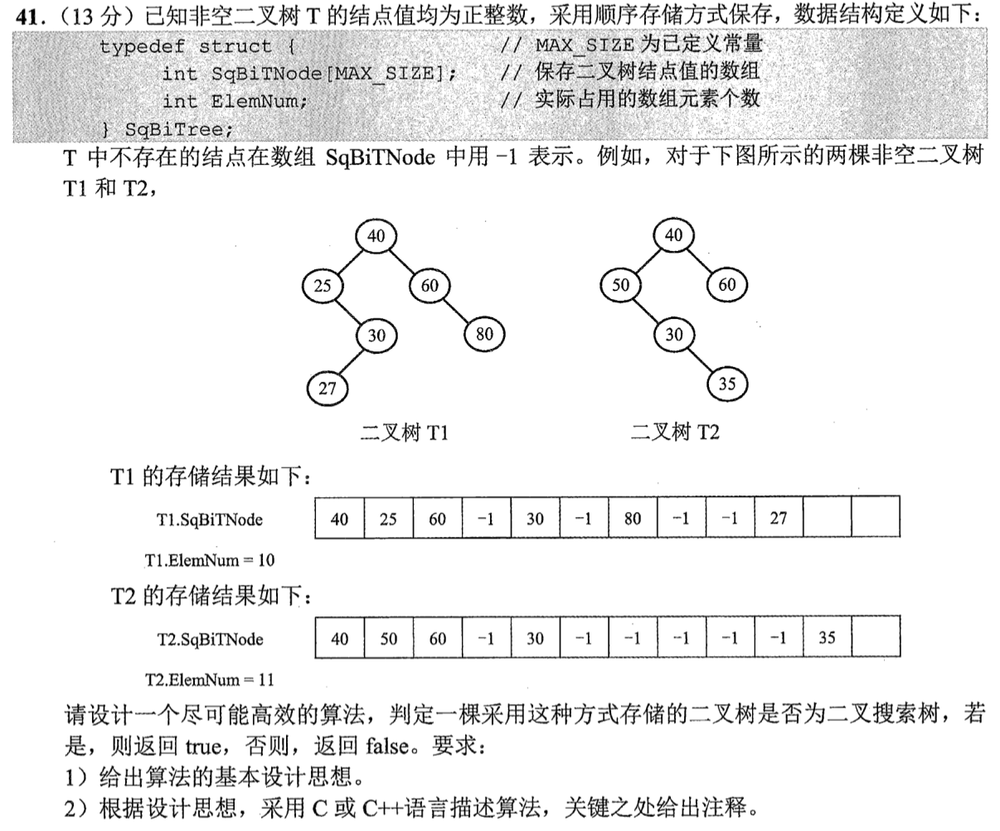
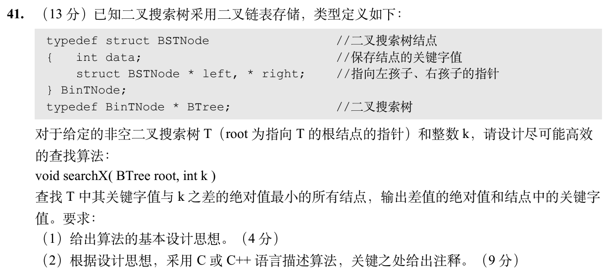
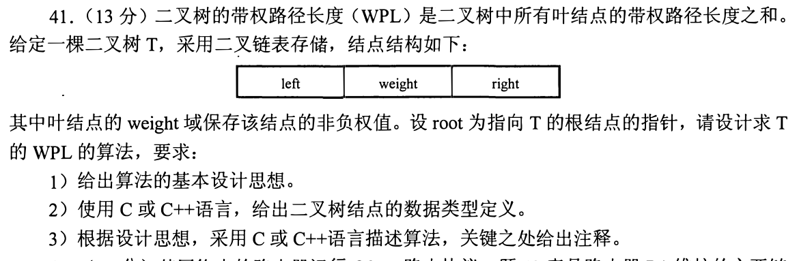
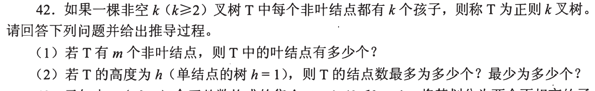
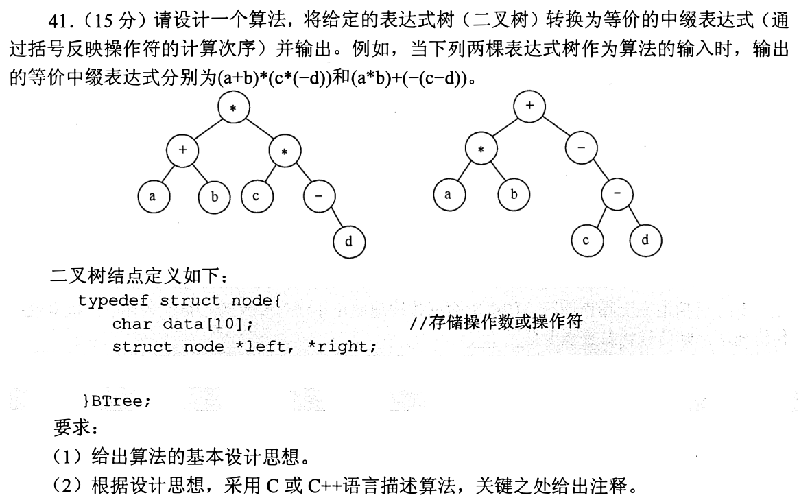

# 0915｜树的递归含义：路径、编码、表达式与存储形态

> 当前显示 **3 题**（2020—2026 年）；**3 题暂缓**，原文保留在文件末尾的 HTML 注释中，未删除。

## 当前题单（2020—2026）

### 01 · 2020-42
> *前缀编码判定大题，把编码串看作根到叶结点的路径，证明所有字符互不为祖先前缀，画出二叉树结构清晰答题。*

### 02 · 2022-41
> *顺序存储判定二叉排序树。下标 $2i$ 和 $2i+1$ 容易越界，先老实写一遍中序遍历把值拷进辅助数组，再扫一遍看是否严格单调递增，多开一点空间但能稳稳拿满 13 分。*

### 03 · 2026-41
> *二叉搜索树（BST）算法设计大题。树上查找与关键字修改：写出递归或非递归遍历查找算法，并在更新关键字后注意维持 BST 的有序性。*

## 暂缓题目

以下题目仅暂时不处理；完整题目条目保留在 Markdown 源文件的 HTML 注释内，预览不显示题目。

<!-- 暂缓题：2014-41；暂时不处理，未删除。
### 01 · 2014-41
> *求二叉树 WPL，递归传一个 `depth` 参数，遍历到叶结点累加 `weight * depth`，闭着眼睛写标准先序遍历。*

-->

<!-- 暂缓题：2016-42；暂时不处理，未删除。
### 02 · 2016-42
> *正则 $k$ 叉树纯数学推导，不写一行代码，利用度数方程 $E = V - 1$ 与等比数列求和直接拿满 10 分。*

-->

<!-- 暂缓题：2017-41；暂时不处理，未删除。
### 04 · 2017-41
> *表达式树中序遍历输出带括号中缀式。加括号时机是核心——除了根结点和叶子外，其余所有子树左右加括号，处理好递归边界。*

-->
