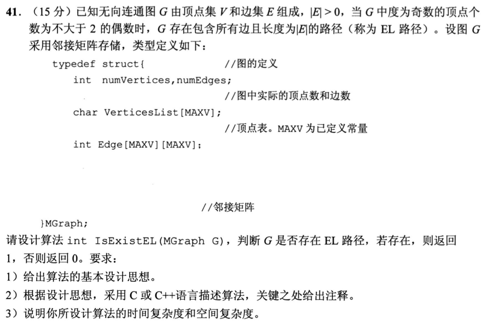
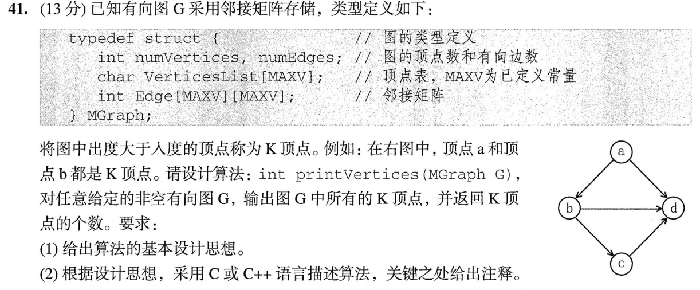
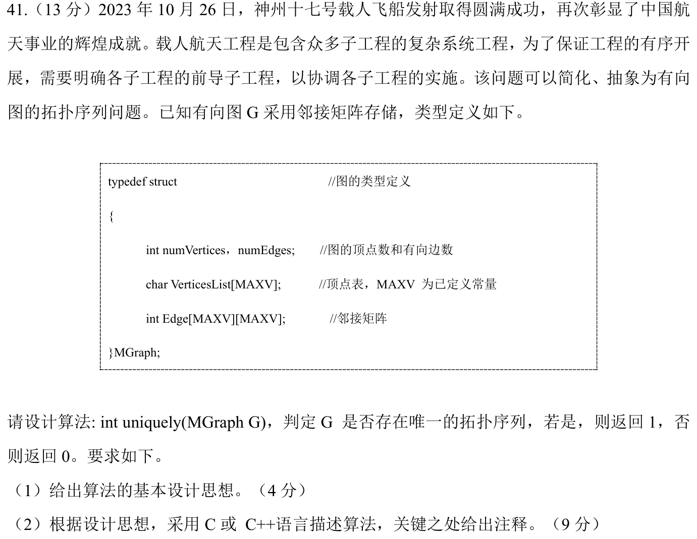
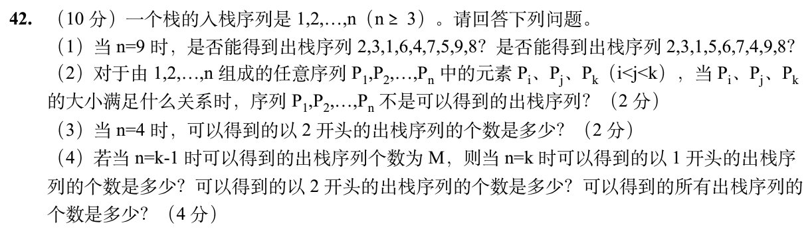
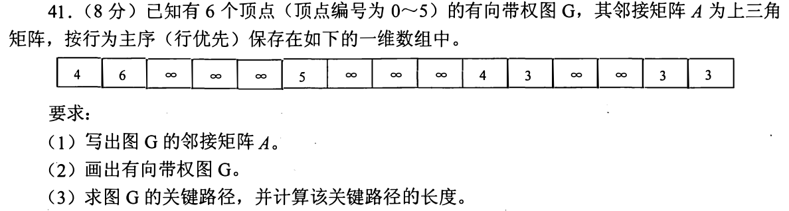
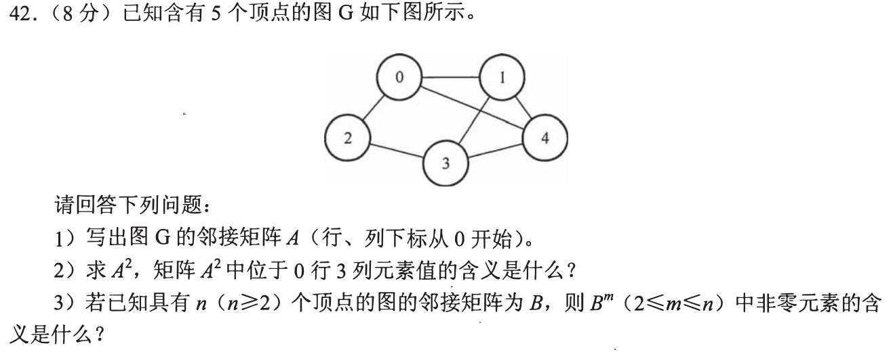

# 0916｜图的结构判定：从邻接信息恢复全局性质

> 当前显示 **4 题**（2020—2026 年）；**2 题暂缓**，原文保留在文件末尾的 HTML 注释中，未删除。

## 当前题单（2020—2026）

### 01 · 2021-41
> *判定欧拉（EL）路径：题干直接给出了充要条件（奇数度顶点个数为 0 或 2），扫一遍邻接矩阵每行求和数度数，按部就班拿满 15 分。*

### 02 · 2023-41
> *有向图找 $K$ 阶回路：写标准带深度参数的 DFS 回溯搜索，控制步数达到 $K$ 时检查是否回到起点，加好访问标记防止死循环。*

### 03 · 2024-41
> *工程项目工期推进：本质是拓扑排序入度维护与关键路径分析，依题意搭好循环框架，常规法保底拿大头分。*

### 04 · 2026-42
> *有向图拓扑排序与关键路径综合大题。从邻接矩阵出发计算各顶点入度，推导拓扑序列并分析事件最早发生时间。*

## 暂缓题目

以下题目仅暂时不处理；完整题目条目保留在 Markdown 源文件的 HTML 注释内，预览不显示题目。

<!-- 暂缓题：2011-41；暂时不处理，未删除。
### 01 · 2011-41
> *上三角邻接矩阵压缩还原，看清行优先偏移，直接在草稿纸上画图手算最短路，纯送分大题。*

-->

<!-- 暂缓题：2015-42；暂时不处理，未删除。
### 02 · 2015-42
> *邻接矩阵乘方 $A^2[i][j]$ 的图论含义是顶点 $i$ 到 $j$ 长度为 2 的路径条数，写出矩阵写出乘积，标准理论送分。*

-->
