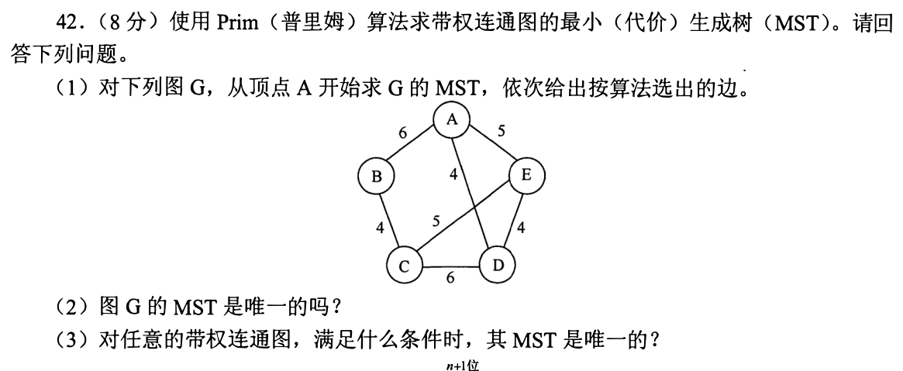
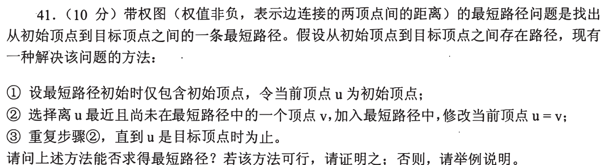
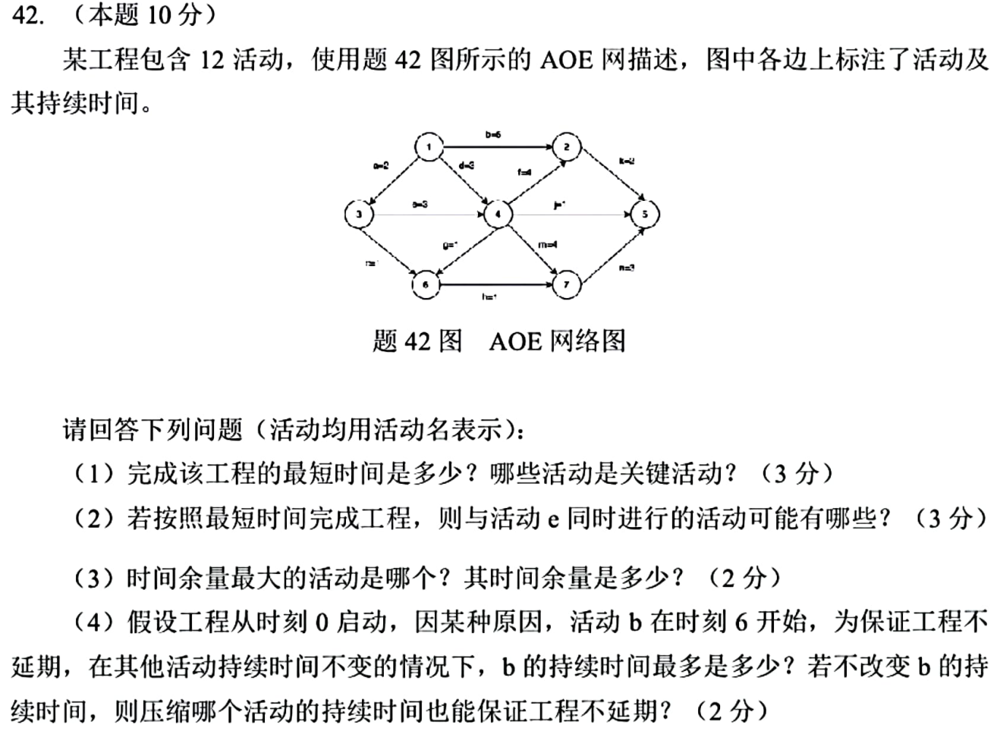

# 0917｜图上的最优推进：最短路、生成树与关键路径

> 这组题直接分成两截：
> 前面是**快速拿分题**，看清题意直接写，别犹豫；
> 后面是**耗时攻坚题**，3~5 分钟内想不出巧劲，就老老实实写常规解法拿大头分，绝不陷在里面空耗时间。

---

## 一、 快速拿分题（稳稳收下）

### 01 · 2017-42
> *Prim 算法从单点出发贪心挑最近邻，写出选边次序与复杂度分析，纯送分考查。*

### 02 · 2009-41
> *局部贪心不等于全局最短路：画出 3 个结点的反例图（一条短边连着大长边，另一条稍长边直达终点），直截了当推翻猜想。*

---

## 二、 耗时攻坚题（掂量开销，想不出巧解就用常规法保底）

### 03 · 2025-42
> *最新真题：12 个活动的复杂 AOE 网，在草稿纸上耐下心来正推事件最早时间 $ve$、逆推事件最迟时间 $vl$，算准关键活动和各活动的时间余量，分值全收。*

