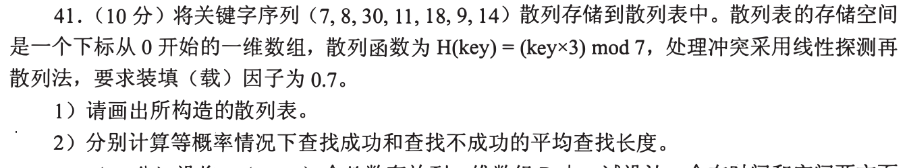
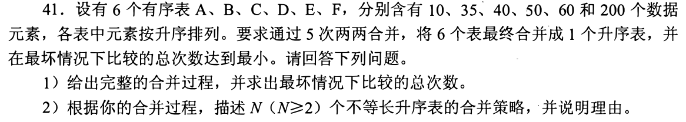
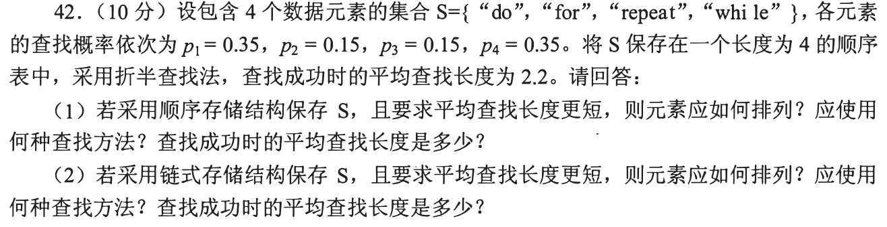
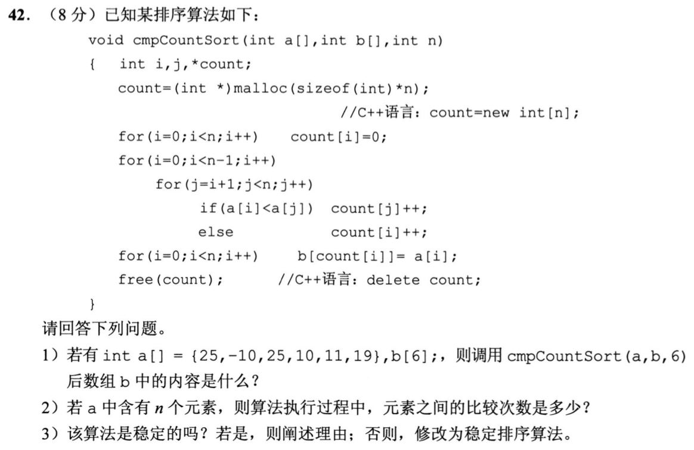
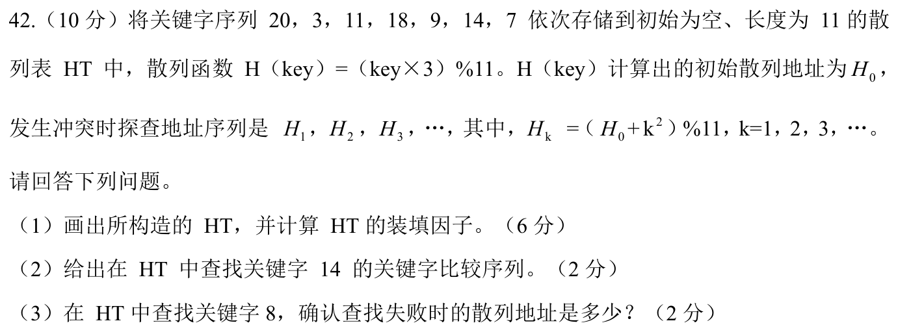
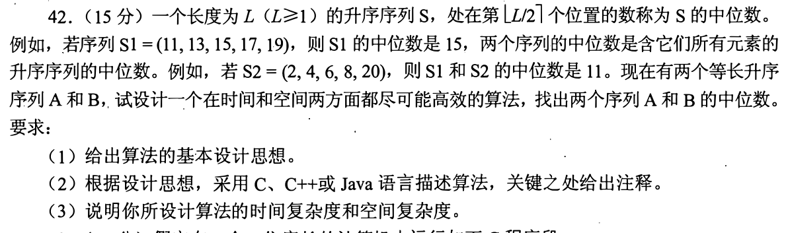
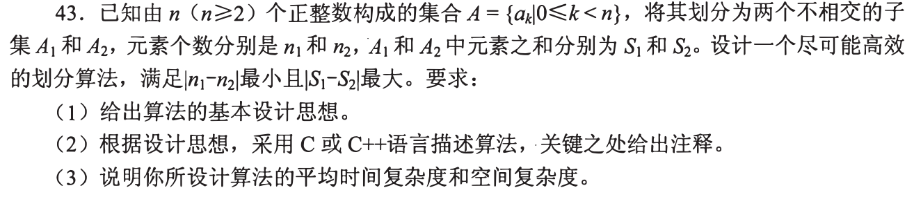
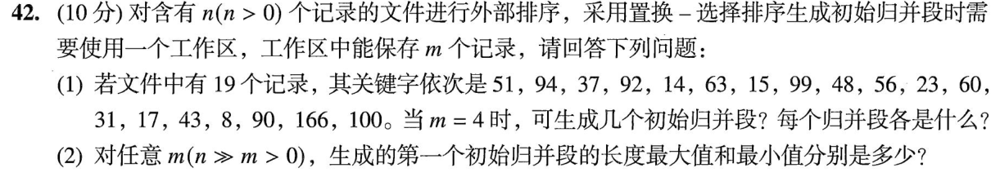

# 0918｜查找与排序：让分布、权重和内存边界决定代价

> 这组题直接分成两截：
> 前面是**快速拿分题**，看清题意直接写，别犹豫；
> 后面是**耗时攻坚题**，3~5 分钟内想不出巧劲，就老老实实写常规解法拿大头分，绝不陷在里面空耗时间。

---

## 一、 快速拿分题（稳稳收下）

### 01 · 2010-41
> *手算散列表线性探测并求查找成功 ASL，按散列函数逐个填入表格，标准大题送分。*

### 02 · 2012-41
> *6 个有序表两两合并使比较次数最少：本质是哈夫曼树贪心合并，每次挑当前长度最小的两个表合并，画出归并树直接数比较次数。*

### 03 · 2013-42
> *带权查找概率建树：高概率关键字尽量放在靠近树根处，算出各结点的查找路径代价和，送分大题。*

### 04 · 2021-42
> *计数排序代码分析：两重循环统计比自身小的元素总个数直接定最终下标，按题目要求分析比较次数与稳定性，纯送分。*

### 05 · 2024-42
> *散列表二次探测再散列：记住探测增量序列是 $\pm 1^2, \pm 2^2, \dots$，严格照着公式一步步算落点和探测次数，稳扎稳打。*

---

## 二、 耗时攻坚题（掂量开销，想不出巧解就用常规法保底）

### 06 · 2011-42
> *两序列找中位数。折半查找很容易写错边界；双指针各走一步归并到一半虽然普通，但最稳最快能拿 90% 分数。*

### 07 · 2016-43
> *划分集合使元素和之差最大：核心是找到第 $\lfloor n/2 \rfloor$ 小的元素划分两半。巧解是用快排划分思想，想不出就先用快速排序整体排好序再切开，代码量稍大但稳拿大头分。*

### 08 · 2023-42
> *置换-选择排序全过程推演：工作区满了之后每次输出当前最小且不小于前一个输出的记录，草稿纸画工作区逐步更替，一步都不能慌。*

