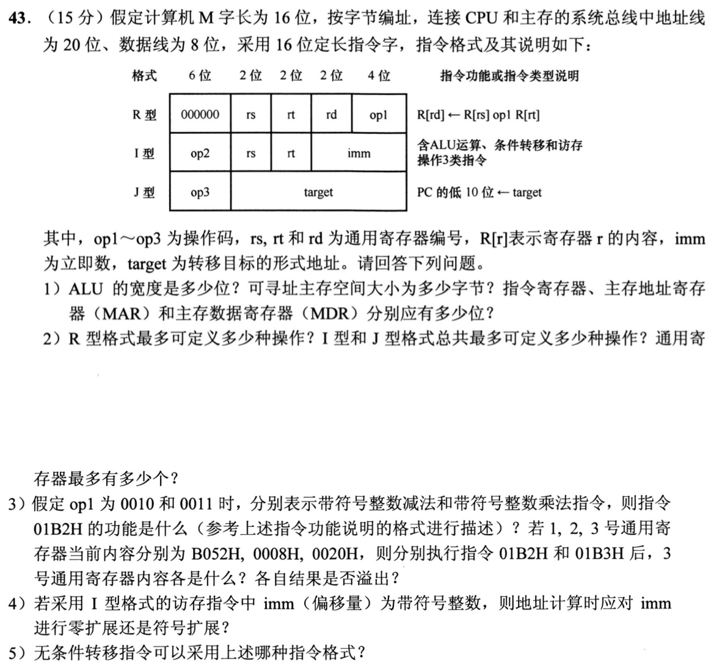
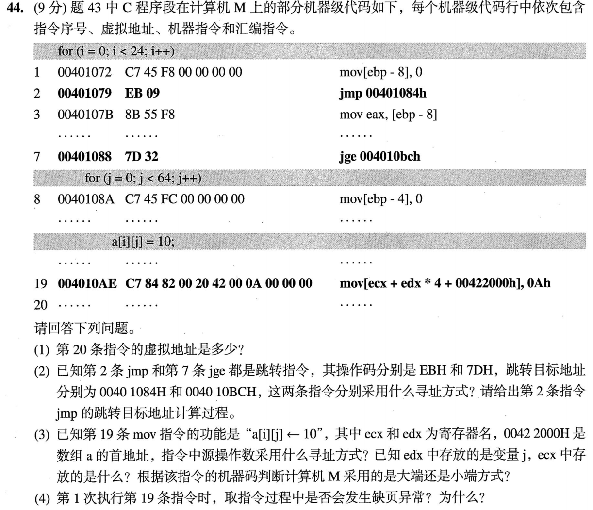
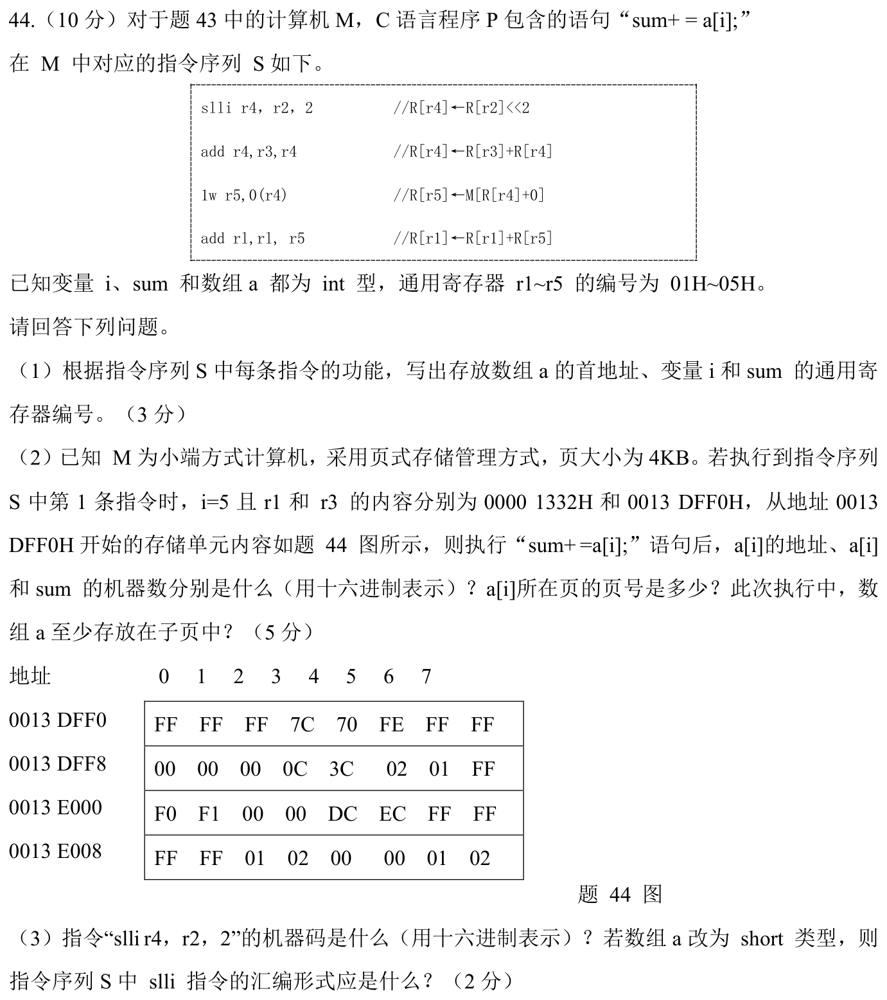
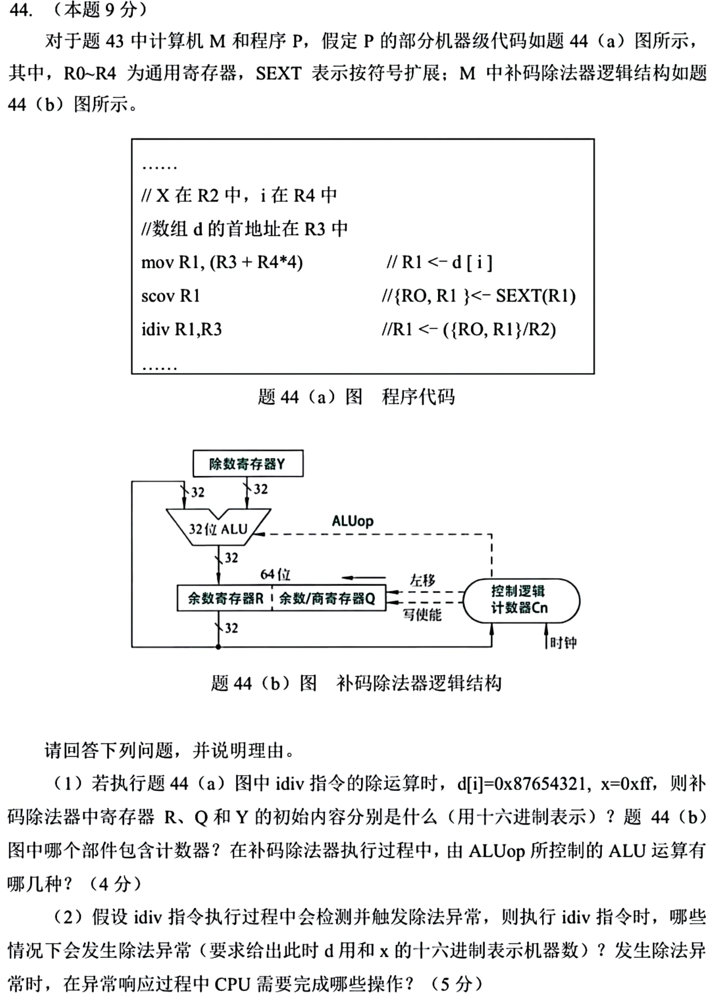
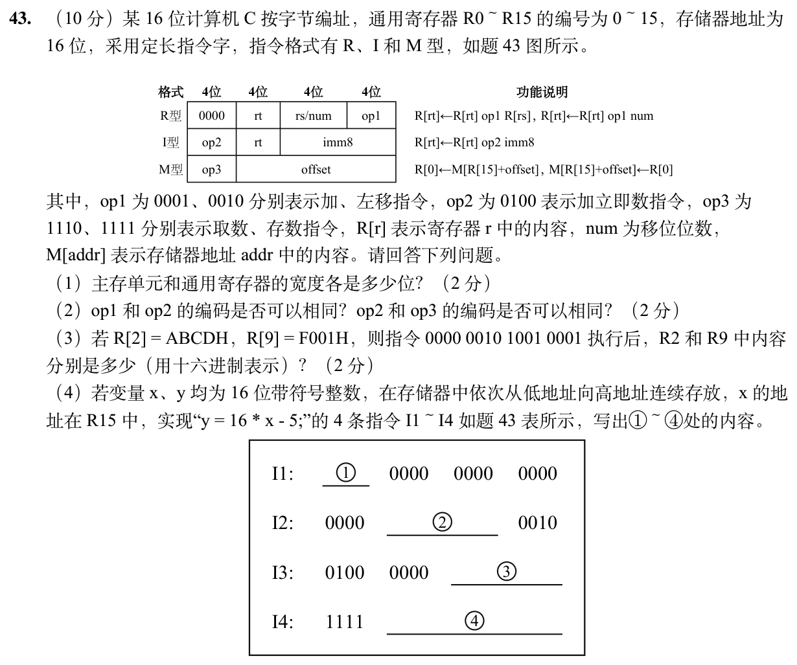
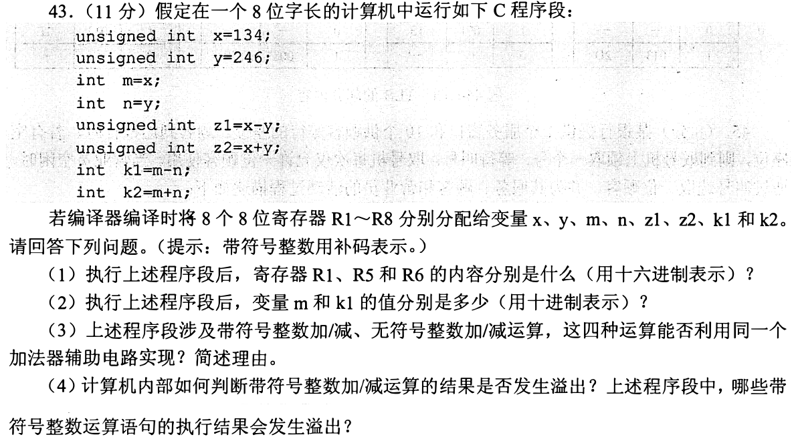
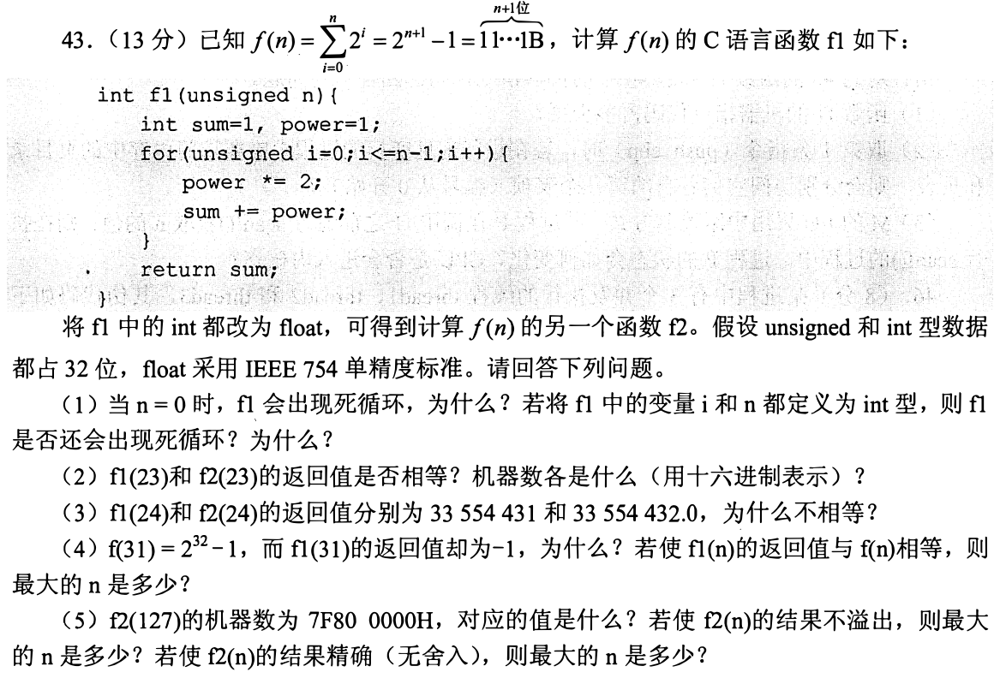
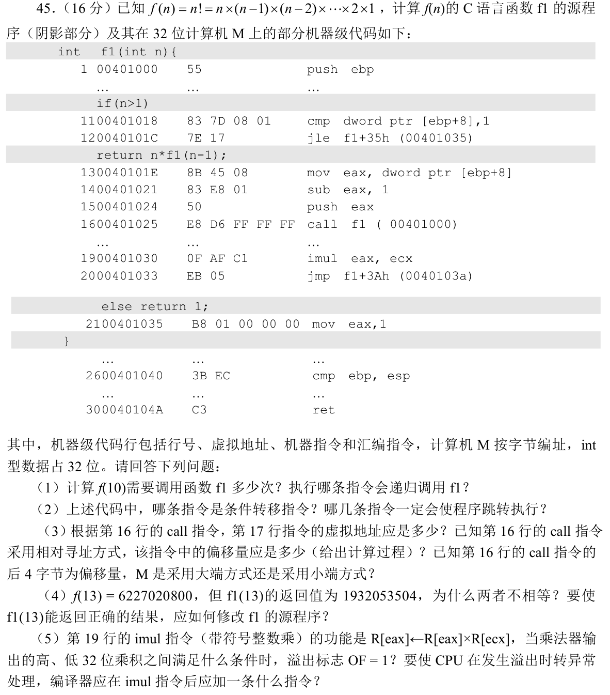

# 0919｜表示到汇编：同一位模式在类型、指令与调用中怎样解释

> 当前显示 **5 题**（2020—2026 年）；**3 题暂缓**，原文保留在文件末尾的 HTML 注释中，未删除。

## 当前题单（2020—2026）

### 01 · 2021-43
> *16 位定长指令系统格式设计。根据寻址方式种类和通用寄存器数量切分指令字段，标准基础分直接拿下。*

### 02 · 2023-44
> *现代机器级代码逐行分析。理清分支跳转目标、循环控制变量在寄存器中的分配与控制流图走向。*

### 03 · 2024-44
> *数组累加 `sum += a[j]` 对应汇编指令序列。看准变址乘 4 和寄存器对应关系，直接把对应空填满。*

### 04 · 2025-44
> *高级语言循环结构映射到机器代码。注意条件转移指令与标志位（ZF/SF/OF）的严格对应关系。*

### 05 · 2026-43
> *16 位计算机定长指令字编码分析：R 型、I 型、M 型操作码扩展与字段切分，根据指令二进制机器码手工反汇编并跟踪寄存器内容变化。*

## 暂缓题目

以下题目仅暂时不处理；完整题目条目保留在 Markdown 源文件的 HTML 注释内，预览不显示题目。

<!-- 暂缓题：2011-43；暂时不处理，未删除。
### 01 · 2011-43
> *8 位字长下 C 语言循环。有符号与无符号数值回绕导致死循环，直接代入临界值验证变量翻转。*

-->

<!-- 暂缓题：2017-43；暂时不处理，未删除。
### 04 · 2017-43
> *循环求和函数 C 代码与汇编对照。分析编译器如何用移位和减法优化乘法，以及补码比较跳转的条件判断。*

-->

<!-- 暂缓题：2019-45；暂时不处理，未删除。
### 05 · 2019-45
> *阶乘函数在 32 位机器上的汇编分析。栈帧指针维护、参数传递、递归压栈以及阶乘溢出的临界点推导。*

-->
