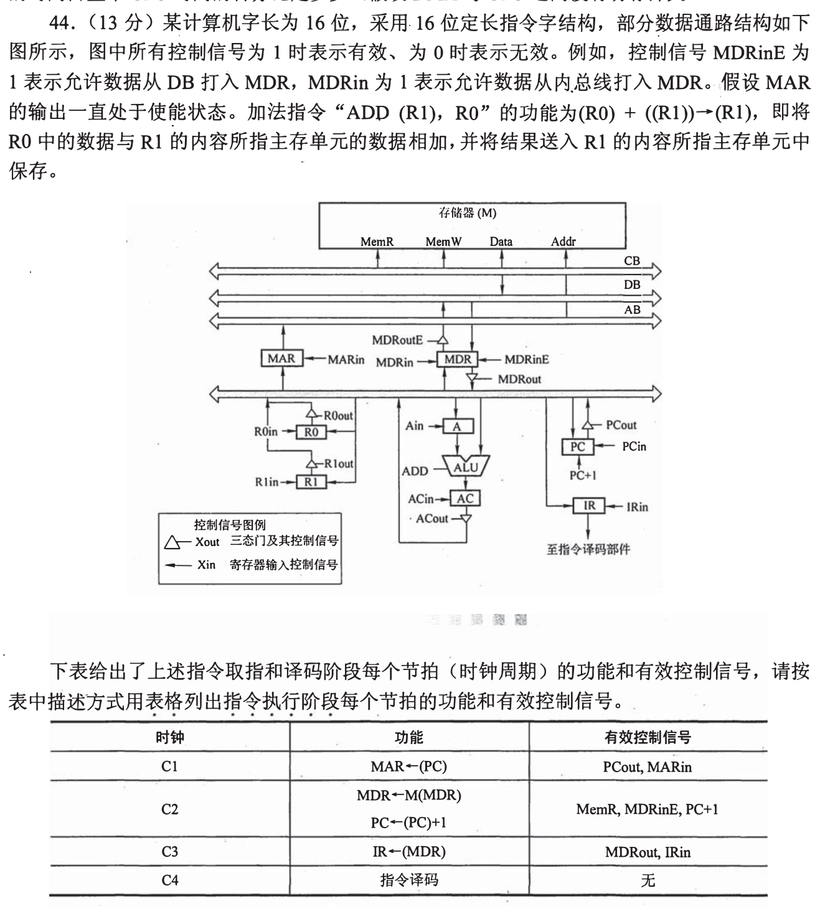
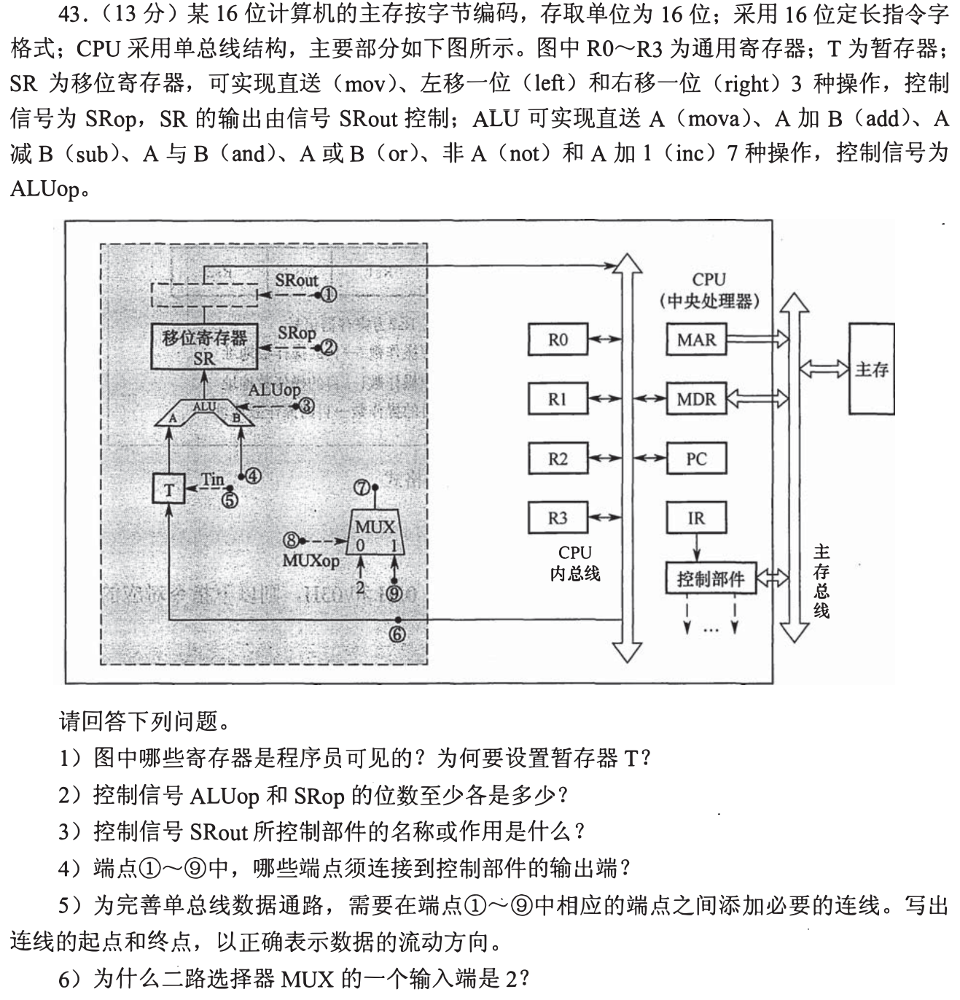
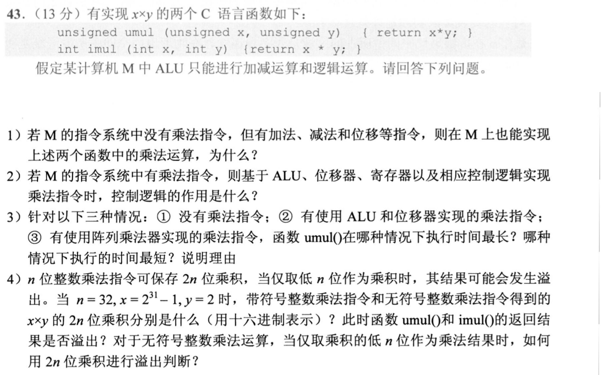
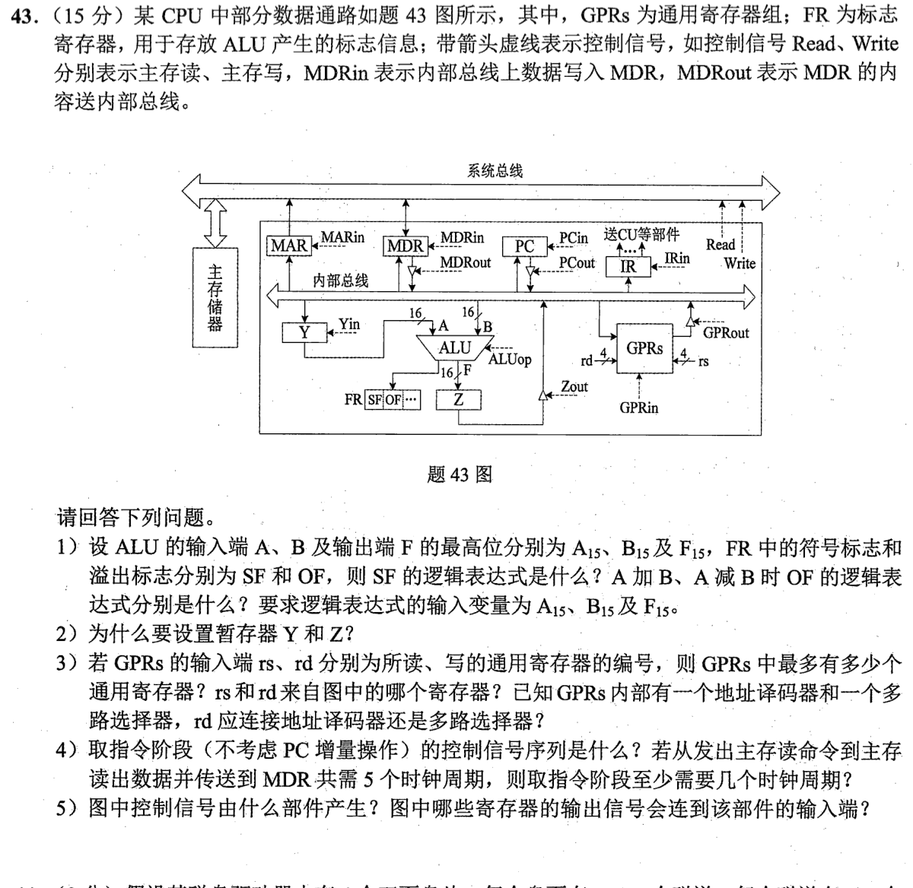
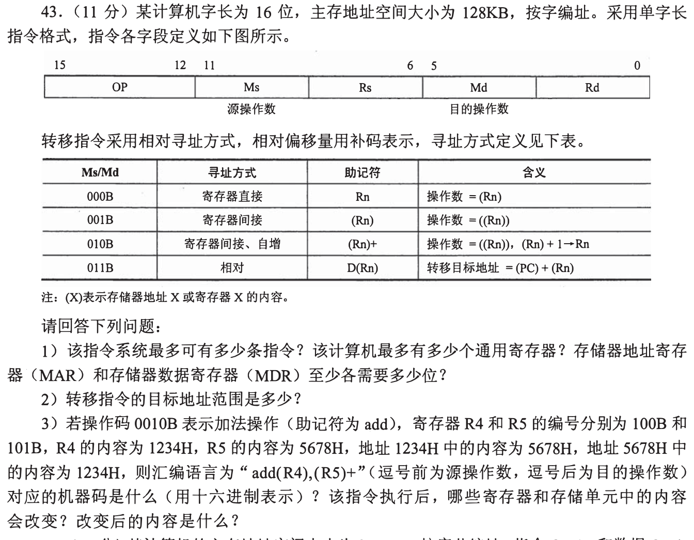
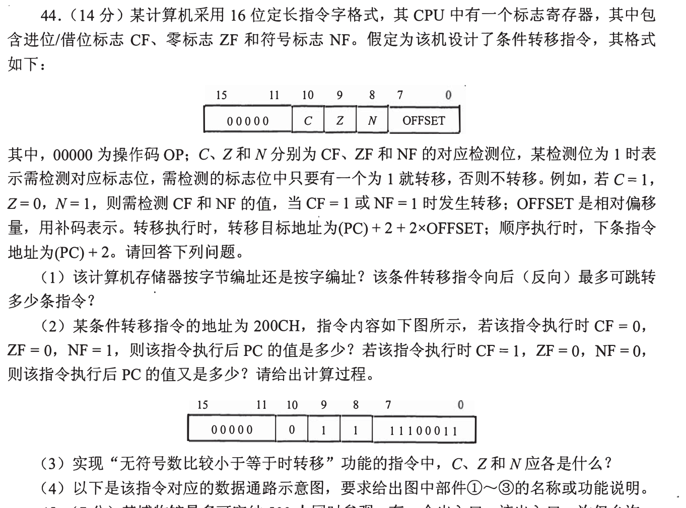
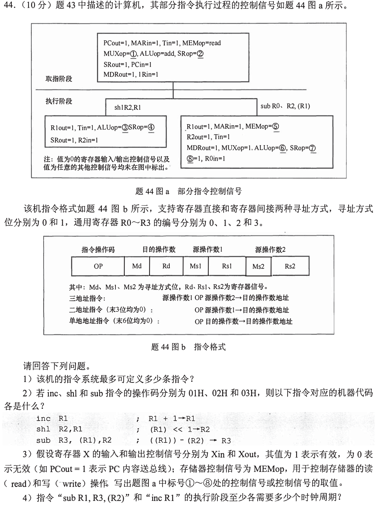
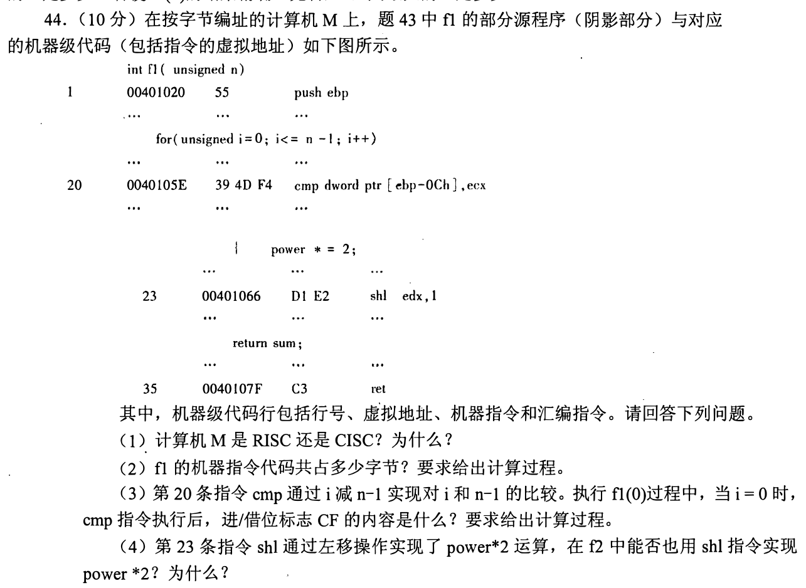
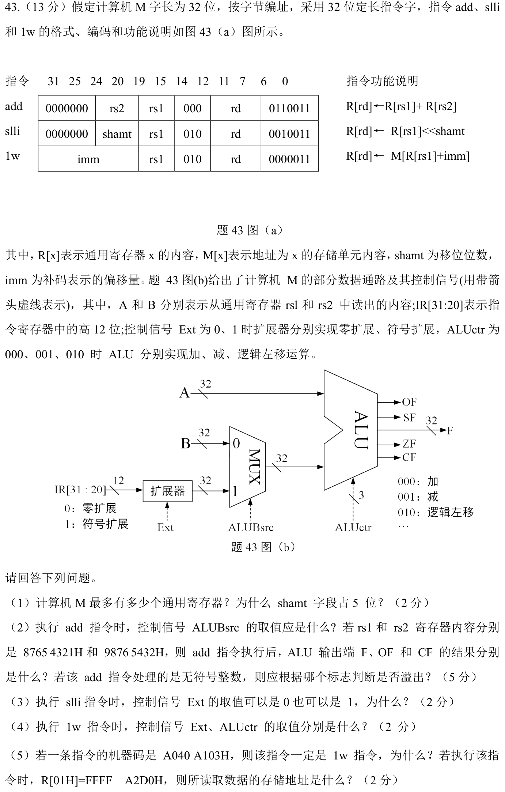

# 0920｜指令落到数据通路：寄存器、部件与控制信号协同

> 这组题直接分成两截：
> 前面是**快速拿分题**，单总线/多总线结构中基本微操作信号填写，按部就班顺水推舟；
> 后面是**耗时攻坚题**，复杂指令多周期控制流、微程序控制器断定法打表，想不透细节先保住前两问的基础分。

---

## 一、 快速拿分题（取指公共流与部件位数，标准送分）

### 01 · 2009-44
> *经典单总线数据通路取指周期。微操作控制信号（PCout, MARin, MEMR, MDRin 等）按顺序填写，标准套路分。*

### 02 · 2015-43
> *16 位单总线 CPU 结构。辨析各寄存器位数及与主存的接口，送分的第一问坚决拿下。*

### 03 · 2020-43
> *乘法函数在不同字长机器上的实现与控制流开销，抓准无符号乘法溢出判断与执行周期折算。*

### 04 · 2022-43
> *现代数据通路结构。看清通用寄存器读写端口与 ALU 输入直连路径，写出微操作步骤。*

---

## 二、 耗时攻坚题（执行周期微操作设计、条件分支与多周期控制）

### 05 · 2010-43
> *指令系统在数据通路上的译码与时序。控制信号真值表与状态转移推导，每一步都不能串位。*

### 06 · 2013-44
> *条件转移指令在数据通路中的执行过程。看清标志寄存器如何控制多路选择器打入 PC。*

### 07 · 2015-44
> *减法指令与间接寻址指令的微操作控制序列。结合硬件拓扑图，分节拍详细列出有效控制信号。*

### 08 · 2017-44
> *数据通路与汇编代码联动。分析某条指令在数据通路中的数据流向与停顿周期。*

### 09 · 2024-43
> *RISC 风格 32 位定长指令数据通路。分析 add、slli、lw 在执行各阶段的控制信号与数据流动。*

### 10 · 2026-44
<!-- 2026 压轴题位，已在 paper_html/408-2026.html 就绪 -->
