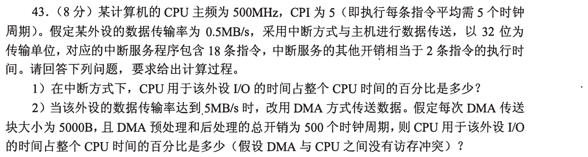
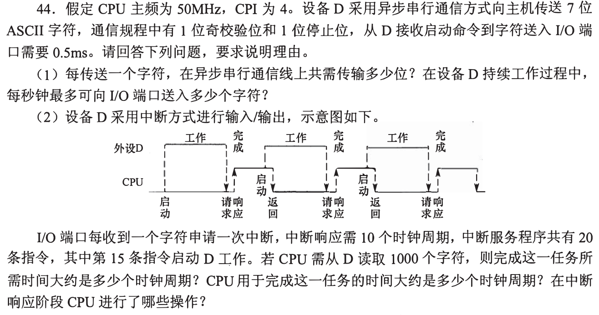
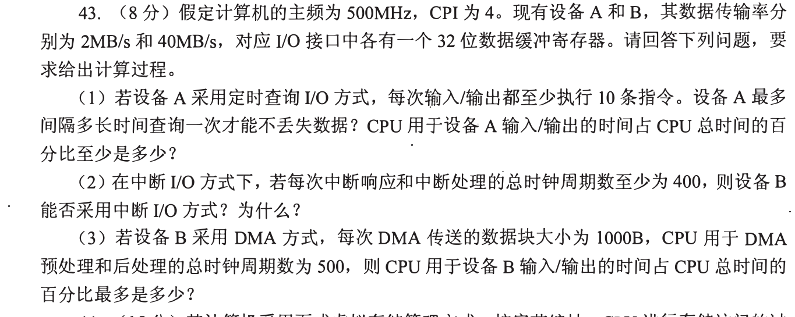
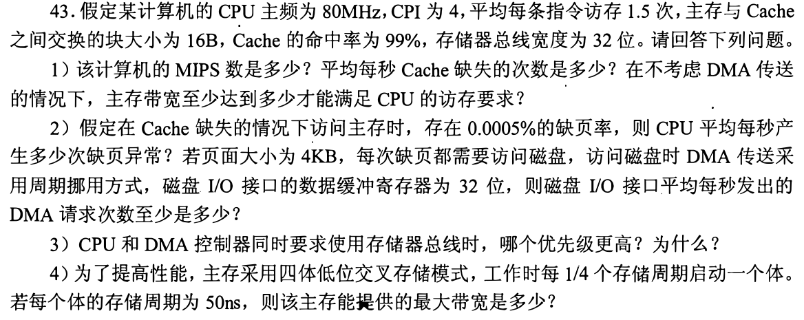
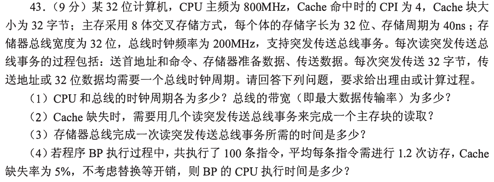

# 0921｜总线与 I/O：事务次数、控制交接和有效吞吐

> 这组题直接分成两截：
> 前面是**快速拿分题**，传输速率单位换算、字符帧格式计算，搞清协议开销直接拿分；
> 后面是**耗时攻坚题**，轮询/中断/DMA 三种模式 CPU 占用率综合对比，抓牢主频、CPI 与指令开销方程。

---

## 一、 快速拿分题（帧格式开销与简单传输率，直接拿分）

### 01 · 2009-43
> *外设数据传输率 0.5MB/s。中断服务程序指令数与执行时间计算，直接套公式算 CPU 占比。*

### 02 · 2016-44
> *异步串行通信帧开销（1 起始 + 7 数据 + 1 校验 + 1 停止）。波特率与有效字符传输率换算，送分题。*

### 03 · 2018-43
> *两台不同速率设备分别采用中断和 DMA 传输。计算每次 I/O 请求的频率和响应时间。*

---

## 二、 耗时攻坚题（Cache 缺失总线事务、交叉编址突发周期精算）

### 04 · 2012-43
> *Cache 缺失与主存总线事务综合。平均每条指令访存 1.5 次，推算总线带宽占用率与系统瓶颈。*

### 05 · 2013-43
> *8 体交叉编址主存配合总线突发传输。精确计算一条指令从发起到 Cache 块填满的总时钟周期数。*

