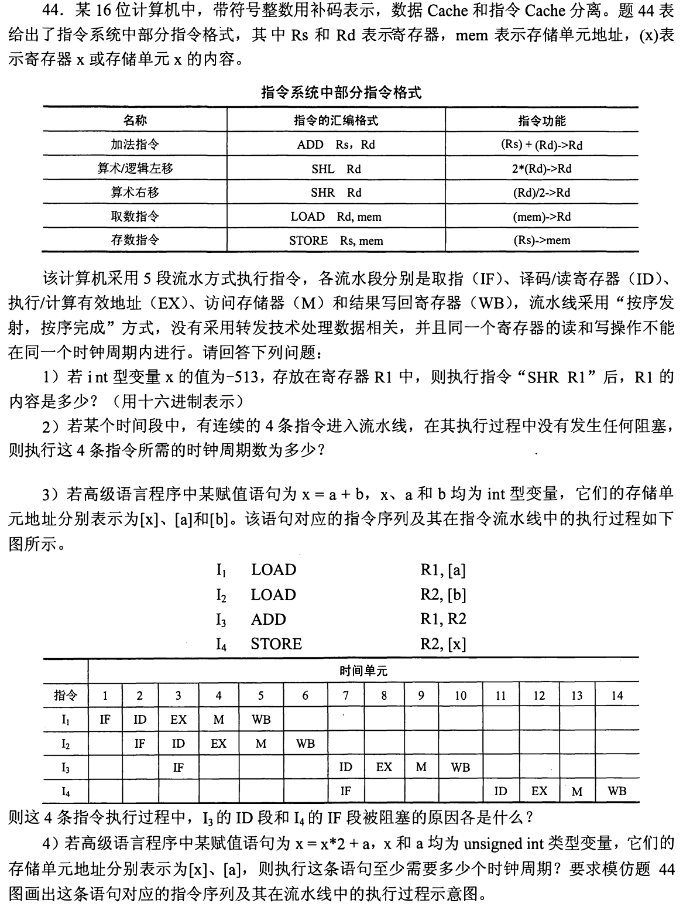
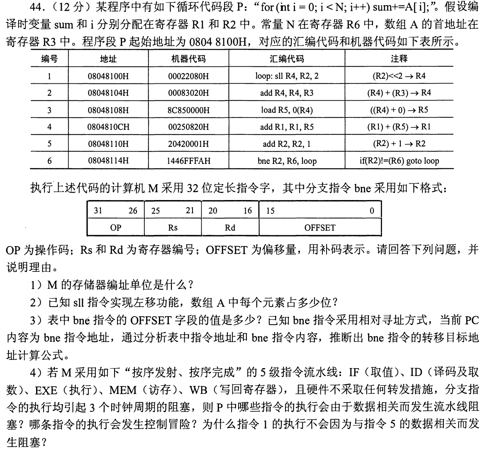
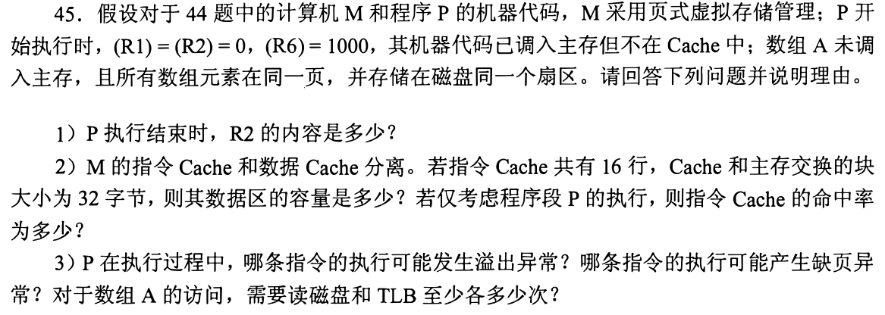

# 0922｜流水与异常：相关、转移和精确状态怎样收口

> 这组题直接分成两截：
> 前面是**快速拿分题**，识别指令间数据相关、判断空操作插入，基础分稳稳拿下；
> 后面是**耗时攻坚题**，分支预测惩罚周期精算、精确异常流水线现场清理与恢复，推演复杂先写好骨架。

---

## 一、 快速拿分题（数据相关识别与 NOP 插入，快速拿下）

### 01 · 2012-44
> *16 位定长指令格式。识别指令序列间的数据相关（RAW），判断哪些指令之间必须插入空操作（NOP）。*

---

## 二、 耗时攻坚题（分支惩罚周期累计与精确异常恢复现场）

### 02 · 2014-44
> *循环代码在 5 段流水线上的执行时序。推导分支预测失败造成的时钟惩罚和总时钟周期数。*

### 03 · 2014-45
> *结合虚拟存储缺页异常的流水线现场恢复。分析精确异常发生时哪些指令必须撤销、哪条指令重新执行。*

