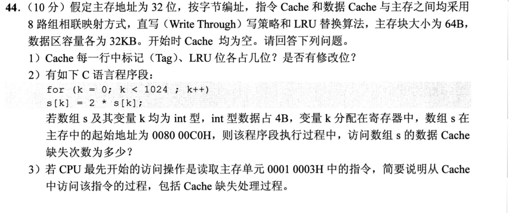
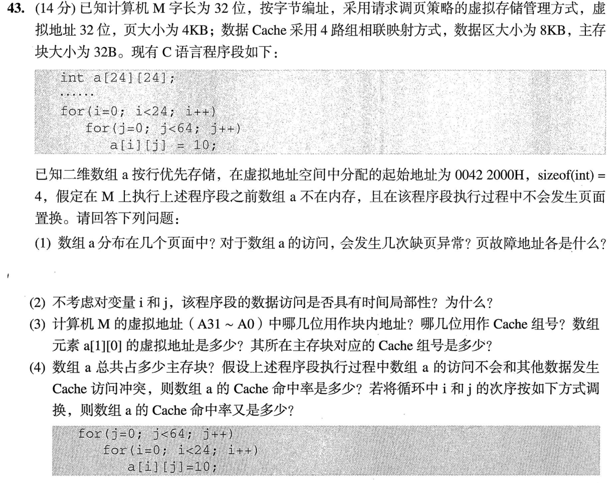
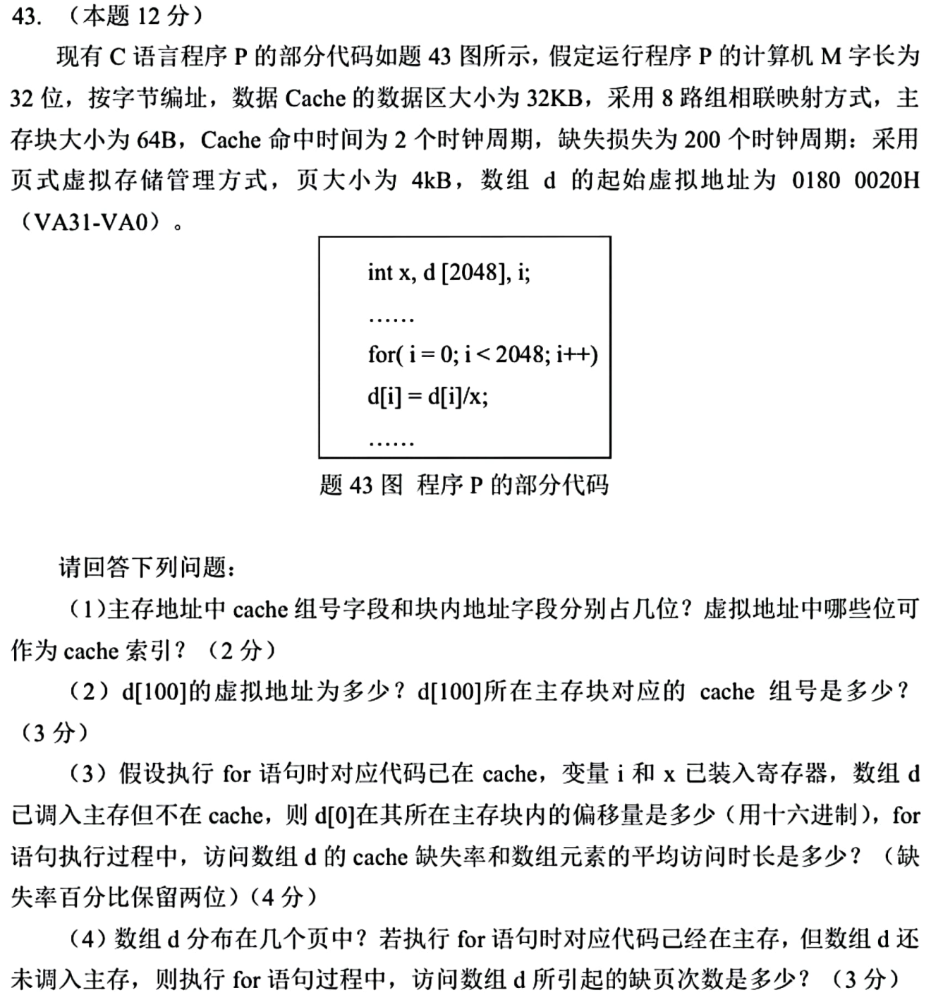
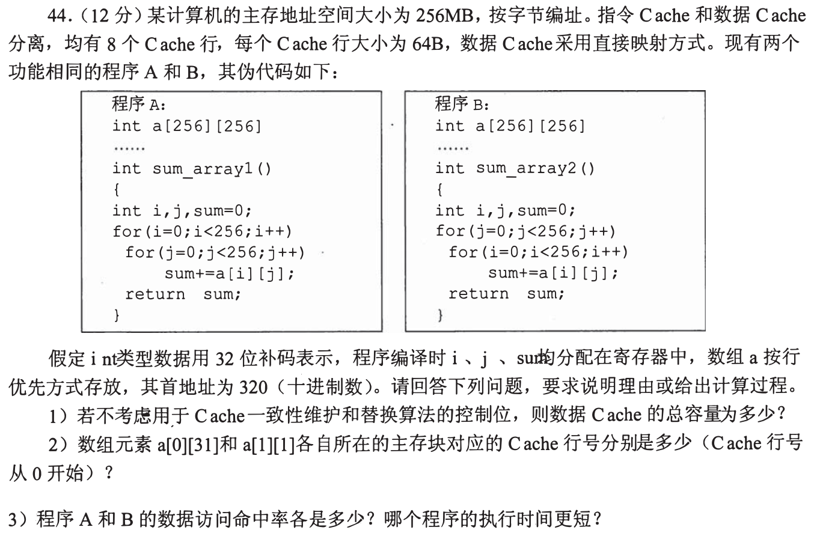
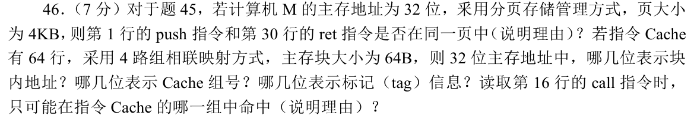

# 0923｜Cache 局部性：地址映射、访问序列与缺失代价

> 当前显示 **3 题**（2020—2026 年）；**2 题暂缓**，原文保留在文件末尾的 HTML 注释中，未删除。

## 当前题单（2020—2026）

### 01 · 2020-44
> *8 路组相联 Cache 结合直写策略。计算命中与缺失时的总线事务开销与写入总次数。*

### 02 · 2023-43
> *请求分页虚存加数据 Cache。分析程序执行中数组元素访问的缺页次数与 Cache 缺失次数，分步保底。*

### 03 · 2025-43
> *循环重组与矩阵乘法局部性分析。精确计算不同访问步长下的 Cache 缺失率与执行时间差异。*

## 暂缓题目

以下题目仅暂时不处理；完整题目条目保留在 Markdown 源文件的 HTML 注释内，预览不显示题目。

<!-- 暂缓题：2010-44；暂时不处理，未删除。
### 01 · 2010-44
> *分离式 Cache 地址划分。根据容量、组相联路数和块大小，秒算 Tag、组索引和块内地址位数。*

-->

<!-- 暂缓题：2019-46；暂时不处理，未删除。
### 02 · 2019-46
> *分页管理下指令与数据的地址映射。判断某两条指令是否落在同一个物理页内。*

-->
