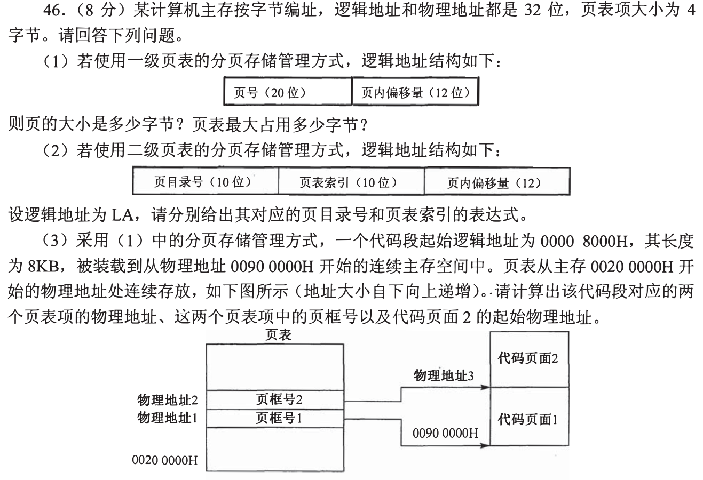
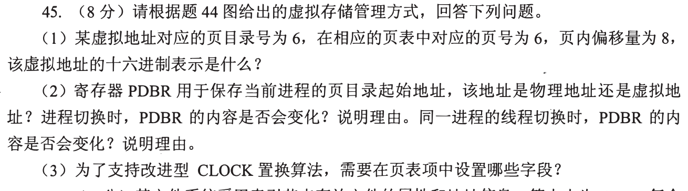
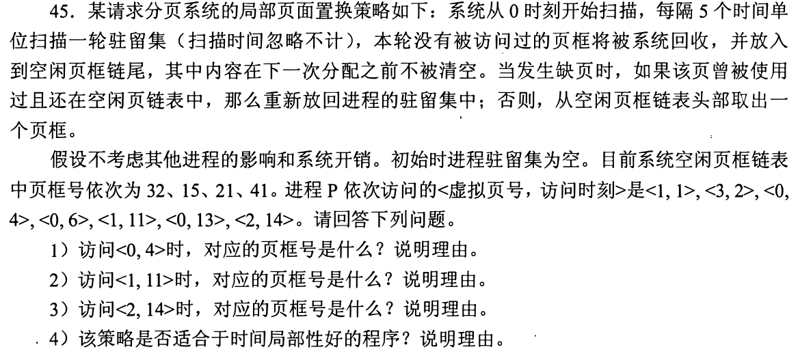
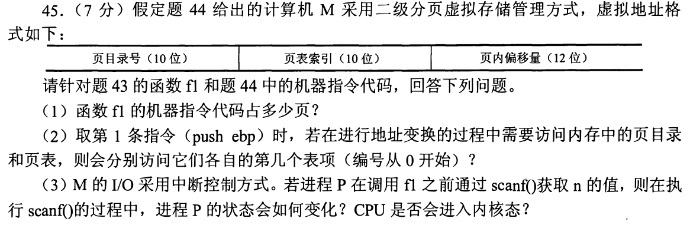
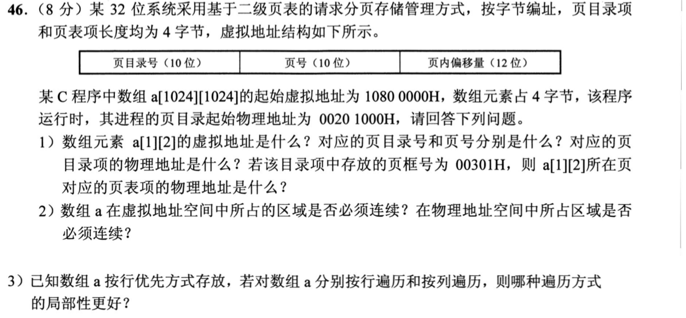

# 0926｜页面驻留：分配、置换与缺页过程

> 这组题直接分成两截：
> 前面是**快速拿分题**，地址结构划分与常规页表项算术，套公式 8 分钟稳稳拿满；
> 后面是**耗时攻坚题**，带空闲链表扫描、TLB与Cache协同、脏页回写代价综合题，必须耐着性子把每一轮访存画清楚。

---

## 一、 快速拿分题（标准套路，稳稳收下）

### 01 · 2013-46
> *32 位系统单级与二级页表划分，直接按公式切出页号和偏移量，再用主存大小除以页大小算出最大页表项数，标准送分。*

### 02 · 2018-45
> *进程驻留集与两级页表地址拆分，按部就班算出逻辑地址到物理块号的映射，缺页率计算一目了然。*

---

## 二、 耗时攻坚题（软硬件状态机与长链路推演，步步为营）

### 03 · 2012-45
> *空闲页框链表加定期扫描回收，状态机非常细腻，未被访问过的页放入链尾但不清空，推演缺页时千万看清时间戳。*

### 04 · 2017-45
> *虚存 + TLB + Cache 三位一体综合终极大题！分清虚页号到实页号、Cache 组号与块内偏移的每一步映射，草稿纸画齐表头。*

### 05 · 2020-46
> *带修改位 Dirty 的缺页代价推演：算清每一次换出脏页引起的磁盘写 I/O 开销，有效访存时间千万别漏加写回耗时。*

