# 0927｜文件与磁盘：名字、索引和物理块怎样连接

> 当前显示 **4 题**（2020—2026 年）；**7 题暂缓**，原文保留在文件末尾的 HTML 注释中，未删除。

## 当前题单（2020—2026）

### 01 · 2021-46
> *标准 UNIX 混合多级索引计算，根据直接项和一次间接项跨度算出指定字节在哪个块，套路极其成熟。*
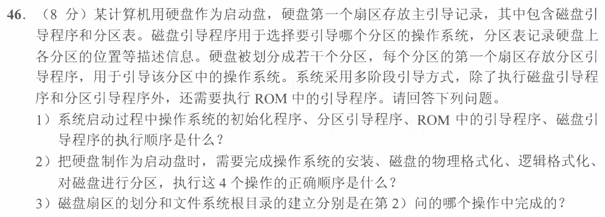

### 02 · 2022-44
> *FAT 文件系统目录项与簇号链式追踪，把簇号转为物理扇区号，画出 FAT 表推演链路。*
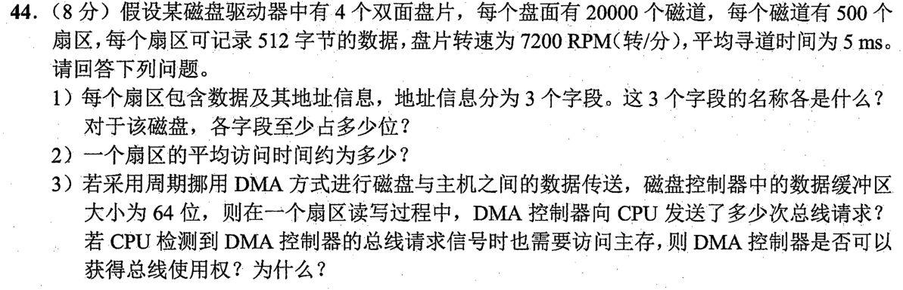

### 03 · 2022-45
> *RAID 跨条带读写开销与校验块重构，算准一次局部小写操作需要几次读和几次写。*
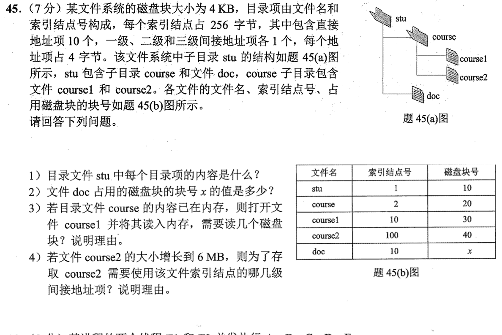

### 04 · 2026-46
> *UNIX inode 多级寻址计算。结合 5 个直接项、一次/二次/三次间接项，计算偏移地址所需访问的磁盘块号，并推演目录删除操作的元数据变更。*
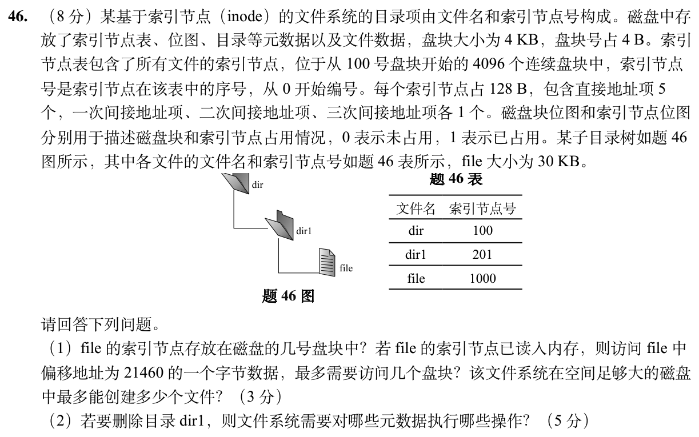

## 暂缓题目

以下题目仅暂时不处理；完整题目条目保留在 Markdown 源文件的 HTML 注释内，预览不显示题目。

<!-- 暂缓题：2011-46；暂时不处理，未删除。
### 01 · 2011-46
> *一次性写入文件系统，对比连续、链式、索引优缺点并给出 FCB 字段设计，考的是基本功，踩点给分。*
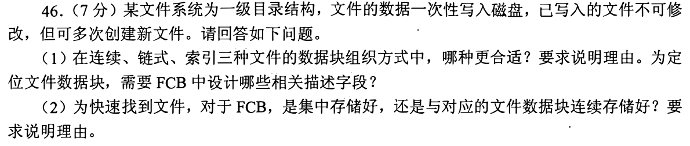
-->

<!-- 暂缓题：2012-46；暂时不处理，未删除。
### 02 · 2012-46
> *4TB 存储空间配合直接索引，磁盘块大小 1KB，直接用块数乘块大小算出最大文件容量，算术题稳稳拿下。*
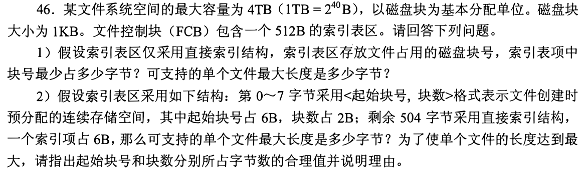
-->

<!-- 暂缓题：2014-46；暂时不处理，未删除。
### 03 · 2014-46
> *记录插入在连续分配、隐式链接和索引结构下的读写 I/O 次数对比，把移动记录的盘块数列出即出答案。*
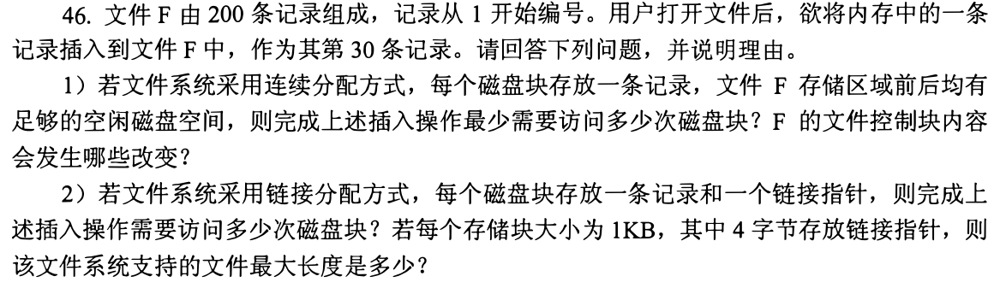
-->

<!-- 暂缓题：2010-45；暂时不处理，未删除。
### 05 · 2010-45
> *CSCAN 循环扫描与位图空间结合，算准 6000rpm 下磁盘转一圈的时间与空闲块位图所占内存，综合度极高。*
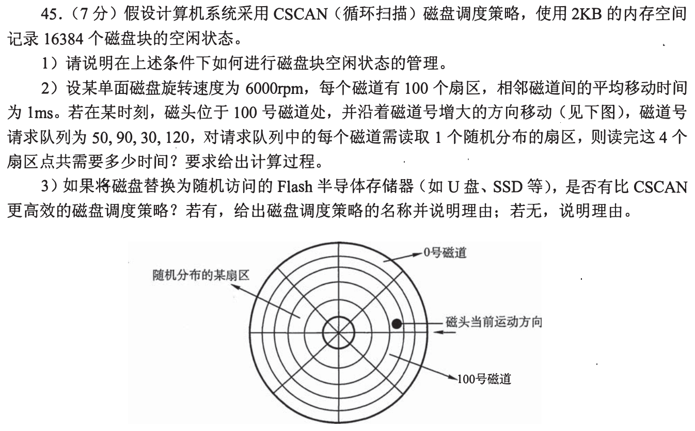
-->

<!-- 暂缓题：2016-47；暂时不处理，未删除。
### 06 · 2016-47
> *磁盘扇区连续读取优化：算准处理一个扇区期间磁头已经转过了几个物理扇区，推导出最佳交替编号间距。*
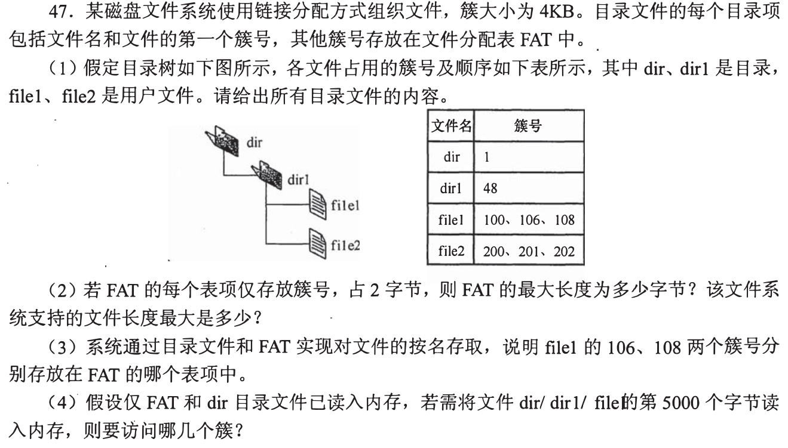
-->

<!-- 暂缓题：2018-46；暂时不处理，未删除。
### 07 · 2018-46
> *从根目录一路向下解析绝对路径，分清目录文件占几个盘块、文件 inode 在哪，算准每一次跨盘 I/O。*
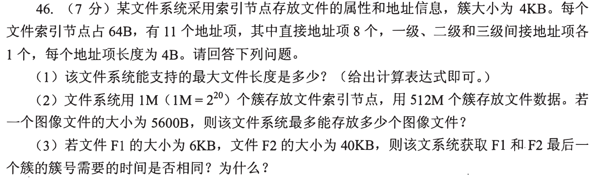
-->

<!-- 暂缓题：2019-44；暂时不处理，未删除。
### 08 · 2019-44
> *磁盘坏块管理机制：备用扇区重映射与磁道备用扇区跳转，注意重映射后引起的额外旋转等待。*
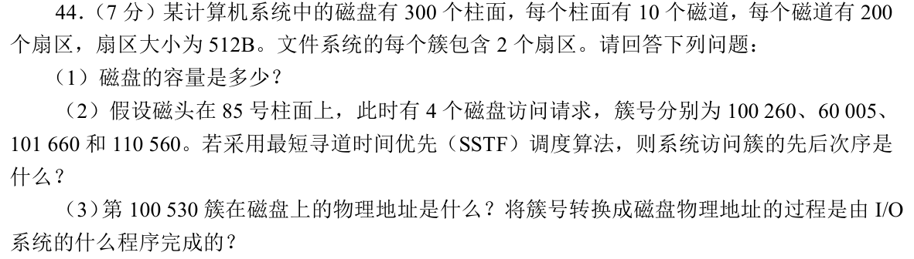
-->
