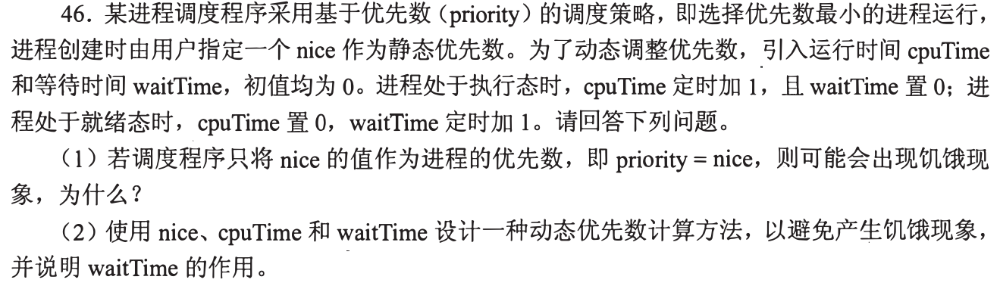
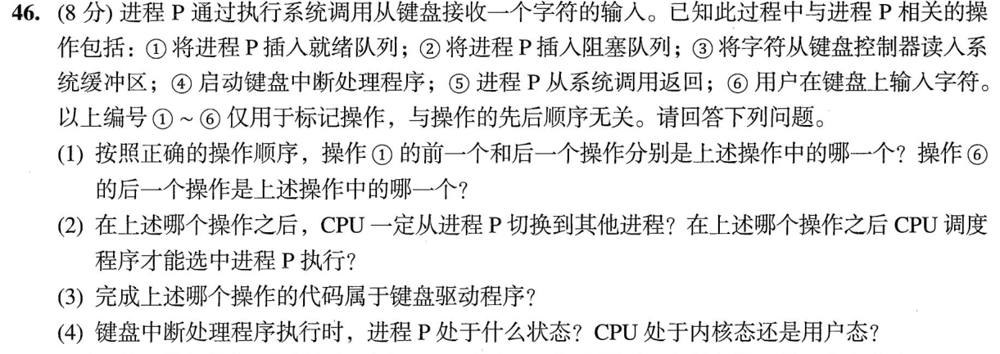
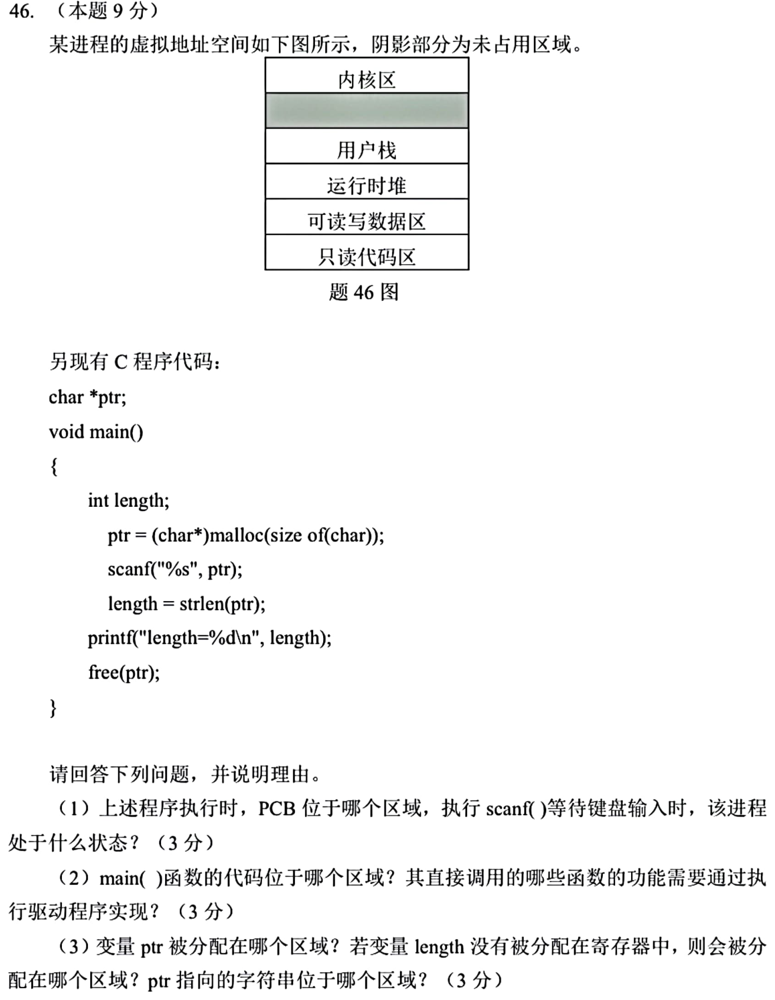
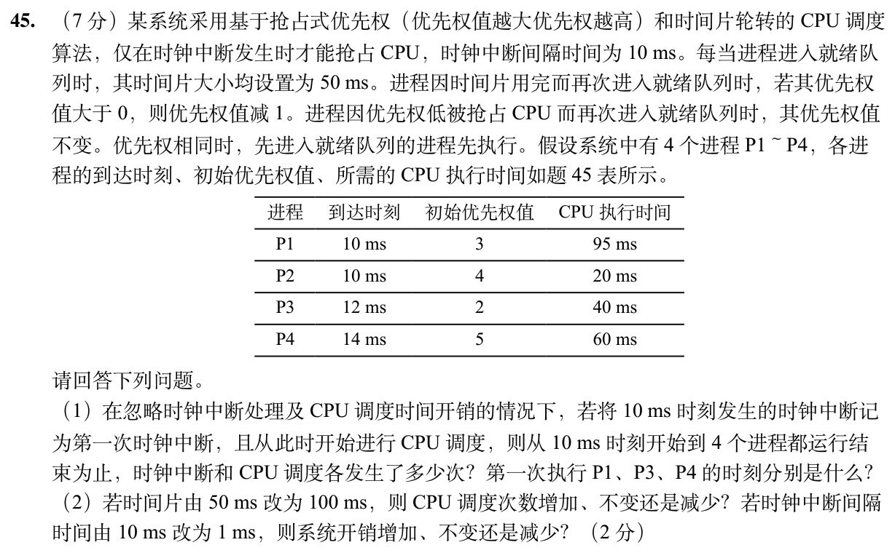

# 0928｜进程生命线：调度、输入与用户—内核边界

> 这组题直接分成两截：
> 前面是**快速拿分题**，经典 CPU 调度甘特图与周转时间，看清到达次序 10 分钟稳稳拿满；
> 后面是**耗时攻坚题**，管道阻塞条件交互、时钟中断离散触发抢占与深层内核边界，小心父子进程管道端点死锁。

---

## 一、 快速拿分题（甘特图推演，套路明确）

### 01 · 2016-46
> *先来先服务、短作业优先与时间片轮转周转时间计算，草稿纸画好甘特图，算准等待时刻，基本盘全收。*

---

## 二、 耗时攻坚题（时钟中断离散抢占与管道死锁，细致推导）

### 02 · 2023-46
> *管道通信大题：fork 产生多进程读写共享管道，盯紧每个进程的读端写端有没有关闭，只有全部写端关掉读端才读到 EOF，极易漏关死等。*

### 03 · 2025-46
> *操作系统内核与用户态交界综合大题，时钟中断、系统调用和进程上下文切换交织在一起，理清特权级跳变与中断屏蔽。*

### 04 · 2026-45
> *时间片轮转（RR）调度过程推演。结合时钟中断触发时机，沿时间轴列出就绪队列变迁，计算各进程首次响应时间与总调度次数。*

