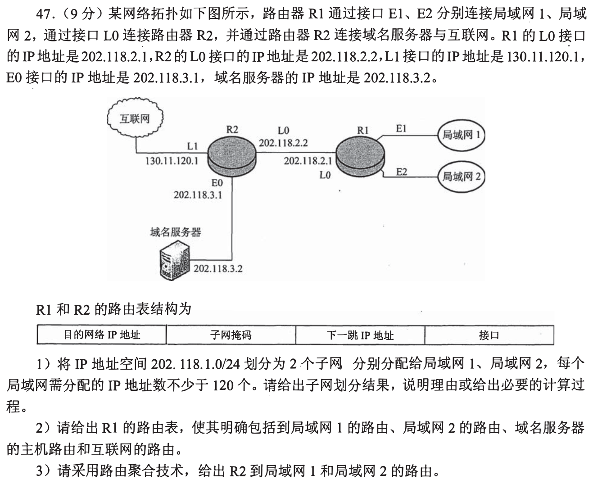
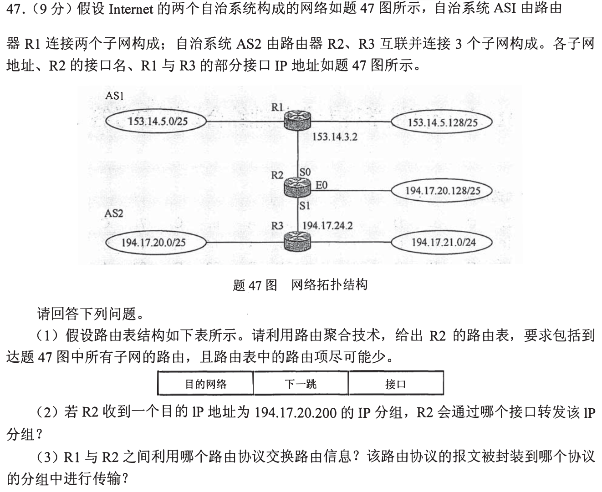
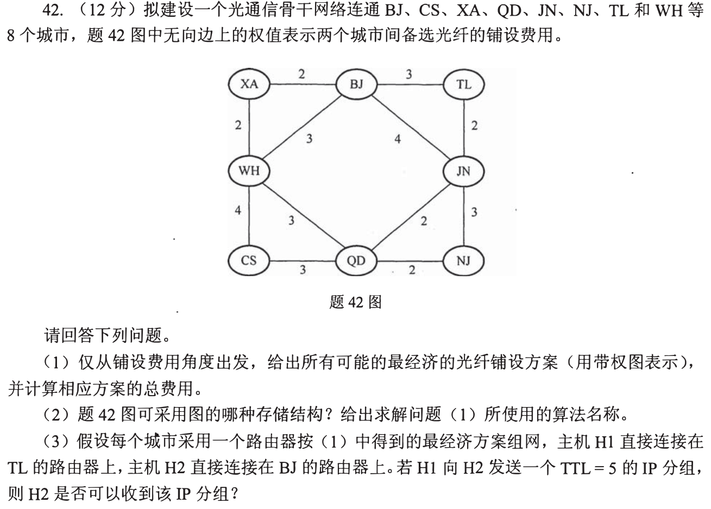
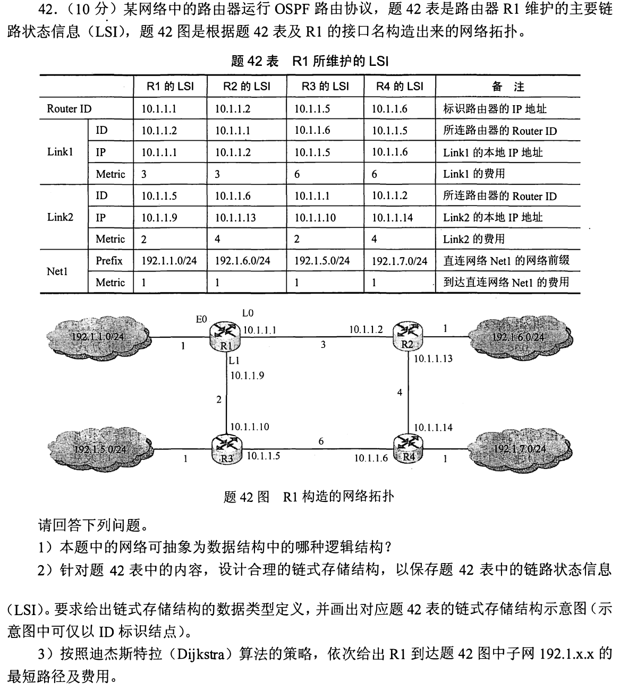
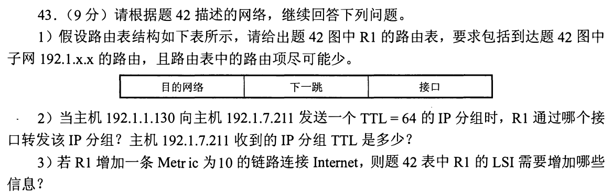
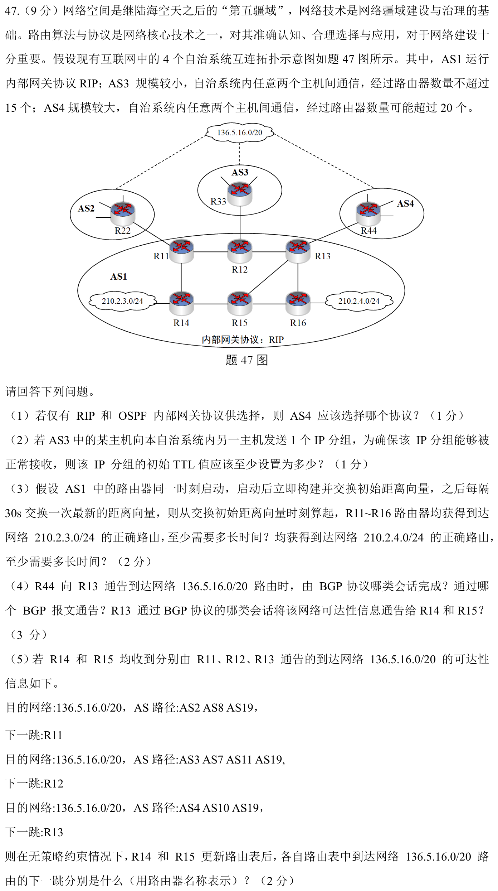

# 0929｜寻址与路由：从前缀匹配到路由协议收敛

> 这组题直接分成两截：
> 前面是**快速拿分题**，子网掩码划分与路由表默认下一跳，看清拓扑直接填，分步拿稳基础分；
> 后面是**耗时攻坚题**，OSPF 链路状态数据库反推拓扑、跨自治系统路由协议混合互联，理清细节绝不陷在死角空耗时间。

---

## 一、 快速拿分题（稳稳收下）

### 01 · 2009-47
> *三路由器互联局域网规划：为接口和子网分配可聚合 CIDR 地址，写出默认路由与静态路由项，送分大题稳稳拿下。*

### 02 · 2013-47
> *跨自治系统拓扑：划分 CIDR 子网地址空间，写出路由器接口 IP 与路由表下一跳，按部就班分步得分。*

### 03 · 2018-42
> *骨干网建设与路由规划：最小生成树铺设光纤，结合 IP 前缀分配计算路由汇聚，两问相互独立，算清权值。*

---

## 二、 耗时攻坚题（理清拓扑，分步写全保底）

### 04 · 2014-42
> *OSPF 链路状态数据库（LSI）反推网络拓扑：根据路由器维护的 Router LSA 和 Network LSA，还原出三台路由器与子网的完整物理拓扑。*

### 05 · 2014-43
> *基于 OSPF 拓扑构建路由表与转发追踪：路由聚合精简路由表项，追踪 TTL 递减与首部校验和重新计算过程，细节多需步步验算。*

### 06 · 2024-47
> *多自治系统混合互联大题：结合跳数限制与网络规模为 AS 选择最佳 IGP，分析跨 AS 路由宣告与路由环路预防。*

