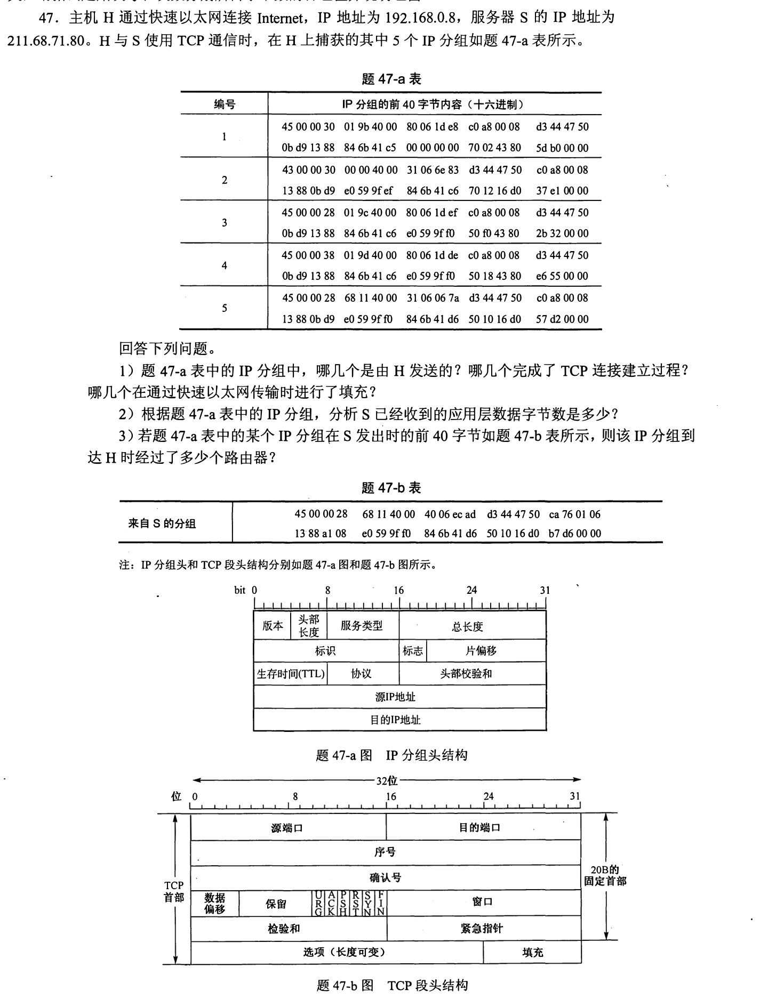
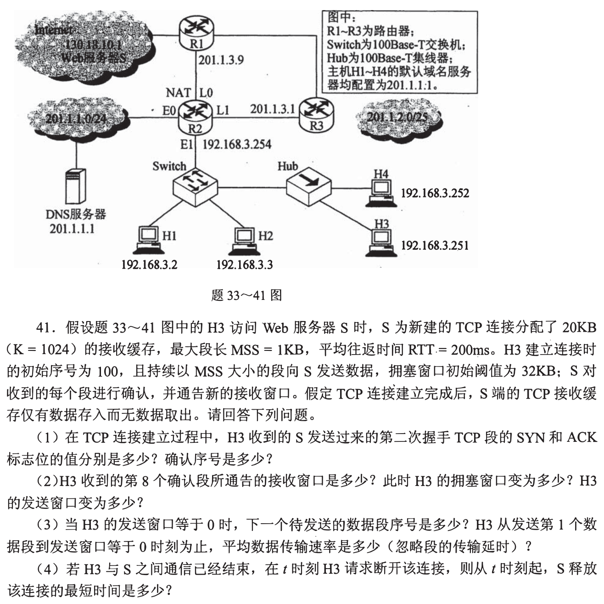
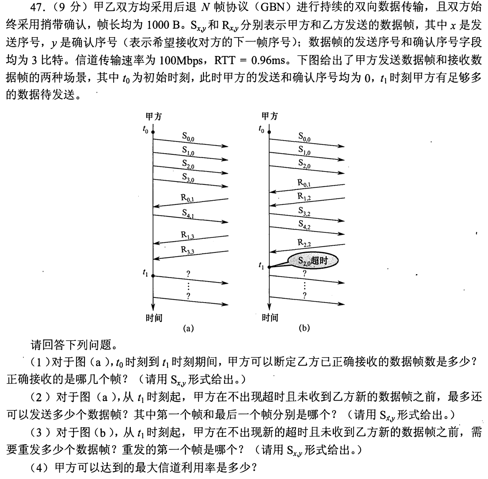
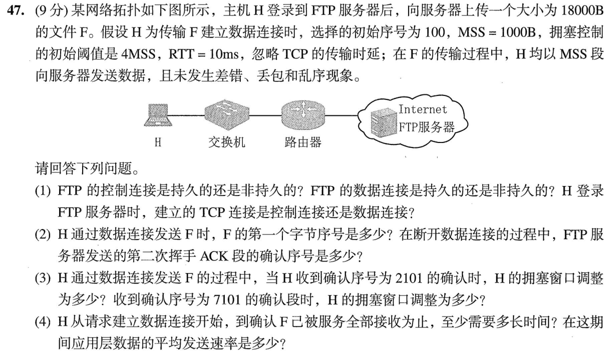
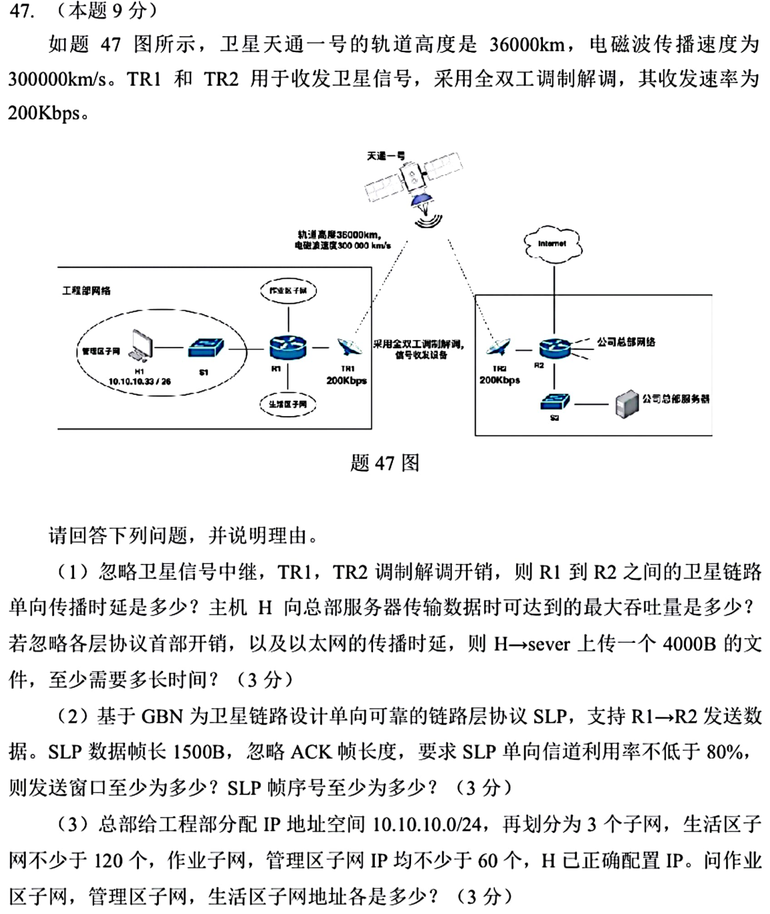

# 0930｜传输窗口：序号空间、确认与超时共同推进

> 这组题直接分成两截：
> 前面是**快速拿分题**，从抓包表直接读序号确认号、判断连接建立与释放状态，按规则直接提取；
> 后面是**耗时攻坚题**，拥塞窗口翻倍与线性递增、卫星高延迟信道吞吐量推演，画准往返时延表格防止算错一轮。

---

## 一、 快速拿分题（稳稳收下）

### 01 · 2012-47
> *分析 Wireshark 抓包报文段：看清 SYN/ACK 标志位、推算三次握手过程与双方初始序号，提取接收窗口大小，标准送分大题。*

### 02 · 2016-41
> *综合拓扑下的 TCP 握手与首部字段：指出三次握手报文类型，计算应用层数据传输时的序号与确认号增长，看清两端匹配。*

### 03 · 2017-47
> *GBN 持续双向捎带确认时序大题：画清双方发送序号 $S_x$ 和确认序号 $R_y$ 推进轨迹，求极限吞吐率与信道利用率。*

---

## 二、 耗时攻坚题（画准往返表格，列表逐轮推导）

### 04 · 2023-47
> *FTP 上传大文件 TCP 拥塞控制全流程推演：从慢开始、拥塞避免到接收窗口限制，列表格逐轮写清每个 RTT 内发送的段数与确认序号。*

### 05 · 2025-47
> *天通一号卫星高延迟信道 TCP 传输大题：传播时延高达数百毫秒，算准时延带宽积，推导慢开始阶段窗口增长与实际吞吐率瓶颈。*

### 06 · 2026-47
<!-- 2026 压轴题位，已在 paper_html/408-2026.html 就绪 -->
