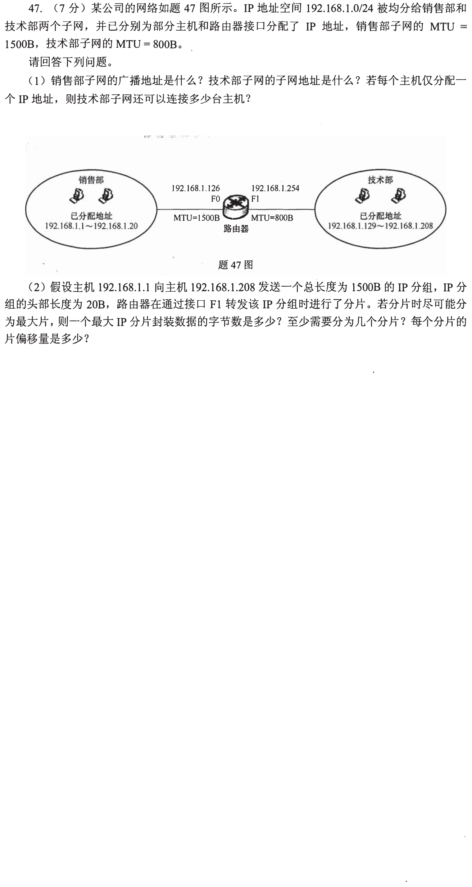
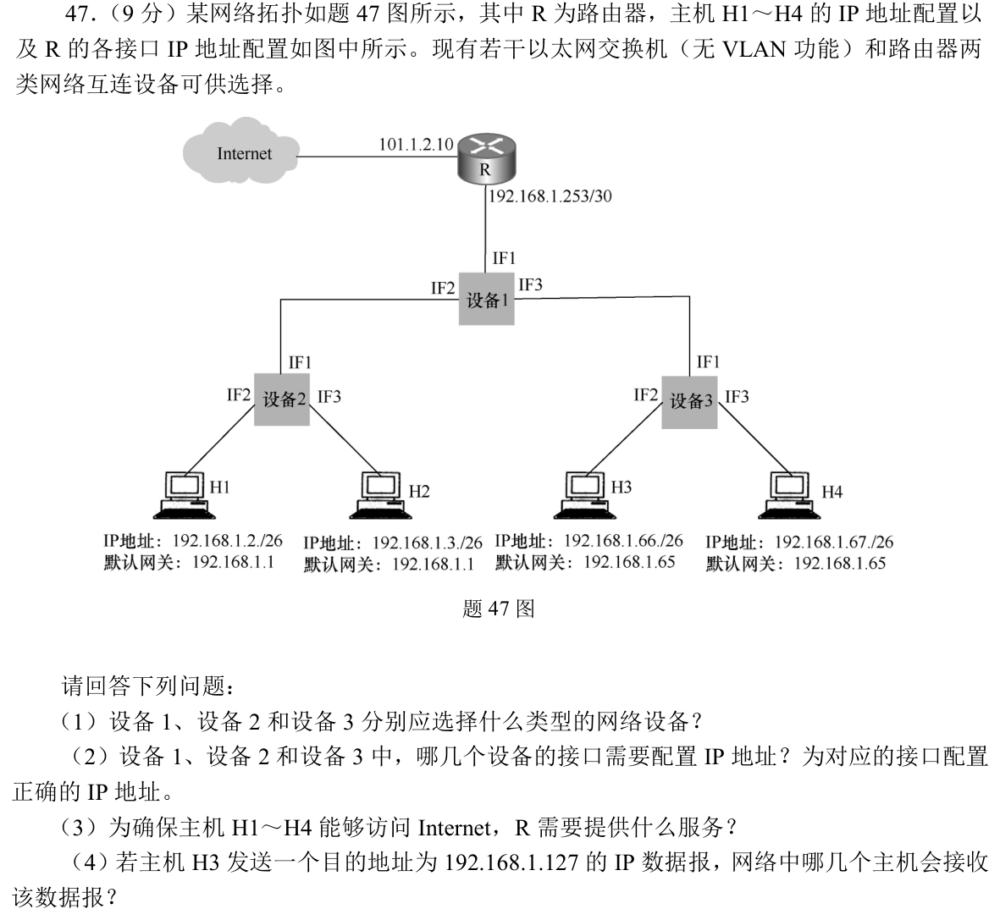
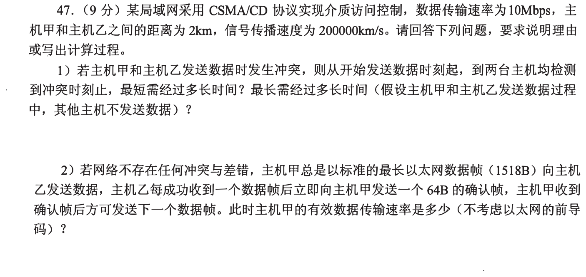
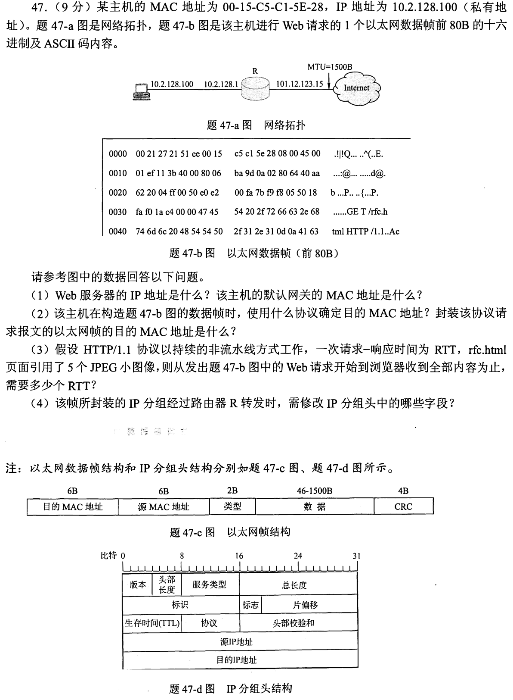

# 1001｜链路与局域网：竞争、封装、交换和跨网转发

> 这组题直接分成两截：
> 前面是**快速拿分题**，子网划分与广播地址、冲突域与设备选型，看清题目设问直接写；
> 后面是**耗时攻坚题**，CSMA/CD 最短最长冲突时间计算、十六进制以太网帧结构反查，逐字节对齐协议头别看走眼。

---

## 一、 快速拿分题（稳稳收下）

### 01 · 2018-47
> *公司销售部与技术部子网规划：均分 /24 地址空间，直接算出广播地址与可用主机数，根据 MTU 判定是否需要分片，送分题稳稳收下。*

### 02 · 2019-47
> *网络互连设备选型大题：根据各主机 IP 和网段划分，分析哪些接口直连需要交换机、哪些需要路由器，判断默认网关和路由表项。*

---

## 二、 耗时攻坚题（理清时延，对齐十六进制）

### 03 · 2010-47
> *CSMA/CD 争用期与冲突检测时间计算：两主机相距 2km，推导检测到冲突的最短时间与最长时间，并计算带确认帧时的有效数据传输速率。*

### 04 · 2011-47
> *以太网数据帧 16 进制转储逆向解析：逐字节拆解以太网目的 MAC、源 MAC、类型字段，再解析 IP 首部源目 IP 及 TCP 端口号。*

