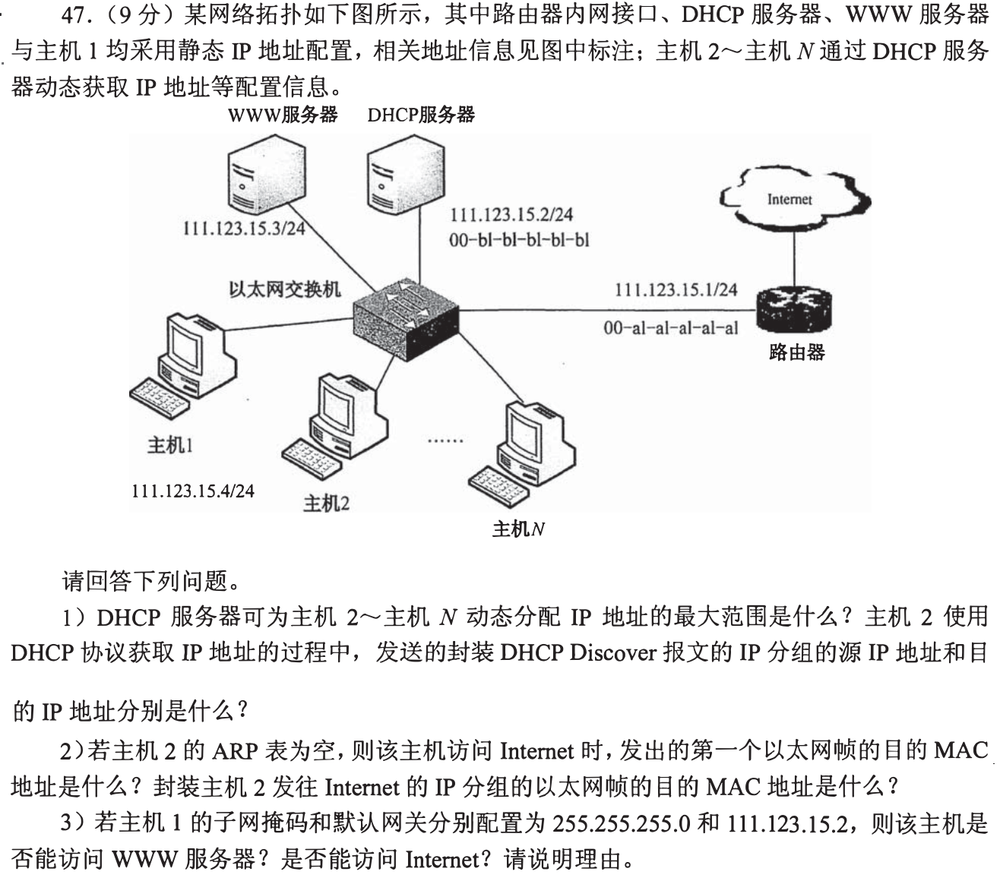
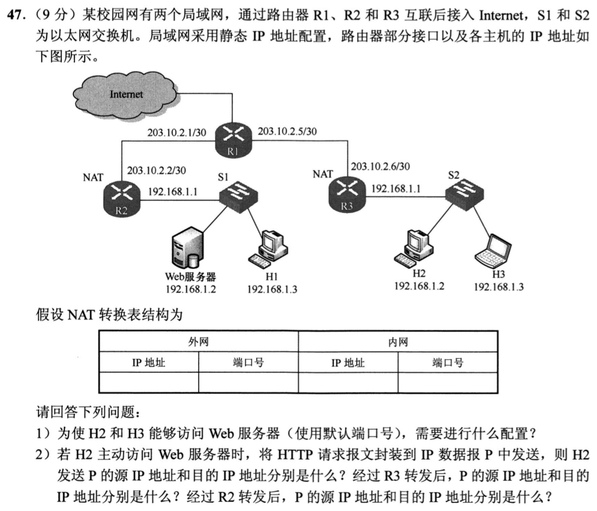
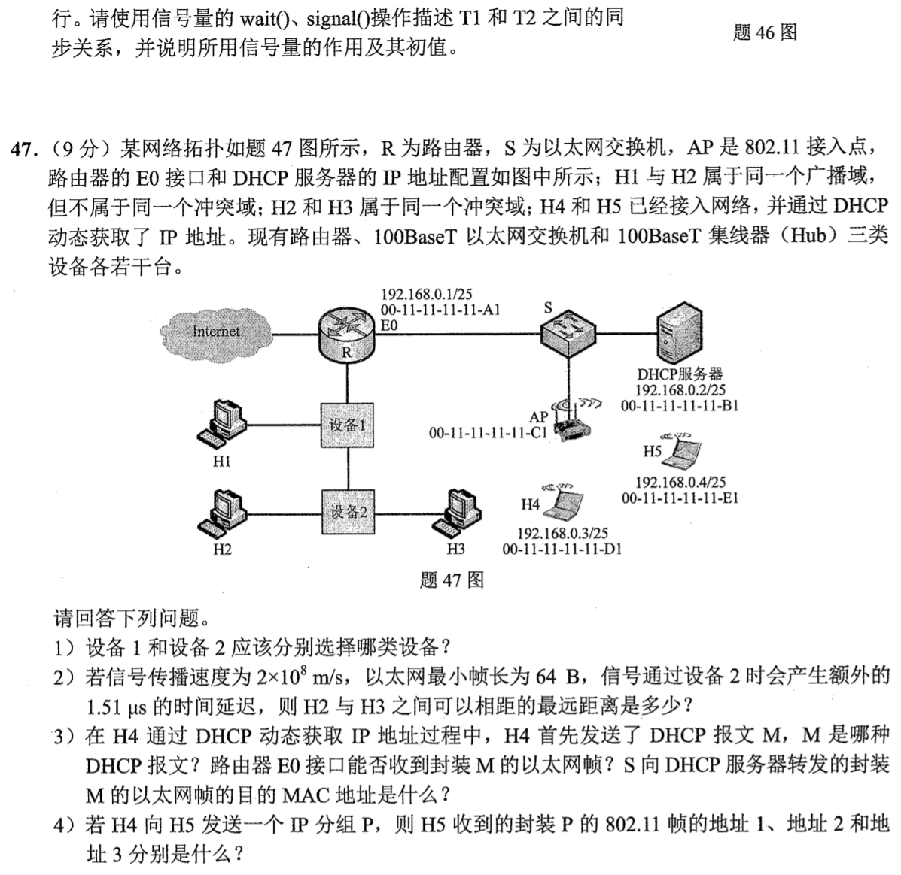

# 1002｜网络服务：配置、地址转换与应用会话

> 这组题直接分成两截：
> 前面是**快速拿分题**，看清拓扑图直接读 IP 地址、网关配置与 DHCP 报文角色，稳稳收下大头分；
> 后面是**耗时攻坚题**，主机开机从无到有的全流程状态机（DHCP -> ARP -> DNS -> TCP -> HTTP），理顺时序绝不遗漏关键协议。

---

## 一、 快速拿分题（稳稳收下）

### 01 · 2015-47
> *局域网接入与 DHCP 动态分配：写出 DHCP Discover 报文的源目 IP 与 MAC，指出 DHCP 提供的网关及 DNS 地址，基础套用。*

### 02 · 2020-47
> *校园网两局域网通过多路由器互联：根据 NAT 路由器接口分配私网与公网地址，写出 NAT 转换表项及各路由器下一跳。*

---

## 二、 耗时攻坚题（理顺端到端时序，补齐沿途状态）

### 03 · 2021-47
> *主机开机访问 Web 站点的全流程追踪：ARP 表与交换机转发表均为空，写出从点击链接到显示网页沿途发出的所有报文名称与目的 MAC。*

### 04 · 2022-47
> *无线 AP 与有线交换机混合拓扑综合大题：区分冲突域与广播域，推演 DHCP 租约获取过程与跨路由器跨 AP 转发时的帧封装变化。*

