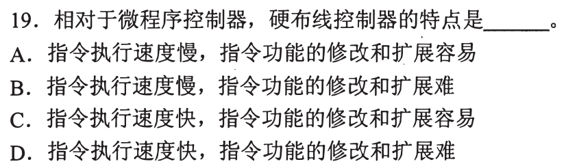
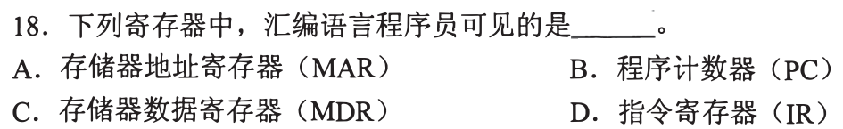
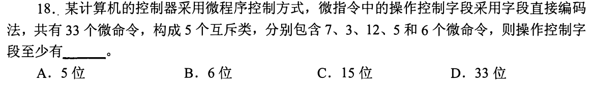
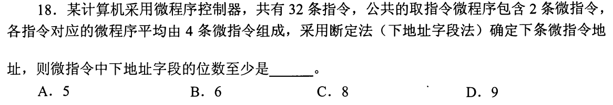
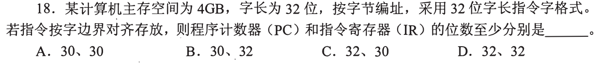
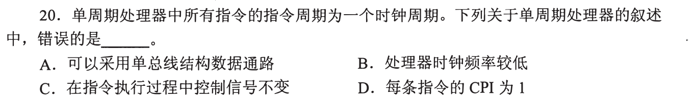
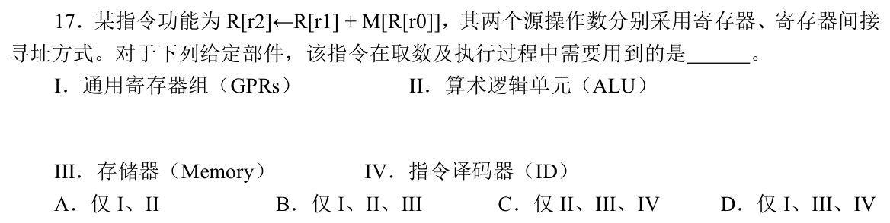
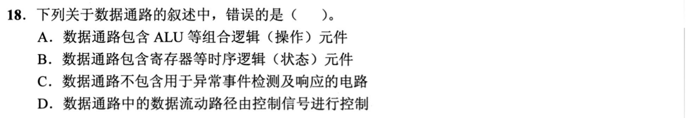
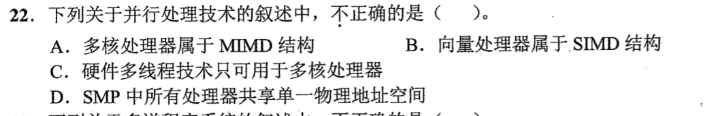
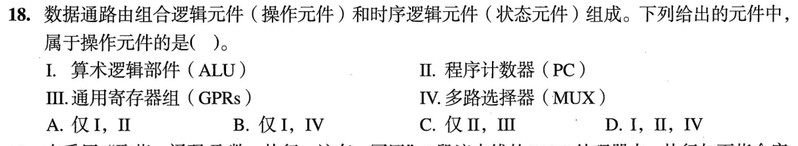

[« 0818-answer-sonnet](0818-answer-sonnet.md)　　[0820-answer-sonnet »](0820-answer-sonnet.md)

# 0819 Answer｜数据通路：状态元件、操作元件与控制信号

> [原题 12 题](../0819.md) · [0818 程序层级 · 0818-answer-sonnet](0818-answer-sonnet.md) · [能力账本](../answer-quality/learning-ledger.md)

**进入本篇时已有**：硬连线与微程序是两种控制器（0818-01）；“可见”＝有指令能指名它或语义依赖它（0818-02）；ISA 与实现的判据（0818-10）；字段位数由取值个数定（0817-05）；EA 与操作数分两步（0817-04）。
**读完新增**：01 控制信号的两条产生路径 · 02 无新台阶 · 03 指令周期必含取指 · 04 字段直接编码按互斥类分字段 · 05 下地址字段要编遍控存全部微指令 · 06 PC 位数由指令位置数定 · 07 单周期一拍内总线只载一个值 · 08 把一条指令的数据流映射到部件 · 09 数据通路＝操作元件＋状态元件（最小形式） · 10 硬件多线程＝一核多套线程状态 · 11 MUX 也是操作元件 · 12 通用寄存器组由指令字段选

<details><summary>速览</summary>

| # | 新增台阶 | 起手 | 最易错 → 先看什么 |
|---|---|---|---|
| [01](#q01) | 信号产生路径 | 写两条链：操作码→…→信号 | 把“易改”给硬连线 → 看链中有无读控存 |
| [02](#q02) | 无 | 每项问“哪条指令能指名它” | 在 CPU 里就可见 → 有无指令能指名 |
| [03](#q03) | 指令周期含取指 | 写一条 NOP 的取指/译码/执行 | “空操作”＝什么都不变 → 取指已动 PC |
| [04](#q04) | 互斥类各占一字段 | 逐类算⌈log₂n⌉ | 对 33 取一次对数 → “互斥类”意味着类间并行 |
| [05](#q05) | 微地址空间＝微指令总数 | 先数微指令条数 | 对 32 条指令取对数 → 要编的是微指令 |
| [06](#q06) | PC 位数＝指令位置数 | 写 2³²÷4 | PC、IR 同宽 → IR 要装整条指令 |
| [07](#q07) | 单总线一拍一值 | 逐拍写 add 的搬运 | 把 CPI=1 当频率高 → B、D 是两回事 |
| [08](#q08) | 数据流→部件 | 画读 r0、读 M、加、写 r2 的箭头 | 漏掉间接寻址的读存储器 → 看“寄存器间接” |
| [09](#q09) | 两类元件 | 给三条定义各找对应元件类 | 凭“控制器管一切”选 C → 看检测电路属哪类 |
| [10](#q10) | 一核多线程状态 | 问“一个核能否放两套 PC 与寄存器” | 把多线程等同多核 → 看是否需要第二个核 |
| [11](#q11) | MUX 归类 | 问“输出是否只由当前输入定” | MUX 不运算所以是状态 → 看有无存储 |
| [12](#q12) | GPR 由字段选 | 问“哪个字段能选出它” | “PC 在 CPU 里”→“在 GPR 里” → 看谁驱动它 |

**反复信号**：题面带“一定/只可/不包含/应该”时，找一个真实部件或情形核对（03、09、10、12）；控制信号从哪来（01、07、12）。
</details>

<a id="q01"></a>
## 01｜控制信号的两条产生路径



**新增**：硬连线与微程序的差别落在“信号怎么产生”。**起手**：写两条链。**答案：D**

```
硬连线：操作码 → 译码与时序电路 → 控制信号
微程序：操作码 → 微地址 → 读控制存储器 → 微指令（内含各微命令）→ 控制信号
```

微指令是控制存储器里的一个字，其中的微命令就是一个控制信号的开/关。微程序多出“读存储器”一步，慢，但改功能只改存储内容；硬连线由门电路直接给出，快，但改功能要改电路。

| 选项 | 与题面（硬连线 vs 微程序）不符之处 |
|---|---|
| A 慢、易 | 两项都是微程序的特点 |
| B 慢、难 | “慢”错：硬连线链里没有读控存 |
| C 快、易 | “易”错：逻辑固定在电路里 |
| D 快、难 | 两项都对 |

<a id="q02"></a>
## 02｜无新台阶：回链 0818-02



与 [0818-02 · 0818-answer-sonnet](0818-answer-sonnet.md#q02) 同题，只调用旧判据。**起手**：每项问“哪条汇编指令能指名它或依赖它”。**答案：B**

- PC：转移指令改写它，相对寻址以它为基准。可见。
- MAR、MDR、IR：只在取指、访存的内部通路上暂存，没有指令能指名。不可见。

<a id="q03"></a>
## 03｜指令周期必含取指


**新增**：任何指令（含 NOP）的指令周期都以取指开头。**起手**：写一条 NOP 的周期。题问**错误**项。**答案：C**

```
取指：MAR←PC，读内存，IR←这条 NOP，PC 指向下一条
译码：识别为空操作
执行：无动作
结束：开中断时，此处可响应外部中断请求
```

| 选项 | 依据 | 判断 |
|---|---|---|
| A 至少访存一次 | 取指就是一次访存；无 Cache、无预取，指令只能来自内存 | 对 |
| B ≥ 一个时钟周期 | 取指本身至少占一拍 | 对 |
| C 任何寄存器都不变 | 上面第一行：PC、IR 已变 | **错** |
| D 每条指令结束都可能被中断 | 题设“开中断”，指令结束处可响应（中断过程本题不展开） | 对 |

<a id="q04"></a>
## 04｜字段直接编码：每个互斥类一个字段



**新增**：字段直接编码＝同一互斥类的微命令共用一个字段，一次只选一个；类与类之间可同时发令。**起手**：逐类用 0817-05 的位数规则。**答案：C**

| 类内命令数 | 7 | 3 | 12 | 5 | 6 |
|---|---|---|---|---|---|
| ⌈log₂n⌉ | 3 | 2 | 4 | 3 | 3 |

合计 3+2+4+3+3＝15。若每类再留一个“不发令”码（8、4、13、6、7 种），位数仍是 3、2、4、3、3，结果不变。

| 选项 | 与题面不符 |
|---|---|
| A 5 位 | 至多 32 种取值，而 5 类各自要区分 7、3、12、5、6 种 |
| B 6 位 | ⌈log₂33⌉：一个字段只能选一个命令，等于把 5 类并成一类，丢掉“类间并行” |
| D 33 位 | 每个命令一位，是不分类的直接表示，不是题设的字段直接编码 |

<a id="q05"></a>
## 05｜下地址字段要能编遍控存里的每条微指令



**新增**：断定法里，下地址字段给出的是微指令的地址，所以位数＝⌈log₂ 微指令总条数⌉。**起手**：先数条数。**答案：C**

```
32 条指令 × 平均 4 条 = 128
+ 公共取指 2 条（只存一份，加一次）= 130
```

| 位数 | 5 | 6 | 7 | 8 | 9 |
|---|---|---|---|---|---|
| 可编号数 | 32 | 64 | 128 | 256 | 512 |
| ≥130？ | 否 | 否 | 否（差 2） | 是，最少 | 是，但不是最少 |

A 是对 32 条指令取对数，要编号的却是微指令。读法：题面只给“平均 4 条”，按平均数得总量 130，没有其他可用数据。

<a id="q06"></a>
## 06｜PC 位数由指令位置数定，IR 要装整条指令



**新增**：PC 要区分的是“指令可能所在的位置”，不一定是全部字节地址。**起手**：写 2³² ÷ 4。**答案：B**

```
4GB = 2³² 字节，按字节编址
指令 4 字节、按字边界对齐 → 首地址低 2 位恒为 00
指令位置数 = 2³² / 4 = 2³⁰ → PC 至少 30 位
IR 装一条完整指令 → 32 位
```

选项只剩 B：A、C 的 IR 或 PC 与上面不符，D 是 PC 存完整字节地址的实现。读法：题问“至少”并特意给出“按字边界对齐”，所以取可省去低 2 位的读法；不对齐时 PC 必须 32 位。

<a id="q07"></a>
## 07｜单周期：一拍内总线只载一个值



**新增**：单总线每拍只能载一个值，所以一条指令需要多拍；单周期要求一拍做完。**起手**：在单总线上逐拍写 `add R3,R1,R2`。题问**错误**项。**答案：A**

```
拍1：R1 → 总线 → 暂存器 A
拍2：R2 → 总线 → ALU 另一输入，A 与之相加，结果入暂存器 Z
拍3：Z  → 总线 → R3
```

两个源操作数就不能同拍上总线。而题设所有指令周期都是一个时钟周期。

| 选项 | 依据 |
|---|---|
| B 频率较低 | 一拍要装下最慢指令的整条路径，周期长，频率低 |
| C 执行中控制信号不变 | 只有一拍，没有“下一拍”可换信号；信号由操作码译出后全程保持（教材读法） |
| D CPI 为 1 | 题面直接给出：每条指令一个时钟周期 |

B 与 D 不能互推：CPI 数每条指令的周期数，频率数每秒的周期数。

<a id="q08"></a>
## 08｜把一条指令的数据流映射到部件



**新增**：每个箭头对应一个部件。**起手**：沿 0817-04 的“先算 EA、再取数”画箭头。**答案：B**

```
R[r0] --读GPR--> 作为地址 --读Memory--> M[R[r0]]
R[r1] --读GPR--> ┐
M[R[r0]]         ┴--> ALU 相加 --写GPR--> R[r2]
```

| 部件 | 在哪一步 |
|---|---|
| I GPRs | 读 r0、r1，写 r2 |
| II ALU | 相加 |
| III Memory | 第二源操作数是寄存器间接，要读存储器 |
| IV 译码器 | 在取数之前识别指令；题问“取数及执行”，把它另列为一项 |

IV 的排除取这一读法。印证：选项里没有 I–IV 全选，C 缺 GPR（数据从哪来）、D 缺 ALU（加法在哪做），都不成立，只剩 B。

<a id="q09"></a>
## 09｜数据通路由操作元件和状态元件组成



**新增**（本篇首次出现，最小形式）：

- **操作元件**：组合逻辑，输出只由当前输入定（如 ALU）；
- **状态元件**：时序逻辑，在时钟沿保存值（如寄存器）；
- 数据通路＝这两类元件加连线，数据走哪条路由控制信号选。

**起手**：给 A、B、D 各找一条上面的对应。题问**错误**项。**答案：C**

A 对应操作元件，B 对应状态元件，D 对应控制信号选路。C 的“不包含”没有题面里的判据可验，采用教材读法：ALU 产生溢出等标志，这类检测电路属数据通路，控制器据此响应。

<a id="q10"></a>
## 10｜硬件多线程＝一个核里放多套线程状态



**新增**：线程状态（PC、寄存器堆）可在核内复制。**起手**：问“一个核里能不能放两套 PC 和寄存器”。题问**不正确**项。**答案：C**

| 选项 | 依据 |
|---|---|
| A 多核属 MIMD | 多个核各跑自己的指令流、处理自己的数据 |
| B 向量属 SIMD | 一条指令作用于多份数据 |
| C 只可用于多核 | 核内复制线程状态，在线程间切换或交错发射，不需要第二个核。**错** |
| D SMP 共享单一物理地址空间 | SMP 的定义 |

A、B、D 是分类与定义的记忆项，不需要推导；多线程与多核是两个维度。

<a id="q11"></a>
## 11｜把具体部件归类：MUX 是操作元件



**新增**：用 09 的两类定义判断具体部件，其中 MUX 不运算也算操作元件。**起手**：对每个部件问“输出是否只由当前输入定”。**答案：B**

| 部件 | 判断 |
|---|---|
| I ALU | 是，操作元件 |
| II PC | 否，保存取指地址，状态元件 |
| III GPRs | 否，保存寄存器值，状态元件 |
| IV MUX | 是：按选择信号把一路输入接到输出，没有存储 |

A、D 把 PC 当操作元件；C 两项都是状态元件。

<a id="q12"></a>
## 12｜通用寄存器组由指令字段选


**新增**：GPR 组是指令里的寄存器字段（0817-05）能选出的那组寄存器。题问**错误**项。**答案：A**

| 选项 | 依据 | 判断 |
|---|---|---|
| A GPR 组应含 PC | PC 由取指逻辑推进、由转移指令改写（0818-02），不是靠寄存器号字段选出的条目 | **错** |
| B 控制器一定有操作码译码 | 两种控制器都从操作码出发（01 的两条链第一步） | 对 |
| C 单周期控制器更简单 | 单周期信号由操作码译出后全程保持（07）；多周期要按拍变化 | 对 |
| D 流水线要解决数据、控制冒险 | 题面当作事实，本题不判断冒险机制 | 对 |

A 的读法：题面用“应该”，按教材通用寄存器组处理。个别 ISA（如 ARM）把 PC 编为 R15，属特例，题面不支持。

[« 0818-answer-sonnet](0818-answer-sonnet.md)　　[0820-answer-sonnet »](0820-answer-sonnet.md)
