[« 0821-answer-sonnet](0821-answer-sonnet.md)　　[0823-answer-sonnet »](0823-answer-sonnet.md)

# 0822 Answer｜传输时间：宽度、频率、事务与瓶颈

> [原题 18 题](../0822.md) · [0821 性能方程 · 0821-answer-sonnet](0821-answer-sonnet.md) · [能力账本](../answer-quality/learning-ledger.md)

**进入本篇时已有**：频率与周期互为倒数、周期数÷主频＝时间（0821-10）；单位换算与量级（0821-09）；MIPS、CPI 是性能指标名（0821-02）。总线本身从零开始。
**读完新增**：01 带宽＝字节÷所占时间 · 02 无计算台阶，总线标准名单 · 03 需求量＝像素×位深×帧频，按占比反推 · 04 三类线 · 05 突发：1 地址拍＋数据拍 · 06 串行 · 07 每拍多次 · 08 无新台阶 · 09 同步／异步／半同步与互锁 · 10 速度＝宽度×次数（分离事务最小讲） · 11 ×16＝16 条串行通道 · 12 无新台阶 · 13 通道数相乘 · 14 全双工 · 15 无新台阶 · 16 事务＝地址＋准备＋数据 · 17 峰值≠事务平均 · 18 无新台阶

<details><summary>速览</summary>

| # | 新增台阶 | 起手 | 最易错 → 先看什么 |
| --- | --- | --- | --- |
| [01](#q01) | 带宽＝字节÷所占时间 | 写 4B÷(2×时钟周期) | 10M×4B → “一个总线周期占 2 个时钟” |
| [02](#q02) | 总线标准名单 | 每组圈出非总线名 | 只验一组 → 每组都找非总线名 |
| [03](#q03) | 需求量与占比反推 | 写 1600×1200×24×85 | 把 50% 乘上去 → 需求是总量的一半，要除 |
| [04](#q04) | 三类线 | 列三类线各载什么 | “总线上出现过”＝“数据线上传” → 握手属控制 |
| [05](#q05) | 突发＝1 地址＋连续数据 | 画 `A D D D D` | 每个数据前都带地址 → 题面说支持突发 |
| [06](#q06) | 串行一次一位 | 逐条对 USB 命题找矛盾 | “串行＝慢” → 看描述是否与串行矛盾 |
| [07](#q07) | 每拍两次 | 66M×2×4B | 漏双沿 → 题干“每周期传两次” |
| [08](#q08) | 无新台阶 | 对照 05 的拍序列 | 选并行／同步 → 它们不描述“一个首址” |
| [09](#q09) | 同步／异步／半同步，互锁 | 画请求—应答箭头 | 同步时钟由各设备自供 → 同步要共同节拍 |
| [10](#q10) | 速度＝宽度×次数 | 写带宽式再代数 | “并行必更快” → “一定”无数值依据 |
| [11](#q11) | ×16＝16 条串行通道 | 写 16×(1 条 lane) | 线数多＝并行 → 每条 lane 仍串行 |
| [12](#q12) | 无新台阶 | 带宽式逐因子对应 I～IV | 把复用线算成提速 → 它只是分时共用线 |
| [13](#q13) | 通道数相乘 | 1333M×8B 再×3 | 通道数多乘一次 → 只乘一次 |
| [14](#q14) | 全双工双向各一份 | 把题干公式填数 | 单向 9.6 → 题问总线带宽 |
| [15](#q15) | 无新台阶 | 四个命题各对回前题 | “握手＝一位” → 握手对应一个传输单元 |
| [16](#q16) | 事务＝地址＋准备＋数据 | 32B÷8B＝4，写 1+6+1 | 地址只发一次 → 题面不支持突发 |
| [17](#q17) | 峰值≠事务平均 | 峰值与 64B÷7 拍各算一次 | 用 7 拍算 → 括号限定“最大数据传输率” |
| [18](#q18) | 无新台阶 | 1333M 次×8B | 再乘 4 → 1333 已是每秒次数 |

反复出现的信号：题问带宽→写 每次字节数×每秒次数（01、07、13、14、18）；题给“MHz”→先问是拍数还是次数（07、13、18）；“一定”→找合法反例（10、15）。

</details>

<a id="q01"></a>
## 01｜2009-20：带宽＝每次字节数 ÷ 一次所占时间

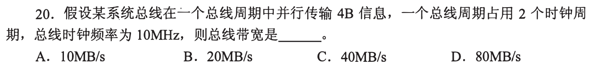

**新增**：一次传输（总线周期）不一定等于一个时钟周期。**起手**：`4B ÷ (2 × 时钟周期)` → **B，20MB/s**。

```
时钟周期 = 1/10MHz = 0.1μs
总线周期 = 2 × 0.1μs = 0.2μs   （一次传 4B）
带宽 = 4B ÷ 0.2μs = 20×10⁶ B/s
```

| 选项 | 算法 | 与题面 |
| --- | --- | --- |
| A 10MB/s | 每时钟周期 1B | 题面一个总线周期并行 4B |
| C 40MB/s | 10M×4B | 题面“占用 2 个时钟周期” |
| D 80MB/s | 40 再乘 2 | 2 个时钟让速度变慢，不是变快 |

<a id="q02"></a>
## 02｜2010-20：每组找一个非总线名

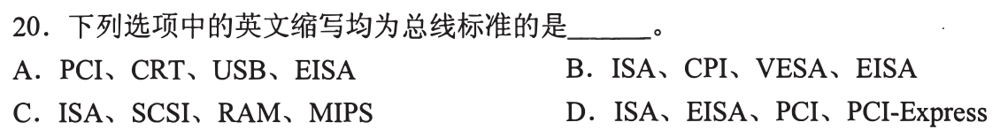

**新增**：无计算台阶，只是名单（记忆项）。**起手**：每组逐个圈出不是总线的名字 → **D**。

| 组 | 非总线名 | 它是什么 |
| --- | --- | --- |
| A | CRT | 显示器件 |
| B | CPI | 每条指令的时钟数（0821 的性能指标） |
| C | RAM、MIPS | 存储器；每秒百万条指令（0821-02 的指标） |
| D | 无 | ISA、EISA、PCI、PCI-Express 均是总线标准 |

其余组里的 PCI、USB、EISA、ISA、VESA、SCSI 也是总线／接口标准，错只错在混入的那一项。

<a id="q03"></a>
## 03｜2010-22：先算刷新所需量，再按占比反推总量

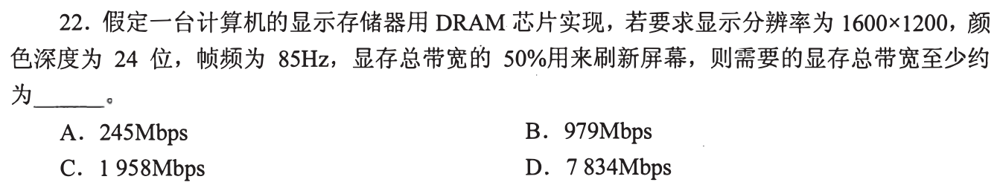

**新增**：带宽可由“每帧位数×每秒帧数”得出，且 50% 是刷新占总量的比例。**起手**：写 `1600×1200×24×85`。→ **D，7834Mbps**。

```
每帧 1600×1200 = 1,920,000 像素 × 24 位 = 46,080,000 bit
每秒 ×85 = 3,916,800,000 bit/s ≈ 3917 Mbps   （刷新所需）
刷新所需 = 0.5 × 总带宽  →  总带宽 ≥ 3916.8 ÷ 0.5 = 7833.6 ≈ 7834 Mbps
```

| 选项 | 与算式 |
| --- | --- |
| A 245 | 无对应步骤 |
| B 979 | ≈3917÷4，题面是除以 0.5 |
| C 1958 | ≈3917×0.5：把占比乘上去，总量反而比需求还小，刷新都供不上 |

<a id="q04"></a>
## 04｜2011-20：总线分地址线、数据线、控制线

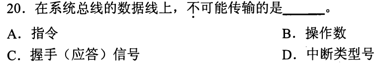

**新增**：三类线各载什么。**起手**：把四个选项各放进三类线 → **C**。

| 线 | 载什么 |
| --- | --- |
| 地址线 | 要访问的单元／设备地址 |
| 数据线 | 被传的内容：指令、操作数、中断类型号 |
| 控制线 | 读／写命令、握手（应答）、中断请求等 |

A、B、D 是“要传的内容”，走数据线；C 的握手（应答）是“是否准备好／收到”的状态，走控制线。

<a id="q05"></a>
## 05｜2012-19：突发——一个首地址，后接连续数据

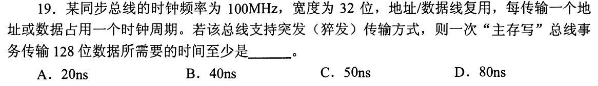

**新增**：一次事务的拍数＝地址拍＋数据拍；突发只发一次地址。**起手**：画拍序列。→ **C，50ns**。

```
拍：  1    2    3    4    5
      A    D    D    D    D        （A=首地址，D=一个 32 位数据）
128 位 ÷ 32 位 = 4 个数据拍；地址/数据线复用，地址占另一拍
5 拍 × 10ns（100MHz 的周期，0821-10 的倒数）= 50ns
```

| 选项 | 对应拍数 | 与题面 |
| --- | --- | --- |
| A 20ns | 2 拍 | 128 位至少 4 个数据拍 |
| B 40ns | 4 拍 | 少了地址拍（复用线，地址不与数据同拍） |
| D 80ns | 8 拍＝4×(地址＋数据) | 每个数据重发地址，是无突发的情形 |

<a id="q06"></a>
## 06｜2012-20：串行——一条线一次一位

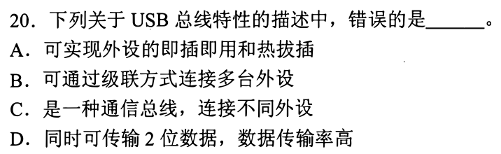

**新增**：并行＝多根线同拍各传一位（05 的 32 根复用线），串行＝一条通路一次一位，靠提高节拍求快。**起手**：对每条 USB 描述找与“通用串行总线”矛盾之处 → **D**。

| 选项 | 内容 | 判断 |
| --- | --- | --- |
| A | 即插即用、热插拔 | 题面无矛盾，是 USB 的特性 |
| B | 级联连接多台外设 | 无矛盾，可经集线器扩展 |
| C | 通信总线，连不同外设 | 无矛盾 |
| D | 同时传 2 位 | USB 是串行总线，一条通路一次一位；“数据率高”靠高频，不靠同时多位 |

<a id="q07"></a>
## 07｜2014-19：每拍传两次（双沿）

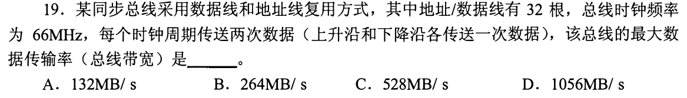

**新增**：每个时钟周期传 k 次时，每秒次数＝频率×k。**起手**：`66M × 2次/拍 × 4B`。→ **C，528MB/s**。

```
32 根线 = 32 位 = 4B/次
每秒次数 = 66×10⁶ × 2 = 132×10⁶
带宽 = 132×10⁶ × 4B = 528MB/s
```

题问“最大数据传输率”，按连续传数据的拍计，不含 05 的地址拍。

| 选项 | 算法 | 与题面 |
| --- | --- | --- |
| A 132 | 66×4÷2 | 把双沿反当成除以 2 |
| B 264 | 66×4 | 漏了“上升沿和下降沿各一次” |
| D 1056 | 66×2×4×2 | 多乘了一次 2 |

<a id="q08"></a>
## 08｜2014-20：无新台阶，命名 05 的拍序列

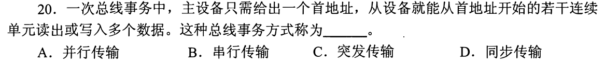

**起手**：把题干写成 05 的 `A D D D D`：只给一个首地址，之后连续多个数据 → **C，突发传输**。

| 选项 | 描述的是 | 与题干 |
| --- | --- | --- |
| A 并行 / B 串行 | 位在线上的排布（07、06） | 不涉及“只给一个首址” |
| D 同步 | 靠共同时钟节拍定时（05、07 的题干已用） | 说的是定时方式，不是事务里地址与数据个数的关系 |

<a id="q09"></a>
## 09｜2015-19：同步、异步、半同步与握手互锁

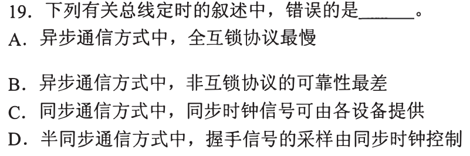

**新增**：定时方式与握手互锁程度。**起手**：画请求(REQ)—应答(ACK)箭头。题问错误项 → **C**。

| 定时 | 依据 |
| --- | --- |
| 同步 | 一个共同的时钟节拍，各信号按节拍有效 |
| 异步 | 请求／应答握手，不要求共同节拍 |
| 半同步 | 仍用共同时钟采样，握手（等待）信号按时钟采 |

```
不互锁：请求发出后，经一段时间自行撤销，不等应答
半互锁：请求撤销要等应答；应答撤销不等请求
全互锁：请求撤销等应答，应答撤销又等请求撤销   → 往返最多，最慢，也最可靠
```

| 选项 | 与上面的对应 |
| --- | --- |
| A 全互锁最慢 | 步骤最多，正确 |
| B 非互锁可靠性最差 | 不确认对方收到，正确 |
| C 同步时钟可由各设备提供 | 各设备各自一个时钟就没有共同节拍，**错** |
| D 半同步握手由时钟控制采样 | 正确 |

<a id="q10"></a>
## 10｜2016-21：线多不等于快，速度看“宽度×每秒次数”

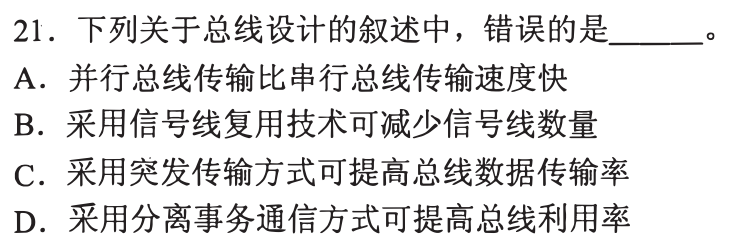

**新增**：把“快”落到 `带宽＝宽度×每秒次数`，不看线数。本题含四个命题；主台阶是这条，分离事务以最小形式附在 D。题问错误项 → **A**。

A 是全称命题，一个合法反例即可击穿：07 的并行总线 `32 位×132M 次/s＝528MB/s`；而一条串行链路（外部数据：SATA 3.0，6Gbit/s，8b/10b 后约 4.8Gbit/s）只有 1 位宽，却有 `≈600MB/s`，更快。题面无数值比较，“一定”无依据。

| 选项 | 成立依据 |
| --- | --- |
| B 复用减少信号线 | 05：地址、数据分时共用同一组线，正确 |
| C 突发提高传输率 | 05：地址只发一次，摊薄到多个数据，正确 |
| D 分离事务提高利用率 | 把“发请求”与“返回数据”拆成两个事务，主存准备期间总线可给别人用，减少空等，正确 |

<a id="q11"></a>
## 11｜2017-20：×16 是 16 条串行通道并排

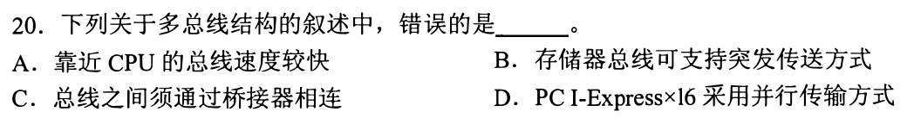

**新增**：PCI-Express 的 ×N 表示 N 条通道（lane），每条 lane 本身是串行（06），N 条并排累加带宽（10 的“串行可很快”）。**起手**：写 `×16＝16 × (一条串行 lane)`。题问错误项 → **D**。

A、B、C 是多总线结构的教材描述（近 CPU 的更快、存储器总线可用突发 05、总线间经桥接器相连），题面无数值可反驳。判别依据是 D 与 06 的串行不符：把“16 条”当“并行传输”，混淆了通道数与每条通道的传输方式。

<a id="q12"></a>
## 12｜2018-21：无新台阶，各手段对应带宽式的哪个因子

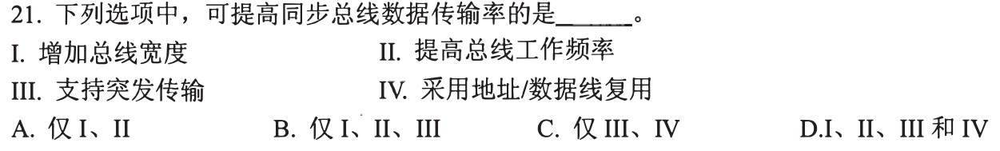

**起手**：写 `传输率 ＝ 宽度 × 频率 × 每拍次数 × 数据拍占事务的比例`，逐项对号 → **B，I、II、III**。

| 项 | 对应因子 | 判断 |
| --- | --- | --- |
| I 增加宽度 | 宽度（01、07） | 提高 |
| II 提高频率 | 频率 | 提高 |
| III 突发 | 数据拍占比（05） | 提高 |
| IV 地址/数据复用 | 减少线数；地址与数据分时，地址拍占掉数据时间（05） | 不是提高手段 |

A 缺 III；C、D 含 IV。

<a id="q13"></a>
## 13｜2019-19：多通道——总带宽＝通道数×单通道带宽

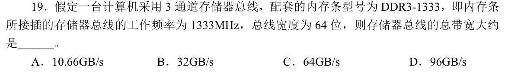

**新增**：并联通道带宽相加。**起手**：先算单通道。→ **B，约 32GB/s**。

```
单通道：1333×10⁶ × 8B(64 位) = 10.664GB/s
3 通道：×3 = 31.992GB/s ≈ 32GB/s
```

读法：题面写“工作频率 1333MHz”，未说每拍几次，直接乘即得 B；DDR3-1333 的 1333 业内本指 MT/s，同样得 B。

| 选项 | 算法 |
| --- | --- |
| A 10.66 | 只算单通道 |
| C 64 | 在 1333 上再乘 2，即把它当物理时钟并加 DDR 双沿；题面未给“每拍两次” |
| D 96 | ≈1333M×8B×3×3，通道数乘了两次 |

<a id="q14"></a>
## 14｜2020-19：全双工——两个方向各有一份

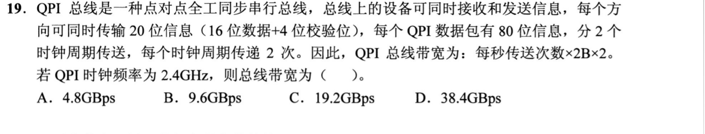

**新增**：全双工可同时收发，总带宽＝单向×2。**起手**：把题干给的公式 `每秒传送次数×2B×2` 填数。→ **C，19.2GBps**。

```
每秒传送次数 = 2.4G 周期/s × 2 次/周期 = 4.8G 次/s
有效载荷 = 20 位 − 4 校验 = 16 位 = 2B/次
单向 = 4.8G × 2B = 9.6GB/s ；双向 ×2 = 19.2GB/s
核对：80 位包 ÷ 20 位/次 = 4 次 = 2 周期 × 2 次/周期 ✓
```

| 选项 | 算法 |
| --- | --- |
| A 4.8 | 次数 4.8G，未乘 2B 与双向 |
| B 9.6 | 单向；公式末项“×2”即双向 |
| D 38.4 | 多乘了一个 2 |

<a id="q15"></a>
## 15｜2021-19：无新台阶，四个命题各对回前题

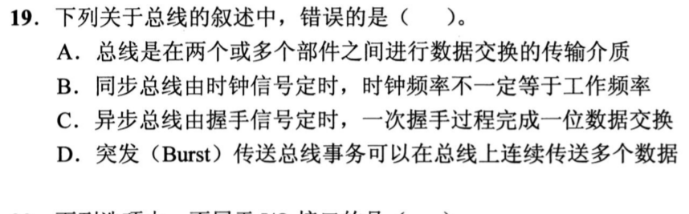

**起手**：每个命题找一个旧题对照。题问错误项 → **C**。

| 选项 | 对照 | 判断 |
| --- | --- | --- |
| A 总线是部件间交换数据的传输介质 | 02、04 | 正确 |
| B 同步总线时钟频率不一定等于工作频率 | 07：时钟 66MHz，每秒传 132M 次 | 正确 |
| C 异步总线一次握手完成一位数据交换 | 09：握手（请求—应答）只确认一次传输“已就绪／已收到” | **错** |
| D 突发连续传多个数据 | 05、08 | 正确 |

C 的反例合法：异步总线若有 32 根数据线，一次握手确认整个 32 位字；题面没把异步限定为串行。

<a id="q16"></a>
## 16｜2023-20：无突发时，每个数据单元都付完整事务

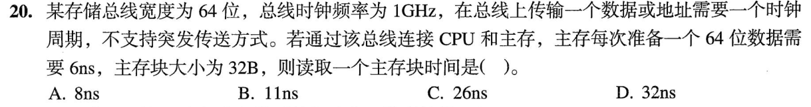

**新增**：一次读＝送地址＋主存准备＋送数据，无突发时每个单元各来一遍。**起手**：先把块拆成单元。→ **D，32ns**。

```
1GHz → 1ns/拍
32B ÷ 8B(64 位) = 4 个单元
每单元 = 地址 1ns + 准备 6ns + 数据 1ns = 8ns
4 × 8 = 32ns
```

| 选项 | 算法 | 与题面 |
| --- | --- | --- |
| A 8 | 只读 1 个单元 | 块有 4 个单元 |
| B 11 | 1＋6＋4×1：地址、准备各一次 | 等于一地址后连续送数据，需要突发 |
| C 26 | 1＋4×6＋1：地址只发一次，数据传送与后续准备重叠 | 同样要求不重复地址，与“不支持突发”冲突 |

<a id="q17"></a>
## 17｜2024-20：峰值与事务平均是两个指标

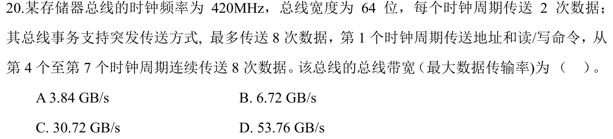

**新增**：峰值（连续数据拍）与事务平均（含地址、等待）是两个率。**起手**：两个都算，再看题问哪个。→ **B，6.72GB/s**。

```
峰值：420M 周期/s × 2 次/周期 × 8B(64 位) = 6.72GB/s
事务平均：第 1 拍地址，第 4～7 拍传 8 次数据（4 拍×2 次，核对 ✓），共 7 拍
          8 次×8B = 64B ；64B ÷ (7/420M s) = 3.84GB/s
```

题面括号限定“最大数据传输率”，据此取峰值 B（仓库答案键也是 B）；A 是含地址与等待拍的事务平均，是另一指标。

| 选项 | 来源 |
| --- | --- |
| A 3.84 | 事务平均 |
| C 30.72 | 事务平均中把 64 位当成 64B（512B÷7 拍） |
| D 53.76 | 峰值中把 64 位当成 64B |

<a id="q18"></a>
## 18｜2025-20：无新台阶，题面已写明 1333 是每秒次数

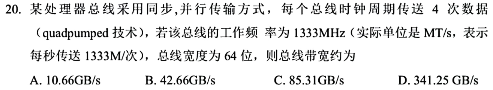

**起手**：读括号——“实际单位是 MT/s，表示每秒传送 1333M 次”。这是图上的明文：已是每秒次数，直接乘每次字节数（对照 07：那里给的是时钟，才要再乘每拍次数）。→ **A，约 10.66GB/s**。

```
1333×10⁶ 次/s × 8B(64 位) = 10.664GB/s
```

| 选项 | 算法 |
| --- | --- |
| B 42.66 | 再乘了 4（quadpumped 已含在 1333 里） |
| C 85.31 | 把 64 位当成 64B |
| D 341.25 | 85.31 再乘 4 |

[« 0821-answer-sonnet](0821-answer-sonnet.md)　　[0823-answer-sonnet »](0823-answer-sonnet.md)
