[« 0822-answer-sonnet](0822-answer-sonnet.md)　　[0824-answer-sonnet »](0824-answer-sonnet.md)

# 0823 Answer｜I/O 路径：轮询、中断与 DMA 怎样交接控制权

> [原题 31 题](../0823.md) · [0822 传输时间 · 0822-answer-sonnet](0822-answer-sonnet.md) · [能力账本](../answer-quality/learning-ledger.md)

**进入本篇时已有**：缺页后重执行原指令（0816-04）；频率与周期互为倒数（0821-10）；数据线载内容、控制线载读写与中断请求（0822-04）；总线事务（0822-16）；指令结束处可响应中断（0819-03，只点了一句）。中断与 DMA 的过程本身从零开始。
**读完新增**：01 外部中断＝事件不由当前指令产生 · 02 硬件响应与服务程序的分界 · 03 屏蔽字：开放更高、屏蔽本级及更低 · 04 轮询占比＝周期/次×次/秒÷主频 · 05 发起向下、完成向上 · 06 数据线载命令字/状态字/类型号 · 07 隐指令还要形成入口地址 · 08 设备侧接口与主机侧总线 · 09 中断请求 CPU 时间，DMA 请求总线 · 10 统一编址与独立编址 · 11 无新台阶 · 12 端口只与设备打交道 · 13 fault/trap/abort 返回点不同 · 14 无新台阶 · 15 I/O 指令只到端口 · 16 多重中断在处理中开中断 · 17 响应的前提是允许 · 18 次数＝数据率÷每次字节数 · 19 DMA 四阶段 · 20 无新台阶 · 21 NMI 与可屏蔽请求 · 22 周期挪用 · 23 接口按服务对象分 · 24 无新台阶 · 25 响应周期的三个前提 · 26 设备准备间隔≥处理时间 · 27 无新台阶 · 28 响应优先级与屏蔽字，PSW 随断点保存 · 29 无新台阶 · 30 用 18 的口径估量级 · 31 无新台阶

<details><summary>速览</summary>

| # | 新增台阶 | 起手 | 最易错 → 先看什么 |
| --- | --- | --- | --- |
| [01](#q01) | 事件不由当前指令产生＝外部中断 | 对每项问“哪条指令发现它” | 缺页要读磁盘＝外设 → 发现点在翻译 |
| [02](#q02) | 硬件响应／服务程序分界 | 先写进入前硬件已做的两件事 | 把关中断、存断点当程序步骤 → 题问“服务程序内” |
| [03](#q03) | 开放更高、屏蔽本级及更低 | 写优先级链并圈 L1 | 按下标 → 看链序 |
| [04](#q04) | 周期/次×次/秒÷主频 | 写 500×200 | 漏除主频 → 单位 |
| [05](#q05) | 发起向下、完成向上 | 画两条时间线 | 中断先于驱动 → 设备还没启动 |
| [06](#q06) | 数据线载编码值 | 逐项问是值还是信号 | 见“命令/中断”想控制线 → 是多位编码 |
| [07](#q07) | 隐指令形成入口地址 | 列硬件动作 | 把 GPR 也算硬件 → 02 在服务程序内 |
| [08](#q08) | 设备侧接口 vs 主机侧总线 | 画三段 | PCIe 也接设备 → 题问设备与控制器之间 |
| [09](#q09) | 请求对象与响应点 | 填表：请求什么、何处响应 | 被“所有/仅”吓住 → 先核对另三项 |
| [10](#q10) | 编址方式 | 写同号地址两种空间 | 统一＝不能访存 → 反了 |
| [11](#q11) | 无新台阶 | 100÷400 | 加 50ns → 它是延迟上限 |
| [12](#q12) | 端口只对设备 | 逐项问谁消费 | 地址当端口内容 → CPU 自己寻址 |
| [13](#q13) | 三类返回点 | 每类举一例 | “都返回原指令” → 系统调用 |
| [14](#q14) | 无新台阶 | 逐项问发现点 | 缺页算中断 → 01 |
| [15](#q15) | 指令到端口为止 | 画三段 | 选到设备 → 端口是边界 |
| [16](#q16) | 处理中开中断 | 画单级/多重时间线 | 一律关中断 → 03 的屏蔽字有用 |
| [17](#q17) | 允许是前提 | 写响应的条件 | “立即暂停” → 指令结束处 |
| [18](#q18) | 次数＝数据率÷字节数 | 50000÷4 | 50000 次 → 缓冲 4B |
| [19](#q19) | DMA 四阶段 | 写四阶段执行者 | 把总线请求给 CPU → 搬运者是控制器 |
| [20](#q20) | 无新台阶 | 逐项问发现点 | 定时器算内部 → 不由指令产生 |
| [21](#q21) | NMI 与可屏蔽 | 写“请求→响应”条件 | 信号有效即响应 → 还有允许、屏蔽 |
| [22](#q22) | 周期挪用 | 512÷4 | 整块独占 → 每份一次 |
| [23](#q23) | 接口按设备分 | 问“服务哪个设备” | 都带控制器二字 → 看对象 |
| [24](#q24) | 无新台阶 | 问指令是否做完 | 系统调用也算异常 → 指令已完成 |
| [25](#q25) | 响应的三个前提 | 逐项配条件 | 态＝允许 → 两个维度 |
| [26](#q26) | 准备间隔≥处理时间 | 画两份数据的间隔 | 越快越好 → 会积压 |
| [27](#q27) | 无新台阶 | 填谁执行 | DMA 也跑 CPU 程序 → 09 |
| [28](#q28) | PSW 随断点保存 | 分响应阶段／处理阶段 | 屏蔽字定响应次序 → 03 |
| [29](#q29) | 无新台阶 | 画数据路径 | 选含 CPU 的路 → 数据不过 CPU |
| [30](#q30) | 估量级 | 取 18 的口径放大速率 | 按设备名记 → 算负担 |
| [31](#q31) | 无新台阶 | 问谁发请求 | “结束”都算 → 看有无外设事件 |

跨题信号：问“外部／内部”→ 问发现点（01、14、20、24）；问占比→ 周期/次×次/秒÷主频（04、11、18）；选项带“所有／仅／一定／立即”→ 找条件（09、13、17、21、25）；问“服务程序内”→ 先剔硬件动作（02、07、28）。

</details>

<a id="q01"></a>
## 01｜2009-22：外部中断＝事件不由当前指令产生

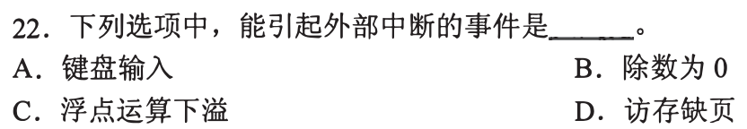

**新增**：事件是否由正在执行的那条指令产生。**起手**：对每项问“哪条指令发现它”。→ **A**

| 选项 | 发现它的是 | 结论 |
| --- | --- | --- |
| A 键盘输入 | 没有指令：用户按键，设备发请求 | 外部中断 |
| B 除数为 0 | 除法指令的执行 | 内部 |
| C 浮点运算下溢 | 浮点指令的结果 | 内部 |
| D 访存缺页 | 访存指令翻译地址时（0816-04） | 内部 |

> 缺页之后要读磁盘，但这是处理方式；发现点仍是翻译那一步。

<a id="q02"></a>
## 02｜2010-21：硬件响应与服务程序的分界

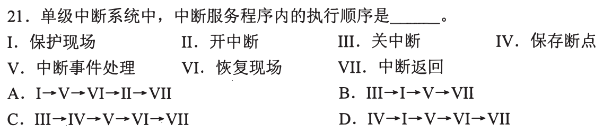

**新增**：CPU 响应中断时，先由硬件做完两件事，服务程序才开始。**起手**：写进入前已发生的事 → **A**

```
硬件（响应）：关中断 III、保存断点 IV   → PC 换成入口
服务程序内  ：保护现场 I → 事件处理 V → 恢复现场 VI → 开中断 II → 中断返回 VII
```

- 为什么 III、IV 在前：PC 要换成入口，旧 PC 不先存就丢；不先关中断，新请求会在存完前打进来（单级中断，处理期间不开）。
- 为什么 II 在 VII 前：返回后若仍关着，CPU 此后不再响应（0819-03：开中断才可响应）。

| 选项 | 与题面不符处 |
| --- | --- |
| A I→V→VI→II→VII | 符合上面的顺序 |
| B III→I→V→VII | 含 III；缺 VI（返回时现场没恢复）和 II |
| C III→IV→V→VI→VII | 含 III、IV；有 VI 却没有 I，没存就恢复；缺 II |
| D IV→I→V→VI→VII | 含 IV；缺 II |

<a id="q03"></a>
## 03｜2011-21：屏蔽字——开放更高、屏蔽本级及更低

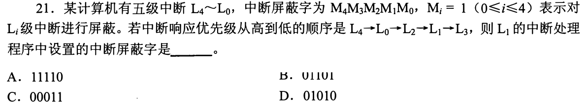

**新增**：在某级的处理程序里设屏蔽字，要看该级在**响应优先级链**中的位置。**起手**：写链并圈 L1 → **D**

```
高 L4 > L0 > L2 > L1 > L3 低        Mi=1 屏蔽 Li
处理 L1：L4、L0、L2 比它高 → 开放 → M4=M0=M2=0
         L1 自己、L3 → 屏蔽 → M1=M3=1
按 M4 M3 M2 M1 M0 写：0 1 0 1 0
```

| 选项 | 与题面不符处 |
| --- | --- |
| A 11110 | M4=M2=M0=1，高于 L1 的三级被屏蔽 |
| B 01101（图上端边缘被截，按此读） | M1=0，本级没有屏蔽；M0=M2=1，高级被屏蔽 |
| C 00011 | M1=M0=1，M3=0：开放了更低的 L3，又屏蔽了更高的 L0 |
| D 01010 | 符合 |

“屏蔽本级”是通行约定，题面未写；A、B、C 在高级位上就已错，不依赖它。

<a id="q04"></a>
## 04｜2011-22：轮询占比＝周期/次×次/秒÷主频

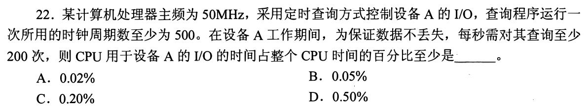

**新增**：定时查询的 CPU 开销按“每秒花多少周期”算。**起手**：`500×200` → **C**

```
每秒查询花：500 × 200 = 100 000 周期
每秒周期数：50 MHz = 50 000 000        （0821-10）
占比：100 000 ÷ 50 000 000 = 0.002 = 0.20%
```

| 选项 | 对应的算式 |
| --- | --- |
| A 0.02% | 相当于每秒 10 000 周期，与 100 000 不符 |
| B 0.05% | 相当于每秒 25 000 周期，与 100 000 不符 |
| C 0.20% | 符合 |
| D 0.50% | 相当于每秒 250 000 周期，与 100 000 不符 |

“至少”：查询次数和每次周期都取下限，占比即下限。

<a id="q05"></a>
## 05｜2011-26：发起向下、完成向上

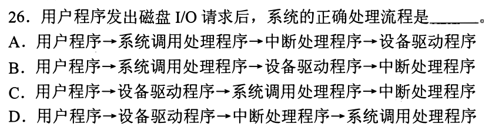

**新增**：一次磁盘请求有两个方向——软件逐层向下发起，设备完成后经中断向上通知。**起手**：画 → **B**

```
发起：用户程序 → 系统调用处理程序 → 设备驱动程序 → 磁盘（启动）
完成：磁盘 → 中断请求 → 中断处理程序
```

| 选项 | 与题面不符处 |
| --- | --- |
| A | 中断处理程序排在驱动之前：驱动还没启动设备，没有完成可通知 |
| C、D | 用户程序直接进驱动：用户程序只能通过系统调用进入内核 |
| B | 符合 |

<a id="q06"></a>
## 06｜2012-21：数据线载命令字、状态字、类型号

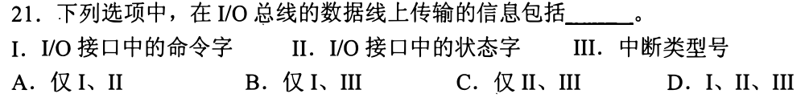

**新增**：判断一项该走哪类线，看它是**多位编码值**还是**请求/应答信号**（0822-04）。**起手**：逐项分类 → **D**

| 项 | 内容 | 线 |
| --- | --- | --- |
| I 命令字 | CPU 写入接口的一个编码 | 数据线 |
| II 状态字 | CPU 从接口读回的一组位 | 数据线 |
| III 中断类型号 | 0822-04 已列在数据线 | 数据线 |

读/写命令、中断请求这类“有/无”信号才在控制线上。

<a id="q07"></a>
## 07｜2012-22：隐指令还要形成入口地址

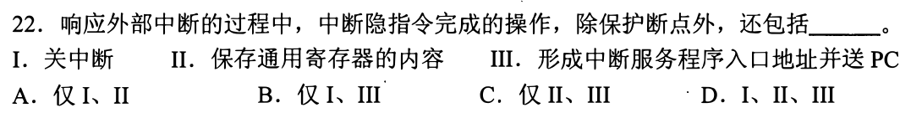

**新增**：硬件响应除关中断、存断点外，还形成入口地址送 PC。**起手**：列硬件动作 → **B**

题问“除保护断点外，还包括”：

| 项 | 判断 |
| --- | --- |
| I 关中断 | 02：硬件先做 |
| II 保存通用寄存器 | 02：在服务程序里保护现场，不由隐指令做 |
| III 形成入口地址送 PC | 硬件：此时 CPU 要靠中断类型号（0822-04）求出入口，才能转去服务程序 |

<a id="q08"></a>
## 08｜2013-19：设备侧接口与主机侧总线

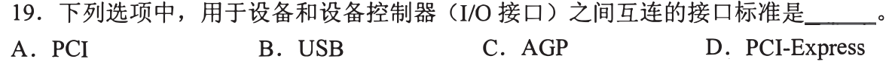

**新增**：控制器两侧是两种连接。**起手**：画三段 → **B**

```
设备 —(a)— 设备控制器 / I/O 接口 —(b)— 主机总线
```

题问括号里写明“设备和设备控制器（I/O 接口）之间”，即 (a)。USB 连接外设与控制器；PCI、AGP、PCI-Express 属 0822-02 的主机侧总线标准，处在 (b) 一侧。

<a id="q09"></a>
## 09｜2013-22：中断请求 CPU 时间，DMA 请求总线

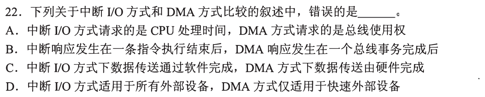

**新增**：两种方式请求的资源、响应点、搬运者各不同。**起手**：填表 → **D**（题问错误）

| 选项 | 题面说 | 依据 | 对错 |
| --- | --- | --- | --- |
| A | 中断请求 CPU 时间，DMA 请求总线使用权 | 中断要 CPU 运行服务程序；DMA 搬运时要用总线 | 对 |
| B | 中断在一条指令结束后，DMA 在一个总线事务完成后响应 | 0819-03；0822-16 的事务 | 对 |
| C | 中断方式靠软件传送，DMA 靠硬件 | 服务程序是软件；DMA 控制器是硬件 | 对 |
| D | 中断适用于所有设备，DMA 仅适用于快速设备 | 另三项都对；以上机制里没有“DMA 限速”的条件 | **错** |

> D 的真正问题是绝对词；速度与方式怎样挂钩见 18、30。

<a id="q10"></a>
## 10｜2014-21：统一编址与独立编址

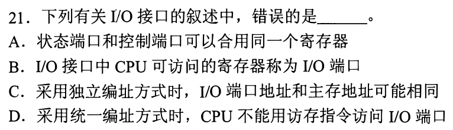

**新增**：两种编址的区别在地址空间。**起手**：写一个数 `60H` 在两种方式下指什么 → **D**

```
独立编址：I/O 空间 ≠ 主存空间；I/O 的 60H 与主存的 60H 可同号，靠专用 I/O 指令区分
统一编址：端口占主存空间中的一段；访存指令的地址落在这段即访问端口
```

| 选项 | 判断 |
| --- | --- |
| A 状态端口与控制端口可合用一个寄存器 | 端口是寄存器，一个寄存器可兼两用，题面未排斥 |
| B CPU 可访问的寄存器称 I/O 端口 | 符合定义 |
| C 独立编址时地址可相同 | 上面的 `60H` 例 |
| D 统一编址时不能用访存指令 | 与统一编址的定义相反 |

<a id="q11"></a>
## 11｜2014-22：无新台阶，占比按周期算

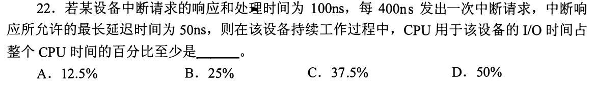

沿用 04：每 400ns 一次，每次占用 100ns，占比 **100÷400＝25%，选 B**。

| 选项 | 对应算式 |
| --- | --- |
| A 12.5% | 50÷400：占用只取 50ns，与题面 100ns 不符 |
| C 37.5% | 150÷400：占用多了 50ns，题面“100ns”已含响应 |
| D 50% | 200÷400：占用 200ns，与 100ns 不符 |

50ns 是“响应最长允许延迟”，限制的是何时开始响应；“响应和处理时间为 100ns”已是每次的占用。

<a id="q12"></a>
## 12｜2015-21：端口只与设备打交道

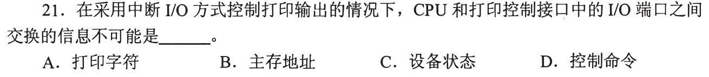

**新增**：接口端口里交换的，都是设备要用或设备给出的信息。**起手**：逐项问“谁消费它” → **B**（题问“不可能”）

| 选项 | 谁消费 |
| --- | --- |
| A 打印字符 | 打印机；CPU 写入数据端口 |
| C 设备状态 | CPU；从状态端口读（06） |
| D 控制命令 | 接口/设备；写入控制端口（06） |
| B 主存地址 | 中断方式下 CPU 自己按地址取字符，再把字符写端口；设备不需要知道字符原在主存何处 |

<a id="q13"></a>
## 13｜2015-22：fault、trap、abort 返回点不同

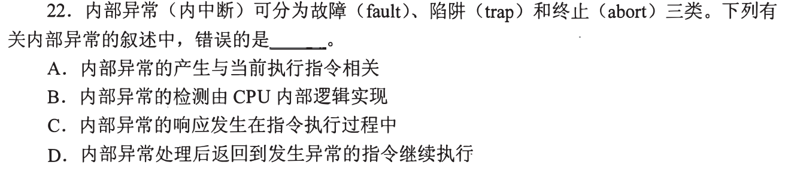

**新增**：三类异常处理后的去向。**起手**：每类举一例，为 D 找反例 → **D**（题问错误）

| 类 | 例子 | 处理后 |
| --- | --- | --- |
| fault | 缺页（0816-04） | 重做原指令 |
| trap | 系统调用 | 指令已完成，回下一条 |
| abort | 严重硬件错 | 通常不能继续 |

A、B、C 是三类的共同点：都由当前指令引起、由 CPU 内部发现、发现在指令执行中（外部中断则在指令结束处，0819-03）。D 的“继续执行**该指令**”只对 fault 成立。

<a id="q14"></a>
## 14｜2016-22：无新台阶，分类按发现点


沿用 01：题干自己定义了——异常在处理器内部发生，中断来自外部。

| 选项 | 发现点 | 类 |
| --- | --- | --- |
| A 访存缺页 | 翻译地址（0816-04） | 异常，**题称“中断”＝错，选 A** |
| B 整数除以 0 | 除法指令 | 异常 |
| C DMA 传送结束 | 控制器通知 | 中断 |
| D 存储保护错 | 访存时检查 | 异常 |

<a id="q15"></a>
## 15｜2017-21：I/O 指令只到端口

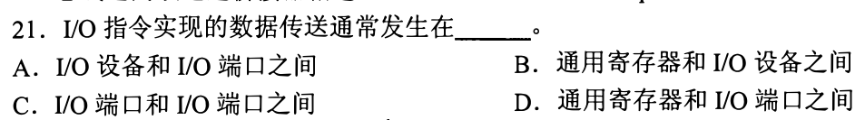

**新增**：I/O 指令的边界在端口。**起手**：画三段 → **D**

```
通用寄存器 —指令→ I/O 端口 —接口硬件→ I/O 设备
```

| 选项 | 与题面不符处 |
| --- | --- |
| A 设备↔端口 | 这段由接口硬件和设备完成，不是 I/O 指令执行的 |
| B 寄存器↔设备 | 越过了端口 |
| C 端口↔端口 | 指令的一端是寄存器 |
| D 寄存器↔端口 | 符合 |

<a id="q16"></a>
## 16｜2017-22：多重中断在处理中开中断

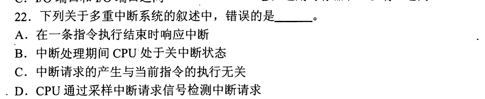

**新增**：多重中断系统保护现场后重新开中断，允许更高级打断。**起手**：画两条时间线 → **B**（题问错误）

```
单级（02）：关→存断点→保护→处理…………→恢复→开→返回
多重      ：关→存断点→保护→开→处理（可被更高级打断）→关→恢复→开→返回
```

03 里 L1 的处理程序要设屏蔽字、开放 L4/L0/L2，前提就是处理期间开着中断。

| 选项 | 依据 |
| --- | --- |
| A 指令结束时响应 | 0819-03 |
| B 处理期间关中断 | 与多重中断相反 |
| C 请求产生与当前指令无关 | 01：键盘按键不看指令 |
| D CPU 采样请求信号检测 | 请求是一根信号线（0822-04），题面无反证 |

<a id="q17"></a>
## 17｜2018-22：响应的前提是中断允许

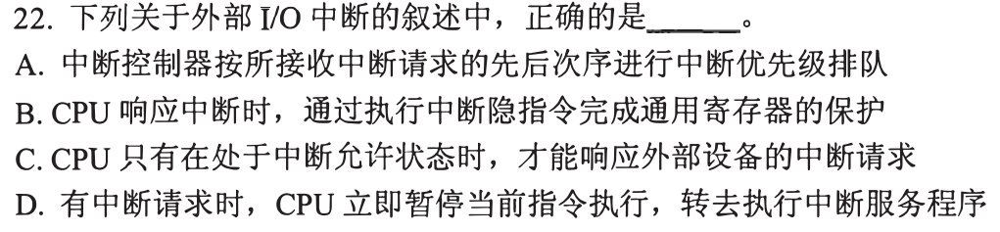

**新增**：CPU 响应中断请求之前，要处于开中断状态。**起手**：写响应条件 → **C**

| 选项 | 与题面不符处 |
| --- | --- |
| A 按请求先后排队 | 03：优先级链决定次序，不按到达先后 |
| B 隐指令保护通用寄存器 | 02、07：GPR 在服务程序里保护 |
| D 立即暂停当前指令 | 0819-03、16：指令结束处响应 |
| C 只有处于允许状态才能响应 | 符合 |

题面未提不可屏蔽中断，按可屏蔽读；NMI 的例外见 21。

<a id="q18"></a>
## 18｜2019-21：次数＝数据率÷每次字节数

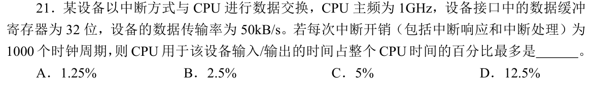

**新增**：开销按**中断次数**计，次数由缓冲一次装多少字节决定。**起手**：`50 000 ÷ 4` → **A**

```
缓冲 32 位 = 4B → 每秒最多 50 000 ÷ 4 = 12 500 次
12 500 × 1000 周期 = 12 500 000 周期/秒
12 500 000 ÷ 1 000 000 000 = 1.25%                 （同 04 的口径）
```

| 选项 | 对应 |
| --- | --- |
| B 2.5% | 按 2B 一次 |
| C 5% | 按 1B 一次 |
| D 12.5% | 相当于每次中断只搬 0.4B，缓冲是 4B，不可能 |

若 kB＝1024：51 200÷4×1000÷10⁹＝1.28%，选项仍取 A。“最多”＝每份缓冲都中断一次。

<a id="q19"></a>
## 19｜2019-22：DMA 四阶段

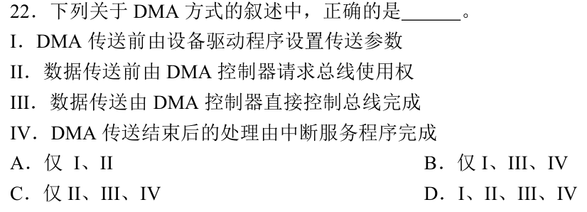

**新增**：DMA 一次传输分四段，各有执行者。**起手**：写四段 → **D**

```
I   传送前  驱动程序（CPU）设参数：主存地址、长度、方向
II  搬运前  DMA 控制器向 CPU 请求总线使用权（09）
III 搬运    DMA 控制器直接控制总线，读写主存
IV  结束后  中断服务程序做后续处理
```

| 选项 | 缺什么 |
| --- | --- |
| A 仅 I、II | 无搬运、无收尾 |
| B 仅 I、III、IV | 无总线使用权，III 无从发生 |
| C 仅 II、III、IV | 没有参数，控制器不知搬哪里、搬多少 |
| D 全部 | 四段都是题面所述 |

<a id="q20"></a>
## 20｜2020-20：无新台阶

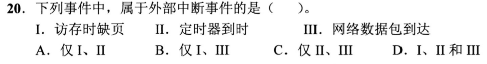

沿用 01：逐项问发现点。

| 项 | 发现点 | 类 |
| --- | --- | --- |
| I 访存缺页 | 翻译地址 | 异常 |
| II 定时器到时 | 计时器自己到点，不由某条指令产生 | 外部中断 |
| III 网络数据包到达 | 网卡通知 | 外部中断 |

**仅 II、III，选 C。**

<a id="q21"></a>
## 21｜2020-21：NMI 与可屏蔽请求

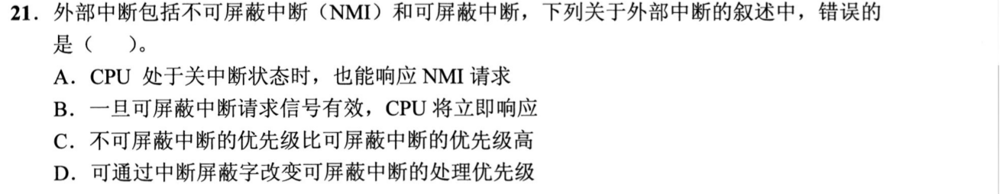

**新增**：不可屏蔽中断不受开/关中断限制；可屏蔽请求有效≠立即响应。**起手**：写“请求→响应”需过的关 → **B**（题问错误）

```
可屏蔽请求：信号有效 → 未被屏蔽？ → CPU 开中断？ → 指令结束处 → 响应（17）
NMI        ：不经开/关中断这一关
```

| 选项 | 依据 |
| --- | --- |
| A 关中断时也能响应 NMI | “不可屏蔽”的含义（本题按教材约定读） |
| B 信号有效即立即响应 | 漏了屏蔽、允许状态和指令结束 |
| C NMI 优先级更高 | 教材约定，题面未给数；与 A 同源 |
| D 屏蔽字改变处理优先级 | 03：处理程序设屏蔽字，决定谁能打断 |

<a id="q22"></a>
## 22｜2020-22：周期挪用

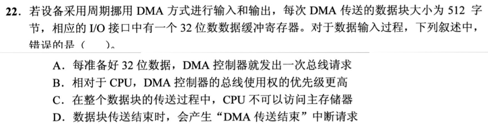

**新增**：周期挪用——DMA 每份数据只借用一个存储周期。**起手**：`512 ÷ 4` → **C**（题问错误）

```
512B ÷ 4B（32 位缓冲）= 128 份 → 128 次总线请求
CPU 访存 | CPU 访存 | DMA 4B | CPU 访存 | … | DMA 4B
```

| 选项 | 依据 |
| --- | --- |
| A 每备好 32 位发一次请求 | 缓冲一次装 4B（18），备满即请求 |
| B DMA 优先级高于 CPU | 教材约定：设备缓冲不等人，否则下一份覆盖；题面没给 |
| C 整个块传送期间 CPU 不可访存 | “周期挪用”就是只借周期，其余周期 CPU 可用 |
| D 块结束产生中断请求 | 19 的第 IV 段 |

<a id="q23"></a>
## 23｜2021-20：接口按服务对象分

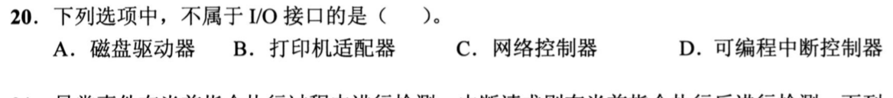

**新增**：I/O 接口＝连接**某个设备**与主机的部件。**起手**：对每项问“它服务哪个设备” → **D**

| 选项 | 服务对象 |
| --- | --- |
| A 磁盘驱动器 | 磁盘 |
| B 打印机适配器 | 打印机 |
| C 网络控制器 | 网络 |
| D 可编程中断控制器 | 不对应某个设备，汇集各设备的中断请求（03、21） |

> A 的“驱动器”字面也可指磁盘设备本身；与 B、C 并列，按设备接口读。即便如此，只有 D 不是任何设备的接口。

<a id="q24"></a>
## 24｜2021-21：无新台阶，看指令是否已做完

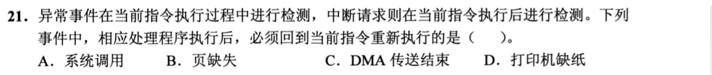

沿用 0816-04 与 13；题干给了检测时刻：异常在执行中，中断在执行后。

| 选项 | 类与状态 | 返回 |
| --- | --- | --- |
| A 系统调用 | trap：指令已完成 | 下一条 |
| B 页缺失 | fault：访存没做成 | **重做当前指令** |
| C DMA 传送结束 | 外部中断：当前指令已执行完 | 下一条 |
| D 打印机缺纸 | 外部中断 | 下一条 |

**选 B。**

<a id="q25"></a>
## 25｜2021-22：响应的三个前提

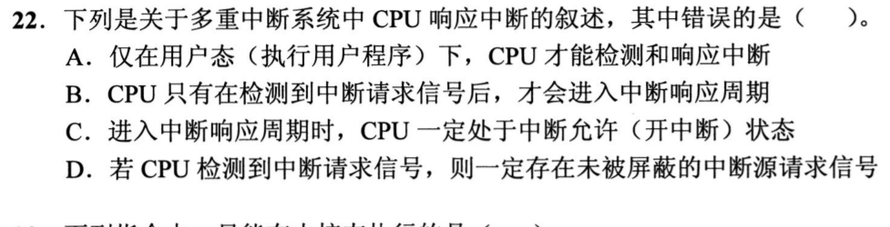

**新增**：进入响应周期要同时有：检测到请求信号、处于开中断、有未屏蔽的源。**起手**：给 B、C、D 配条件 → **A**（题问错误）

| 选项 | 依据 |
| --- | --- |
| A 仅在用户态才能检测响应 | 用户态/内核态是权限；允许与屏蔽是另一个维度，内核态开中断一样响应（17、16） |
| B 检测到信号才进响应周期 | 前提一 |
| C 进入响应时一定处于开中断 | 前提二（读作可屏蔽中断；NMI 见 21） |
| D 检测到信号则一定有未屏蔽的源 | 前提三：信号是经屏蔽后发给 CPU 的（教材模型，题面未画） |

<a id="q26"></a>
## 26｜2022-21：设备准备间隔≥处理时间

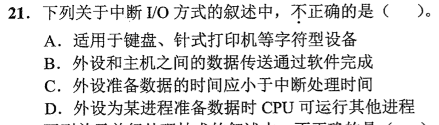

**新增**：中断 I/O 要求设备生成数据的间隔，不小于 CPU 一次响应处理的时间。**起手**：画两份数据到来的间隔 → **C**（题问不正确）

```
准备间隔 T，处理 t：  T ≥ t：上一份处理完，下一份才到
                      T < t：下一份已到而上一份未处理完，积压（11 里 400ns 对 100ns 正是 T>t）
```

| 选项 | 依据 |
| --- | --- |
| A 适用于键盘、针式打印机 | 字符设备，速率低，18 的 1.25% 级别 |
| B 数据传送通过软件完成 | 09-C |
| C 准备数据的时间应小于处理时间 | 与上图相反 |
| D 设备准备数据时 CPU 可运行其他进程 | 设备准备期间不占 CPU |

<a id="q27"></a>
## 27｜2023-22：无新台阶，谁执行 I/O

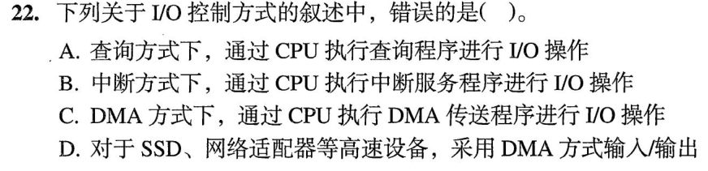

沿用 04、09、19：

| 方式 | 谁做 I/O 操作 | 对错 |
| --- | --- | --- |
| A 查询 | CPU 执行查询程序（04） | 对 |
| B 中断 | CPU 执行服务程序（09） | 对 |
| C DMA | CPU 只设参数、收尾；搬运由控制器（19） | **错** |
| D SSD、网卡用 DMA | 30 再讲量级；本题只核对表述 | 对 |

**选 C。**

<a id="q28"></a>
## 28｜2024-21：PSW 随断点保存

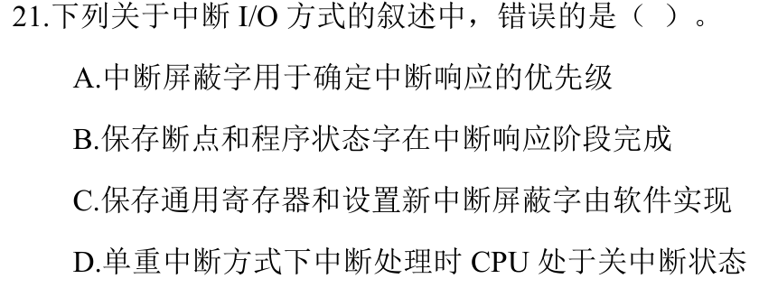

**新增**：响应阶段（硬件）保存的是断点和程序状态字（PSW）。**起手**：分“响应阶段／处理阶段” → **A**（题问错误）

| 选项 | 阶段 | 依据 |
| --- | --- | --- |
| A 屏蔽字确定响应优先级 | — | 03：响应次序由链固定；屏蔽字是处理程序里设置、决定谁能打断 |
| B 断点和 PSW 在响应阶段 | 硬件 | 同 02、07 的断点保存 |
| C 保存 GPR、设新屏蔽字由软件 | 处理 | 02、03 |
| D 单重中断处理时关中断 | 处理 | 02 |

<a id="q29"></a>
## 29｜2024-22：无新台阶，数据路径

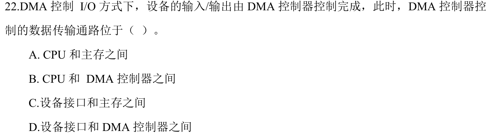

沿用 19、22：搬运由控制器控制，数据在设备接口与主存之间走总线。

| 选项 | 与题面不符处 |
| --- | --- |
| A CPU↔主存 | 数据不经 CPU（19 的 III 由控制器控制总线） |
| B CPU↔DMA 控制器 | CPU 只设参数 |
| C 设备接口↔主存 | 符合（22：接口缓冲 4B 一份搬入主存） |
| D 设备接口↔DMA 控制器 | 控制器提供地址与控制；按教材模型数据不停在控制器里 |

**选 C。**

<a id="q30"></a>
## 30｜2025-21：用 18 的口径估量级

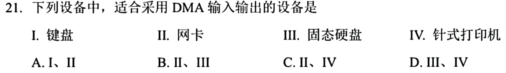

**新增**：判断是否适合 DMA，把速率代入 18 的算式看中断方式的 CPU 负担。**起手**：把 18 的速率放大 → **B**

```
18：50 kB/s → 1.25%
假设一台设备 50 MB/s（1000 倍；示例，非题给）：12.5 × 10⁹ 周期/秒，是 1 GHz 的 12.5 倍 → 无法逐 4B 中断
```

| 项 | 速率级别 | 方式 |
| --- | --- | --- |
| I 键盘 | 字符级，26 | 中断 |
| II 网卡 | 连续大块 | DMA |
| III 固态硬盘 | 连续大块 | DMA |
| IV 针式打印机 | 字符级，26 | 中断 |

“高/低速”是设备常识，题面未给数；选 **II、III，B**。

<a id="q31"></a>
## 31｜2025-22：无新台阶，谁发请求

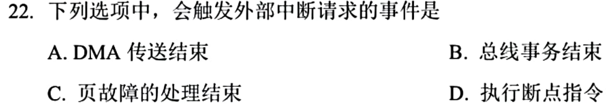

沿用 19、01、13：外部中断由设备事件产生。

| 选项 | 发现点 | 类 |
| --- | --- | --- |
| A DMA 传送结束 | 控制器通知（19 的 IV） | 外部中断 |
| B 总线事务结束 | 只是 09 的响应点，没有设备向 CPU 发请求 | 否 |
| C 页故障处理结束 | 内核处理完毕，无外设事件 | 否 |
| D 执行断点指令 | 指令执行产生（trap，13） | 内部 |

**选 A。**

[« 0822-answer-sonnet](0822-answer-sonnet.md)　　[0824-answer-sonnet »](0824-answer-sonnet.md)
