[« 0824-answer-sonnet](0824-answer-sonnet.md)　　[0826-answer-sonnet »](0826-answer-sonnet.md)

# 0825 Answer｜执行生命线：进程、线程、状态与调度

> [原题 30 题](../0825.md) · [0824 系统边界 · 0824-answer-sonnet](0824-answer-sonnet.md) · [能力账本](../answer-quality/learning-ledger.md)

**进入本篇时已有**：设备自主完成 I/O、完成以中断告知 CPU（0823-01/05）；用户态/内核态与特权判据（0824-05）；时钟中断（0824-10）；进程私有 vs 系统共用（0824-24）；数操作次数（0731）。进程、线程、调度本篇从零开始。
**读完新增**：01 并行＝同一时刻占不同部件 · 02 调度算法各比较什么量 · 03 进程＝被 PCB 记录的执行实体 · 04 降级看已耗 CPU · 05 短优先与防饥饿要分开问 · 06 命令解释程序是用户程序 · 07 线程私有的是恢复执行点所需之物 · 08 虚存＝非连续分配＋容量双上限 · 09 单缓冲时间线 · 10 轮转的等待上界 · 11 运行→就绪（缺 CPU）与运行→阻塞（缺事件） · 12 只在已到达者中选 · 13 时间片长短的折中 · 14 并发要管共享资源 · 15 周转＝已等待＋之后完成 · 16 x++ 是读改写三步 · 17 用户级线程内核看不见 · 18 两级队列逐段推进 · 19 多级反馈的四类设计量 · 20 父子是两个进程 · 21 创建的必做动作 · 22 轮转所需结构 · 23 调度的触发时刻 · 24 并发度有上限 · 25 抢占与调度次数 · 26 无新台阶 · 27 让出 CPU≠等待 · 28 被抢占者保留剩余量 · 29 终止回收自己拥有的 · 30 有序链表插入要找位置

<details><summary>速览</summary>

| # | 新增台阶 | 起手 | 最易错 → 先看什么 |
| --- | --- | --- | --- |
| [01](#q01) | 并行＝同刻不同部件 | 画 CPU/通道/设备三条线 | 见“单处理机”就全否 → 看每对是否占同一条线 |
| [02](#q02) | 比较量 | 写每个算法比较什么 | 选 B → 它不看等待 |
| [03](#q03) | 进程与 PCB | 问“多出一个实体吗” | 设备分配也算 → 只是给已有进程加资源 |
| [04](#q04) | 降级看已耗 CPU | 问“它刚耗了 CPU 吗” | 把等待当惩罚 → 等待久不是已耗 |
| [05](#q05) | 两个问题分开问 | 算法×{短优先,防饥饿}表 | 非抢占 SJF → 构造持续短作业 |
| [06](#q06) | 命令解释程序＝用户程序 | 问“用户程序自己能做吗” | 名字像系统 → 看是否内核入口 |
| [07](#q07) | 线程私有量 | 想象 A 被换下再换回 | 栈指针当共享 → 要恢复调用链 |
| [08](#q08) | 虚存两个事实 | 写地址位数与内存+外存 | “只受” → 举上限反例 |
| [09](#q09) | 单缓冲时间线 | 逐块填起止 | 第二块读提前到 100 → 缓冲仍被占 |
| [10](#q10) | 轮转等待上界 | 写某进程至多等几片 | 平均等待短＝无饥饿 → 看有无上界 |
| [11](#q11) | 缺 CPU/缺事件 | 问“给它 CPU 它能继续吗” | 失败＝就绪 → 缺的是事件 |
| [12](#q12) | 候选集 | 写 t=2 已到达者 | 选 J4 → 未到达 |
| [13](#q13) | 片长折中 | 写一个时间片周期 | 片尽＝阻塞 → 仍能运行 |
| [14](#q14) | 并发要管共享资源 | 用 01 判 I、III | 多任务＝多 CPU → 01 |
| [15](#q15) | 周转含已等待 | 排序后画时间轴 | 漏首次开销/已等待 → 表头的等待 |
| [16](#q16) | 读改写三步 | 编号 a1a2a3、b1b2b3 | 枚举全部 → 看最后写者读到几 |
| [17](#q17) | 内核是否看得见 | 问“内核调度表里有它吗” | 都建控制块 → 用户库管理 |
| [18](#q18) | 逐段推进两级队列 | 画 Q1/Q2 两栏 | Q2 不按短优先 → 题面写短进程优先 |
| [19](#q19) | 四类设计量 | 在 18 题干里找四处出处 | 只答“多队列” → 缺迁移就无法运行 |
| [20](#q20) | 父子是两个进程 | 写 fork 后两个 PCB | 与线程混 → 07 |
| [21](#q21) | 创建必做动作 | 列创建步骤 | III 初态执行 → 单 CPU 上已有运行者 |
| [22](#q22) | 轮转所需结构 | 写一圈轮转 | 加阻塞队列 → 片尽进就绪 |
| [23](#q23) | 调度触发 | 问“是否要重选” | “可能”读成“必然” → 看题问 |
| [24](#q24) | 并发度上限 | 画 n–利用率草图 | “越多越高” → 内存装不下 |
| [25](#q25) | 抢占点与次数 | 在 0、10、15 判新到者 | 到达就计一次 → 看 CPU 是否换人 |
| [26](#q26) | 无新台阶 | 用 11 判每项 | 片尽也阻塞 → 13 |
| [27](#q27) | 让出≠等待 | 问“让出后还缺什么” | 离开执行态都阻塞 → 看缺 CPU/事件 |
| [28](#q28) | 剩余量续算 | 画到达、抢占、剩余 | 先跑 P1 → 值大者优先 |
| [29](#q29) | 终止回收自己的 | 分“自己拥有/别人” | 子进程必随之死 → 20 |
| [30](#q30) | 有序链表插入 | 画三结点链插一个 | 只数改指针 → 还要找位置 |

跨题信号：缺 CPU→就绪、缺事件→阻塞（11、13、26、27）；调度先圈已到达者（12、25、28）；“只/总是/越多越”→举合法反例（05、08、24）。

</details>

<a id="q01"></a>
## 01｜2009-23：并行＝同一时刻占不同部件

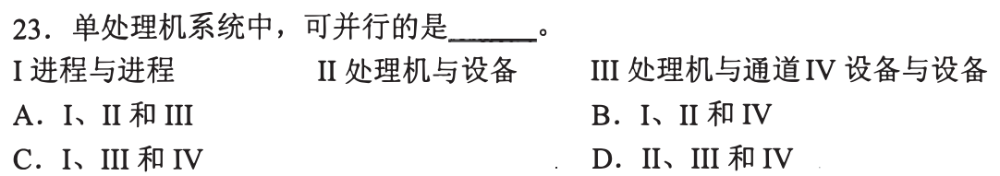

**新增**：并行指同一时刻各占一个部件。**起手**：画 CPU、通道、设备三条线，问两件事能否同刻各占一条。**答案：D**。

| 项 | 判断 | 结论 |
| --- | --- | --- |
| I 进程与进程 | 单处理机只有一个 CPU，同刻只有一个进程在上面执行，只能交替 | 不可并行 |
| II 处理机与设备 | 设备可自行完成 I/O、完成后中断告知（0823），其间 CPU 执行别的指令 | 可 |
| III 处理机与通道 | 通道是独立于 CPU 的 I/O 部件，各占一条线 | 可 |
| IV 设备与设备 | 不同设备各自工作 | 可 |

A、B、C 都含 I，D 不含，且 II、III、IV 全成立。

<a id="q02"></a>
## 02｜2009-24：看每个算法拿什么来比较

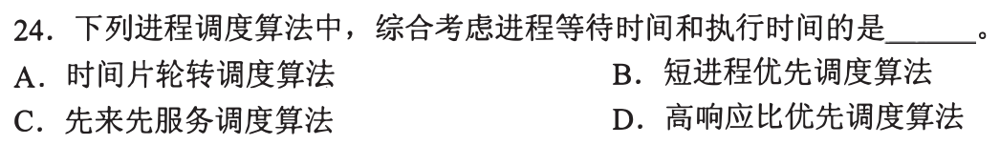

**新增**：每个调度算法选人时比较的量不同。**起手**：对每个算法写“它比什么”。**答案：D**。

| 选项 | 比较量 | 题问“等待与执行时间都考虑” |
| --- | --- | --- |
| A 时间片轮转 | 队列位置，每人一片 | 否 |
| B 短进程优先 | 要求服务时间 | 否，不看已等多久 |
| C 先来先服务 | 到达先后 | 否，不看服务时间 |
| D 高响应比优先 | 响应比＝(等待＋服务)/服务＝1＋等待/服务 | 两个量都在 |

例：服务 2 等 2 → 2；服务 10 等 2 → 1.2；后者等到 10 → 2。

<a id="q03"></a>
## 03｜2010-24：进程＝被 PCB 记录的执行实体

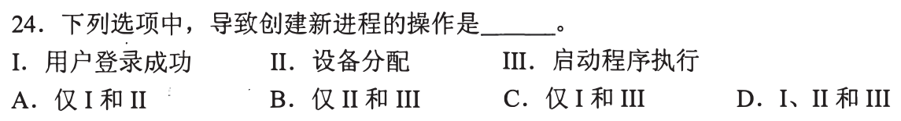

**新增**：内核用**进程控制块（PCB）**记录一个进程；“创建进程”就是多出一个这样的执行实体。**起手**：对每项问“做完后，系统里多出一个能被调度的实体吗”。**答案：C**。

| 项 | 判断 |
| --- | --- |
| I 登录成功 | 系统为该用户建立用户进程（教材读法；题面只有这句）→ 创建 |
| II 设备分配 | 把设备交给已有进程，是给已有 PCB 添资源，不多出实体 → 不创建 |
| III 启动程序执行 | 程序开始运行就是新进程 → 创建 |

A、B、D 都含 II，故排除。

<a id="q04"></a>
## 04｜2010-26：降级看的是已耗掉的 CPU


**新增**：多级反馈等动态优先级方案中，降级依据是进程已消耗的 CPU（此为常见规则，题面未给算法）。**起手**：对每项问“它刚消耗了 CPU 吗”。**答案：A**。

| 选项 | 题面事实 | 判断 |
| --- | --- | --- |
| A 时间片用完 | 刚占满一整片 | 已耗 CPU → 可降 |
| B 刚完成 I/O 进就绪 | 题面只有等 I/O，没有耗 CPU | 无降级依据 |
| C 长期在就绪队列 | 在等 CPU，没有耗 CPU；动态优先级里等久是提高的信号 | 不降 |
| D 就绪→运行 | 刚被选中，尚未耗 | 无降级依据 |

<a id="q05"></a>
## 05｜2011-23：“短优先”和“不饥饿”分开问

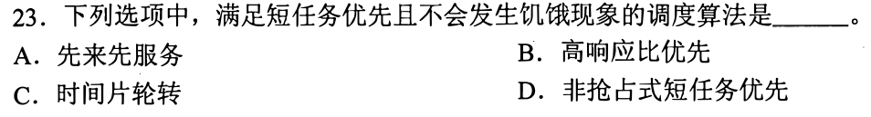

**新增**：饥饿＝某进程永远轮不到。**起手**：列“算法 × {短优先？不饥饿？}”表。**答案：B**。

| 算法 | 短优先 | 不饥饿 |
| --- | --- | --- |
| A 先来先服务 | 否，按到达 | — |
| B 高响应比 | 是：服务短则 1＋W/S 大（02） | 是：W 增大，1＋W/S 无上界，等久必超过新来者 |
| C 时间片轮转 | 否，不看长短 | — |
| D 非抢占式短任务优先 | 是 | 否：长作业 L 在队，每次 CPU 空出时都有新到的更短作业，L 永远不被选 |

D 的反例合法：非抢占式只在 CPU 空出时选就绪者中最短的，持续有短作业到达即可。

<a id="q06"></a>
## 06｜2011-24：命令解释程序是用户程序


**新增**：命令解释程序（读入并解析用户命令的程序）是普通用户程序，要内核服务时发系统调用。**起手**：对每项问“它是不是由异常/中断/系统调用进入的内核代码”（0824-04）。**答案：A**。

| 选项 | 依据 | 态 |
| --- | --- | --- |
| A 命令解释程序 | 读命令、解析，不改系统状态；启动程序、读文件时才系统调用 | 用户态 |
| B 缺页处理程序 | 缺页异常的入口代码 | 内核态 |
| C 进程调度程序 | 要换走进程私有状态（如页表基址，0824-24），属特权操作 | 内核态 |
| D 时钟中断处理程序 | 中断入口代码（0824-10） | 内核态 |

<a id="q07"></a>
## 07｜2011-25：线程私有的是恢复执行点所需之物

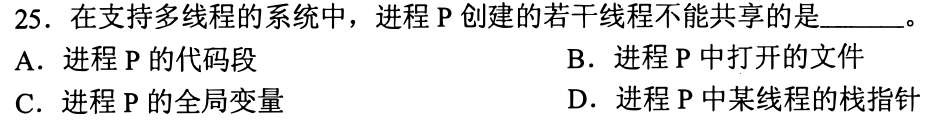

**新增**：**线程**是进程内的一条执行流，共享进程的资源，自己有恢复执行所需的私有量。**起手**：想象线程 A 被换下、B 运行、再换回 A，问 A 需要什么才能接着跑。**答案：D**（题问“不能共享”）。

- 接着跑要有 A 的调用链和局部变量 → 栈；找到栈顶 → 栈指针（还有寄存器值）。B 用自己的，不能是同一个。
- A 代码段：同一进程的线程执行同一份程序，可共享。
- B 打开的文件：属进程资源，可共享。
- C 全局变量：同一地址空间里的同一个变量，可共享。

<a id="q08"></a>
## 08｜2012-25：虚存＝非连续分配，容量有两个上限

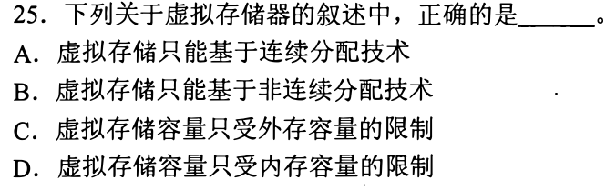

**新增**：虚存的两个事实。**起手**：写 ① 逻辑地址空间 ≤ 2^(地址位数)；② 装得下的量受内存＋外存限制。**答案：B**。

| 选项 | 与事实的关系 |
| --- | --- |
| A 只能连续分配 | 虚存只装入程序的一部分、其余换出，要求逻辑连续而物理可分散，即页式/段式等非连续分配；连续分配要整块放下 |
| B 只能非连续分配 | 同上，成立 |
| C 只受外存 | 地址位数也限制：32 位地址即使外存再大，虚存也不超过 2^32 B；反例合法 |
| D 只受内存 | 虚存可大于内存，这正是它的作用 |

<a id="q09"></a>
## 09｜2013-27：单缓冲时间线，逐块填起止

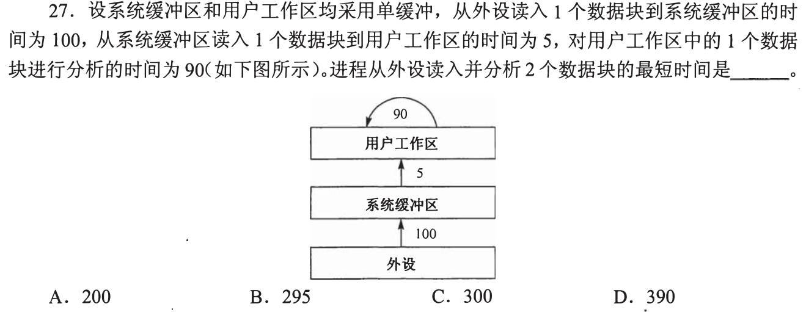

**新增**：单缓冲＝缓冲区被占用期间不能装下一块。**起手**：写三行（读入 100、复制 5、分析 90），逐块填起止。**答案：C（300）**。

```
块1  读 0–100   复制 100–105   分析 105–195
块2  读 105–205 复制 205–210   分析 210–300
```

- 系统缓冲 0–105 一直被块 1 占着，块 2 最早 105 开始读。
- 复制 205 起：用户区 195 就已空，不再等。

| 选项 | 与时间线 |
| --- | --- |
| A 200 | 小于下界：块 2 读完就 ≥205 |
| B 295 | 要块 2 读到 200 结束，即 100 开始读，但 100–105 缓冲仍在被块 1 复制占用 |
| D 390 | 全串行 2×(100+5+90)，而块 1 分析 105–195 与块 2 读 105–205 可重叠 |

<a id="q10"></a>
## 10｜2014-23：轮转的等待有上界


**新增**：时间片轮转中，新就绪者进队尾，某进程至多等 (n−1) 片就轮到。**起手**：设队里 n 个进程、片长 q，写某进程至多等多久。**答案：A**（题问“不可能饥饿”）。

- 队中其他 n−1 个各用 ≤ q，新来的排在它后面，所以等待 ≤ (n−1)q。
- B 静态优先数：优先数不随等待变，高优先级进程持续到达，低者轮不到（同 05 的构造）。
- C 非抢占式短作业优先：05 已构造。
- D 抢占式短作业优先：更短的新到者随时抢占，同样构造。

<a id="q11"></a>
## 11｜2015-25：缺 CPU→就绪，缺事件→阻塞

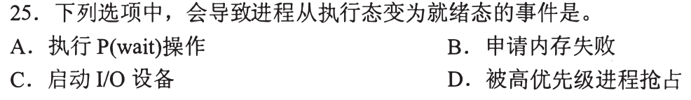

**新增**：三态判据。**起手**：画运行/就绪/阻塞三态，对每项问“此刻把 CPU 给它，它能继续吗”。**答案：D**。

| 选项 | 它可能的结果 | 能到就绪吗 |
| --- | --- | --- |
| A P(wait) | 资源够则继续，不够则等 → 阻塞 | 否 |
| B 申请内存失败 | 等内存可用 → 阻塞（题面无更多细节，取此读法） | 否 |
| C 启动 I/O 设备 | 等 I/O 完成（0823）→ 阻塞 | 否 |
| D 被高优先级抢占 | 它什么都不缺，只是 CPU 被收走 | 是 |

<a id="q12"></a>
## 12｜2017-23：先圈已到达者，再套算法

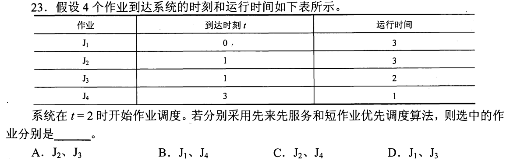

**新增**：调度只在已到达者中选。**起手**：写 t=2 时到达时刻 ≤2 的作业。**答案：D**。

```
t=2 候选：J1(到0,运3) J2(到1,运3) J3(到1,运2)      J4 到 3，不在
FCFS：到达最早 → J1        SJF：运行时间最短 → J3
```

读法：J1 在 t=2 仍是待调度作业（题面说 t=2 开始作业调度）。A 的 FCFS 选 J2，但 J1 到得更早；B、C 的 SJF 选 J4，J4 尚未到达。

<a id="q13"></a>
## 13｜2017-27：时间片长短的折中

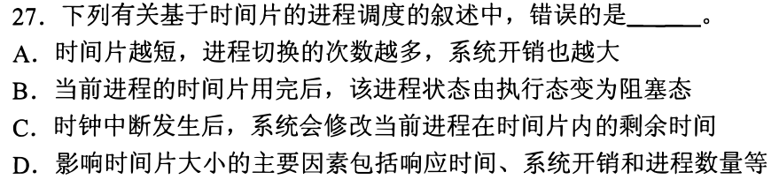

**新增**：片长折中（短→响应快、切换多）。**起手**：写一个时间片周期：时钟中断（0824-10）→ 更新剩余片长 → 片尽则换人。**答案：B**（题问“错误”）。

| 选项 | 依据 | |
| --- | --- | --- |
| A 片越短切换越多、开销越大 | 单位时间换人次数多，每次要保存/恢复 | 对 |
| B 片用完变阻塞态 | 片尽的进程仍具备运行条件，只是失去 CPU → 就绪（11） | **错** |
| C 时钟中断后修改剩余时间 | 否则无法知道何时片尽 | 对 |
| D 因素含响应、开销、进程数 | 响应与开销反向，进程多则一圈长 | 对 |

<a id="q14"></a>
## 14｜2018-23：并发的任务要管共享资源

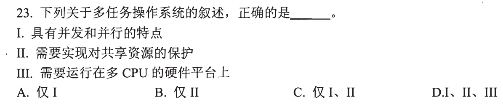

**新增**：多任务并发会访问同一资源，须由系统管理。**起手**：先用 01 判 I、III。**答案：C**。

- I 并发与并行：多任务交替推进是并发，CPU 与设备同刻工作是并行（01）→ 对。
- III 需多 CPU：单处理机上进程也能交替（01）→ 错。
- II：任务可在任意两条指令之间被换走，另一任务可能碰同一文件或设备，故须管理共享资源 → 对。

<a id="q15"></a>
## 15｜2018-24：周转＝已等待＋之后完成

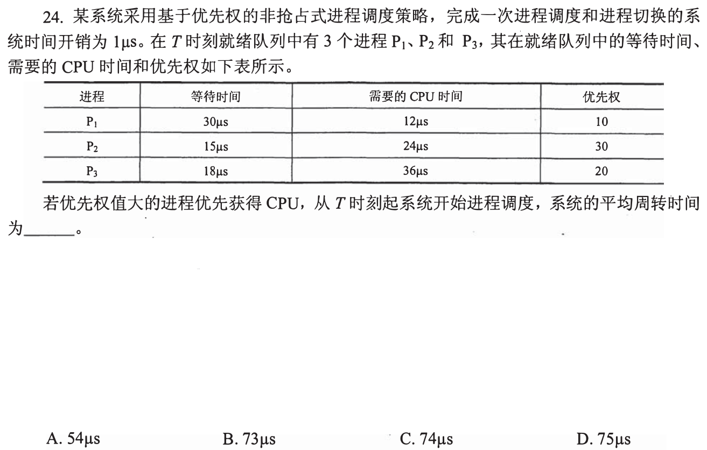

**新增**：表里的“等待时间”是 T 之前已经等过的，要加进周转。**起手**：按优先权 30、20、10 排出 P2→P3→P1，画 T 之后的时间轴。**答案：D（75 μs）**。

```
T  调度1 → P2 跑24 → 25       周转 15+25 = 40
   调度1 → P3 跑36 → 62       周转 18+62 = 80
   调度1 → P1 跑12 → 75       周转 30+75 = 105
平均 (40+80+105)/3 = 75
```

非抢占，所以顺序中途不变；三次调度各 1 μs，首次也计。

| 选项 | 值 |
| --- | --- |
| A 54 | 162/3：只算 T 之后的完成时刻，没加已等待 |
| C 74 | 222/3：首次调度的 1 μs 没计 |
| B 73 | 对应总和 219，我没有找到与题面一致的读法 |

<a id="q16"></a>
## 16｜2018-25：x++ 是读、改、写三步

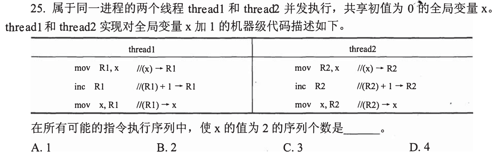

**新增**：交错时看**最后写 x 的线程读到几**。**起手**：编号 a1(读)a2(加)a3(写)、b1b2b3，试 a1 b1 a2 b2 a3 b3 → 两个都读到 0，x＝1。**答案：B（2 个）**。

- 最后执行的写是 a3 或 b3，写入值＝该线程读到的值＋1；要 2，读到的必须是 1。
- 设最后写者是 b：b1 读到 1，说明 b1 之前 x 已被写成 1，只能是 a3 → a1a2a3 都在 b1 之前，序列只能是 a1a2a3b1b2b3。
- 最后写者是 a，同理得 b1b2b3a1a2a3。共 2 个（脚本枚举 20 种交错核对为 2）。

<a id="q17"></a>
## 17｜2019-23：用户级线程内核看不见

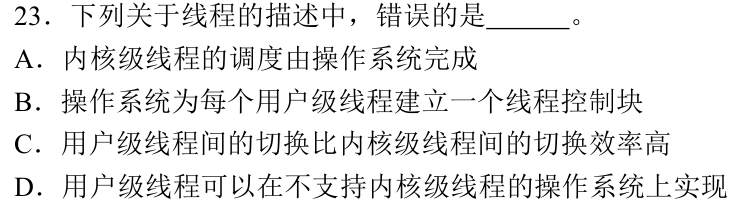

**新增**：线程由谁管——内核级由内核创建调度；用户级由进程内的线程库管理，内核只看见进程。**起手**：问“内核的调度表里有它吗”。**答案：B**（题问“错误”）。

| 选项 | 依据 | |
| --- | --- | --- |
| A 内核级线程由 OS 调度 | 内核可见 | 对 |
| B OS 为每个用户级线程建线程控制块 | 与“内核只看见进程”矛盾 | **错** |
| C 用户级切换更高效 | 不必 trap 进内核（0824-04） | 对 |
| D 可在不支持内核级线程的 OS 上实现 | 线程库在用户态即可 | 对 |

<a id="q18"></a>
## 18｜2019-27：两级队列逐段推进

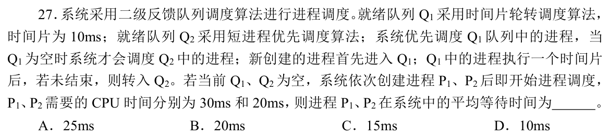

**新增**：多级反馈逐段推进——Q1 轮转一片后去 Q2，Q1 空才轮到 Q2。**起手**：画 Q1/Q2 两栏按时间走。**答案：C（15 ms）**。

```
0–10   Q1：P1（需30，剩20 → Q2）
10–20  Q1：P2（需20，剩10 → Q2）
Q1 空；Q2 短进程优先：P2(10) 先于 P1(20)
20–30  P2 完        30–50  P1 完
等待＝完成−需要（均 0 时到达）：P1 50−30=20，P2 30−20=10，平均 15
```

B 的 20 ms 对应 Q2 先跑 P1（P1 等 10，P2 等 30），与“Q2 采用短进程优先”不符。A、D 在这条时间轴上得不到。

<a id="q19"></a>
## 19｜2020-26：多级反馈的四类设计量

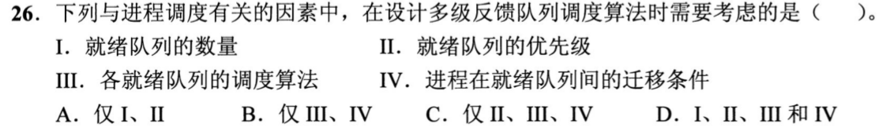

**新增**：多级反馈要定四类量。**起手**：回到 18 的题干，找每类量写在哪。**答案：D**。

| 项 | 18 题干中的出处 | 缺了会怎样 |
| --- | --- | --- |
| I 队列数量 | “二级反馈队列” | 不知有几级 |
| II 队列优先级 | “Q1 空时才调度 Q2” | 不知先服务谁 |
| III 各队列算法 | Q1 轮转 10 ms，Q2 短进程优先 | 不知同队谁先 |
| IV 迁移条件 | “Q1 执行一个时间片后未结束转入 Q2” | 不知何时换队 |

18 去掉任何一条都算不出时间轴。

<a id="q20"></a>
## 20｜2020-29：父子是两个进程，不是两个线程

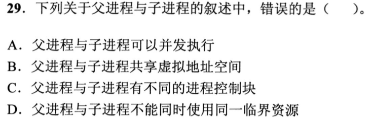

**新增**：父子进程各有自己的 PCB 和虚拟地址空间。**起手**：写创建后的两个 PCB，对照 07 的“同进程线程共享”。**答案：B**（题问“错误”）。

| 选项 | 依据 | |
| --- | --- | --- |
| A 可并发 | 两个进程可交替（01） | 对 |
| B 共享虚拟地址空间 | 进程各有私有地址空间（0824-24：页表基址随进程换）；共享的是 07 的线程 | **错** |
| C 不同 PCB | 每个进程一块（03） | 对 |
| D 不能同时用同一临界资源 | 临界资源的定义：一次只允许一个进程使用 | 对 |

<details><summary>创建后内容相同怎么办</summary>

子进程的初始内容可与父进程相同（甚至暂时共用物理页、写时复制），但地址空间各有一份映射，一方改动不自动出现在另一方。
</details>

<a id="q21"></a>
## 21｜2021-24：创建时必做的是 PCB

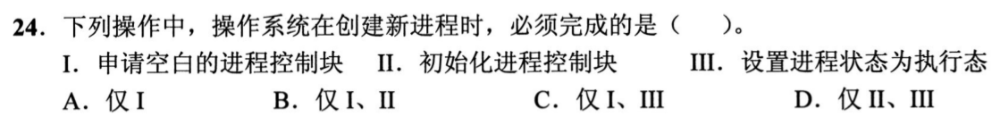

**新增**：创建进程必须有 PCB，初态不是执行态。**起手**：列创建步骤：申请空白 PCB → 填标识、资源、状态 → 放入队列。**答案：B**。

- I 申请空白 PCB、II 初始化 PCB：必须（进程由 PCB 记录，03）。
- III 设为执行态：单处理机上同刻只有一个运行者（01），创建时原运行者仍在 CPU 上，新进程只能先就绪（11）→ 不是“必须”。

<a id="q22"></a>
## 22｜2021-25：写一圈轮转，标出每步用什么

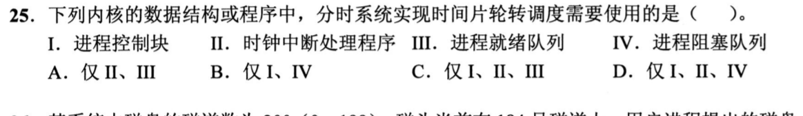

**新增**：轮转要靠就绪队列、时钟中断、PCB。**起手**：写一圈轮转的步骤。**答案：C**。

```
时钟中断(II)：片到 → 当前进程的现场存进 PCB(I) → 回就绪队列(III)队尾
              → 取队首 → 恢复其 PCB(I) → 运行
```

IV 阻塞队列：这一圈里片尽进程去就绪队列（13），没有进程去阻塞队列，轮转本身不用它。A 缺 I，B、D 含 IV。

<a id="q23"></a>
## 23｜2021-27：调度在 CPU 空出或需要重选时运行

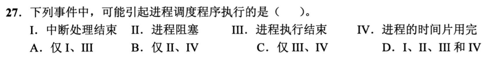

**新增**：调度程序的触发时刻。**起手**：对每项问“此刻要不要重新选一个运行者”。**答案：D**。

| 项 | 为什么可能触发 |
| --- | --- |
| I 中断处理结束 | 中断可能改变就绪集合（如 I/O 完成使进程变就绪，0823）或使片尽（0824-10），返回前可重选 |
| II 进程阻塞 | CPU 空出（11） |
| III 进程执行结束 | CPU 空出 |
| IV 时间片用完 | 要换人（13） |

题问“可能”：I 不是每次中断都换人，只要存在这种情形即可。

<a id="q24"></a>
## 24｜2022-23：并发度不能无限加

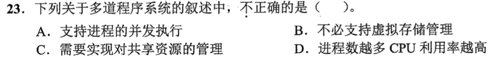

**新增**：并发度有上限。**起手**：画“进程数 n → CPU 利用率”草图：先升，再受限于内存。**答案：D**（题问“不正确”）。

| 选项 | 判断 |
| --- | --- |
| A 支持进程并发 | 多道＝内存中多个程序交替运行，对 |
| B 不必支持虚存 | 虚存（08）是让程序大于内存；多道只要几个程序同时驻留内存，分区管理即可，对 |
| C 管理共享资源 | 同 14，对 |
| D 进程数越多利用率越高 | 内存有限，进程多了每个分到的内存少，要频繁换入换出，CPU 反而在等换页 → **错** |

<a id="q25"></a>
## 25｜2022-25：抢占点与调度次数

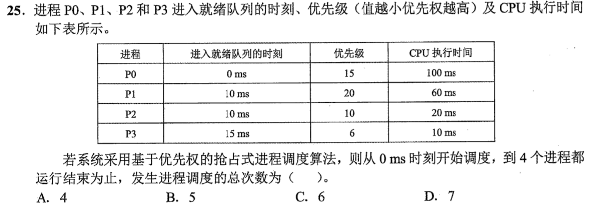

**新增**：抢占条件＝新到者优先级更高（本题值小者高）；调度次数＝CPU 换人开始新一段的次数。**起手**：在 0、10、15 三个到达时刻比新到者与当前者。**答案：C（6）**。

| 时刻 | 事件 | 运行 |
| --- | --- | --- |
| 0 | P0 开始（第 1 次） | P0 |
| 10 | P2(10)、P1(20) 到；P2 的 10 < P0 的 15，抢占（第 2 次）；P1 值 20 更低，只入队 | P2 |
| 15 | P3(6) 到，6 < 10，抢占（第 3 次）。P2 已跑 5，剩 15 | P3 |
| 25 | P3 完；就绪 P0(15)、P1(20)、P2(10)，选 P2（第 4 次） | P2 |
| 40 | P2 完；选 P0（第 5 次），剩 100−10=90 | P0 |
| 130 | P0 完；P1（第 6 次） | P1，至 190 |

到达不等于调度，只有 CPU 开始新一段才计数。读法：“从 0 ms 开始调度”把 t=0 的第一次计入；不计则为 5（选项 B）。

<a id="q26"></a>
## 26｜2022-28：无新台阶，用 11 判每项

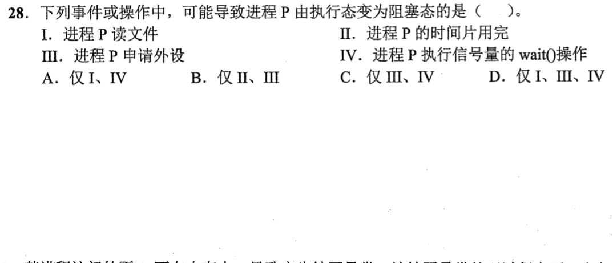

没有新台阶，只复用 11 的判据：对每项问“它是否要等一个事件”。**答案：D**。

| 项 | 判断 |
| --- | --- |
| I 读文件 | 要等磁盘数据到达（0823）→ 可阻塞 |
| II 时间片用完 | 缺 CPU，不缺事件 → 就绪（13） |
| III 申请外设 | 设备被占则等待 → 可阻塞 |
| IV 信号量 wait() | 资源不足则等待 → 可阻塞 |

题问“可能”：读文件若数据已缓存可不阻塞，但存在需等待的情形即成立。

<a id="q27"></a>
## 27｜2023-27：主动让出 CPU，不缺任何事件

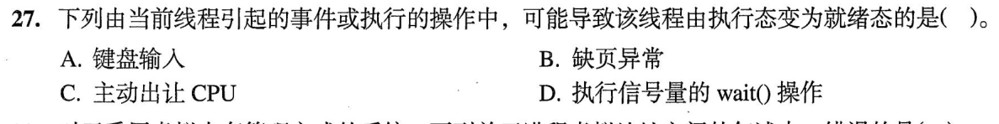

**新增**：主动让出 CPU（yield）后只缺 CPU。**起手**：对每项问“它离开执行态后还缺什么”。**答案：C**。

| 选项 | 缺什么 | 去哪 |
| --- | --- | --- |
| A 键盘输入 | 等输入数据（读法：线程请求键盘输入） | 阻塞 |
| B 缺页异常 | 要等页调入（读盘，0823） | 阻塞 |
| C 主动让出 CPU | 只缺 CPU | 就绪 |
| D 信号量 wait() | 资源不足则等待 | 阻塞 |

<a id="q28"></a>
## 28｜2023-29：被抢占者保留剩余量

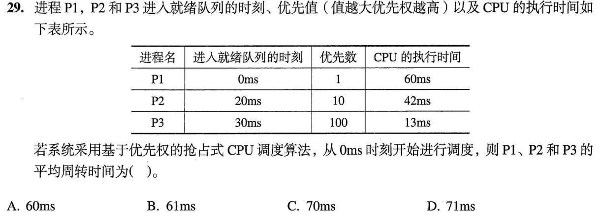

**新增**：被抢占者保留剩余需求量，恢复后接着跑；本题值大者优先（与 25 方向相反）。**起手**：画到达、抢占与各自剩余。**答案：B（61 ms）**。

```
0–20   P1 跑20，剩40
20–30  P2(10>1) 抢占，跑10，剩32
30–43  P3(100) 抢占，13 完 → 43
43–75  P2(10>1) 跑32 → 75
75–115 P1 跑40 → 115
周转＝完成−到达：P1 115，P2 75−20=55，P3 43−30=13
平均 (115+55+13)/3 = 61
```

A 60、C 70、D 71 与这条时间轴不符。

<a id="q29"></a>
## 29｜2024-24：终止回收自己拥有的东西

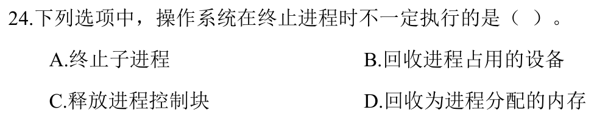

**新增**：终止一个进程要回收**它自己拥有**的设备、内存、PCB。**起手**：把四项分成“该进程拥有的”与“另一个进程”。**答案：A**（题问“不一定执行”）。

- B 设备、D 内存、C PCB：都是本进程拥有的，终止时必须回收。
- A 终止子进程：子进程是另一个进程（20），有自己的 PCB；终止父进程时是否同时终止子进程，由系统规定（可级联终止，也可由系统接管），所以“不一定”。

<a id="q30"></a>
## 30｜2025-25：有序链表，插入要找位置

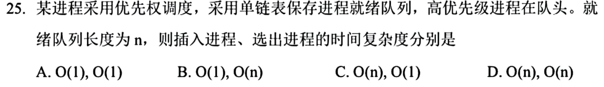

**新增**：有序单链表中，找位置与改指针要分开数（0731：数操作次数）。**起手**：画三结点链（优先级 9→5→2），插入一个 3。**答案：C**。

```
选出：取头结点，头指针后移                     O(1)
插入：从头比较 9?5?2? 找到位置，再改两个指针   找位置最坏 n 步 → O(n)
```

插入的位置题面没给，只给了优先级，所以必须比较；改指针本身是常数，但不能只数它。

[« 0824-answer-sonnet](0824-answer-sonnet.md)　　[0826-answer-sonnet »](0826-answer-sonnet.md)
