[« 0827-answer-sonnet](0827-answer-sonnet.md)　　[0829-answer-gpt »](0829-answer-gpt.md)

# 0828 Answer｜内存边界：分配、回收与保护

> [原题 12 题](../0828.md) · [0827 资源闭环 · 0827-answer-sonnet](0827-answer-sonnet.md) · [能力账本](../answer-quality/learning-ledger.md)

**进入本篇时已有**：本篇从零开始（0827 的资源/安全序列在此用不上）。
**读完新增**：01 访问先比界限再加基址 · 02 段式地址按位拆成段号｜段内位移 · 03 动态分区的空闲孔表与最佳适应 · 04 页式翻译的两条路径：TLB、内存页表 · 05 段表项逐字段检查的顺序 · 06 回收：地址相接就合并，再按算法重排 · 07 权限位串＝类别×权限 · 08 共享段：各进程段号独立，指向同一物理段 · 09 外部碎片与最佳适应的剩余孔 · 10 磁盘分配的“可增长/可随机”两列 · 11 页号各自编，页框共享 · 12 伙伴：同阶且由同一块劈出

<details><summary>速览</summary>

| # | 新增台阶 | 起手 | 最易错 → 先看什么 |
| --- | --- | --- | --- |
| [01](#q01) | 界限检查 | 写 `位移<界限?` 再写 `基址+位移` | 只想到内容保护 → 题问的是“分区”的措施 |
| [02](#q02) | 地址拆位 | 画 32 格，切 8｜24 | 段号位数当段长 → 位移字段有几位 |
| [03](#q03) | 空闲孔表+最佳适应 | 画 55MB 条，标孔 | 把 15 与尾部 10 并成 25 → 中间 30MB 还占着 |
| [04](#q04) | 翻译路径 | 写 `TLB→页表→数据` | 凡存储都加速 → 它是否在这条路径上 |
| [05](#q05) | 检查顺序 | 逐字段对段 2 一行 | 先加 4000 → 位移是否 <段长 |
| [06](#q06) | 合并+重排 | 把区间写成 `[起,止)` | 合并后不重排 → 题问链首 |
| [07](#q07) | 位串计数 | 列 4 类×5 项表 | 只数 5 → 每类各有一套 |
| [08](#q08) | 共享段表 | 画两进程段表指向一块 | 内容同＝段号同 → 段号在谁的地址空间里 |
| [09](#q09) | 剩余孔大小 | 同一请求各策略切一次 | “最贴合＝最省” → 切完剩多大 |
| [10](#q10) | 分配方式两列 | 画 3 种方式找第 k 块 | 链接“也能到第 k 块” → 要走几步 |
| [11](#q11) | 页号/页框对应 | 画 R、S 两张页表 | 共享＝页号相同 → 页表各归谁 |
| [12](#q12) | 伙伴配对 | 地址 0–8 劈两次 | 相邻等大就合并 → 是否同一块劈出 |

**反复出现的信号**：先查边界再算地址（01、05）；先画物理区间再谈大小（03、06、09、12）；逻辑编号归各进程，物理对象共享（08、11）。

</details>

<a id="q01"></a>
## 01｜2009-26：分区分配靠界限检查保护


**新增**：访问先比界限，再加基址。**起手** `位移 < 界限 ?` 通过才算 `基址+位移` → **A 界地址保护**。

分区分配给每个进程一段连续内存。若不检查，进程用大位移就能越到相邻分区。B、C、D 是代码、数据、栈这类内容的保护；题面问的是分区方式的主要措施，与分区边界对应的只有 A。

<a id="q02"></a>
## 02｜2009-27：段式地址按位拆开

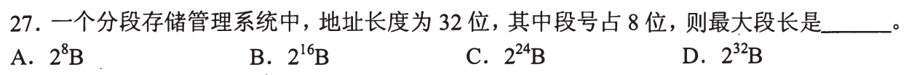

**新增**：段式逻辑地址＝段号｜段内位移，按位拆。**起手**画 32 格，左 8 格段号，右 24 格位移 → **C 2²⁴ B**。

| 选项 | 数值来自 | 与题面 |
| --- | --- | --- |
| A 2⁸ | 段号字段位数 | 它是段的个数上限，不是长度 |
| B 2¹⁶ | 题面没有 16 位字段 | 无依据 |
| C 2²⁴ | 位移字段 32−8=24 位 | 一段内最多 2²⁴ 个位移值 |
| D 2³² | 整个地址 | 段号占了 8 位，位移装不下 32 位 |

<a id="q03"></a>
## 03｜2010-28：动态分区用空闲孔表，最佳适应取最小够用孔

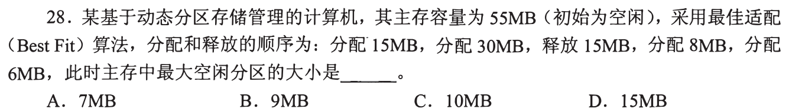

**新增**：空闲孔表；最佳适应＝在够用的孔中选最小的。**起手**画 55MB 条（单位 MB）→ **B 9MB**。

```
分配15、30: [0,15)占 [15,45)占 [45,55)空10
释放15   :  [0,15)空15  占30  [45,55)空10     孔 {15,10}，不相邻
分配8    : 够用的孔 15、10，取 10 → 剩 2        孔 {15,2}
分配6    : 够用的孔只有 15       → 剩 9        孔 {9,2}
```

最大孔 9。其余选项只在换策略时出现（脚本核算）：每次取最大孔（最坏适应）得 7（A）；取地址最小的够用孔得 10（C）；15（D）要求 8、6 都不动 15MB 孔，而 10MB 孔装不下 8+6，不可能。题面指定最佳适应，故 B。

<a id="q04"></a>
## 04｜2014-28：加快虚实地址转换，只看翻译路径上的环节

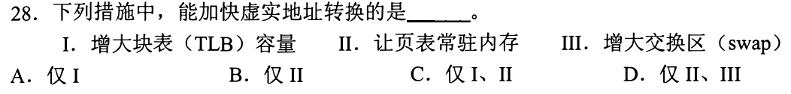

**新增**：页式翻译的两条路径。**起手** `虚地址 → 查TLB；未命中 → 查内存页表 → 物理地址 → 访问数据` → **C 仅 I、II**。

- I 增大 TLB：命中路径更常被走到，少一次内存页表访问。
- II 页表常驻内存：未命中时页表项从内存取；页表若不在内存，要先调入，翻译变慢。
- III 交换区：题面“虚实地址转换”的路径上没有它；它是页面换出的存放区，增大它不改变这条路径。故 A、B、D 均排除。

<a id="q05"></a>
## 05｜2016-28：段表逐字段检查，位移过界先于加基址

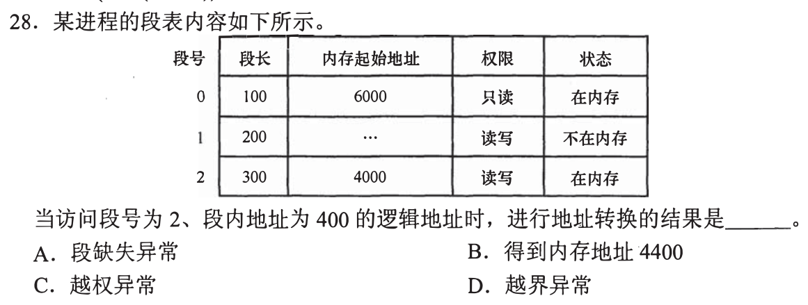

**新增**：段表一行的检查顺序（沿用 01 的界限检查、02 的段号｜位移）。**起手**取段 2 一行：段长 300、基址 4000、读写、在内存 → **D 越界异常**。

| 选项 | 成立需要 | 题面 |
| --- | --- | --- |
| A 段缺失 | 段 2 状态“不在内存” | 段 2 在内存（不在内存的是段 1） |
| B 4400 | 位移 400 < 段长 300 | 400 ≥ 300 |
| C 越权 | 操作与权限冲突 | 段 2 权限读写，读写都允许 |
| D 越界 | 位移 ≥ 段长 | 400 ≥ 300 ✓ |

> 4000+400=4400 没有被段长限制的位置，不能当结果。看到“位移≥段长”即停。

<a id="q06"></a>
## 06｜2017-25：回收时地址相接的空闲孔合并，再按算法重排

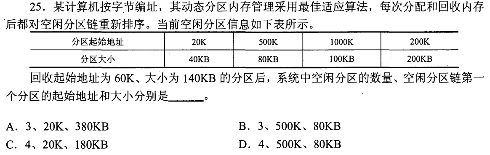

**新增**：回收合并＋重排（沿用 03 的空闲孔表）。**起手**写 `[起,止)`：[20,60)、[200,400)、[500,580)、[1000,1100)，回收 [60,200) → **B 3、500K、80KB**。

```
[20,60)+[60,200)+[200,400) = [20,400)  380KB     三块并成一块
[500,580) 80KB   [1000,1100) 100KB               与 400、580 均不相接
孔数 4+1−2 = 3
```

约定：题面只说“重新排序”，未写顺序；最佳适应的链按容量递增（第一个够用的就是最小够用的），这是通行读法。递增为 80、100、380，链首 (500K, 80KB)。

A 孔数对，但把 380 放链首，对应按地址或最大优先的排法；C、D 孔数 4 要求不合并，而 [60,200) 两端恰与 60、200 相接。

<a id="q07"></a>
## 07｜2017-30：位串长度＝类别数×每类权限项数

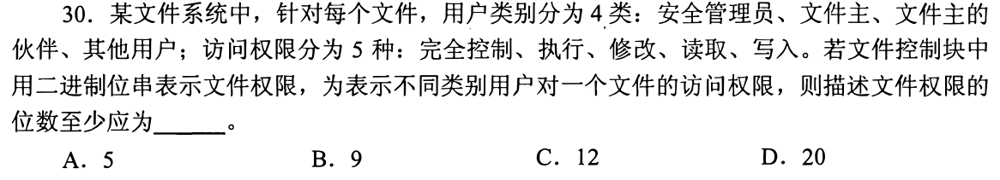

**新增**：用位串记录“有/无”，位数按项计数。**起手**画表：4 行（安全管理员、文件主、伙伴、其他）×5 列（完全控制、执行、修改、读取、写入），每格 1 位 → **D 20**。

A 5 只够一类用户；B 9、C 12 在 4 类 5 项下没有对应的乘积。

读法：题面要求表示“不同类别用户”的权限，故每类各一套；按逐项独立的有/无来记。若按语义压缩（如完全控制蕴含其他），题面未给，不采用。

<a id="q08"></a>
## 08｜2019-28：共享段——段号归进程，内容只有一份

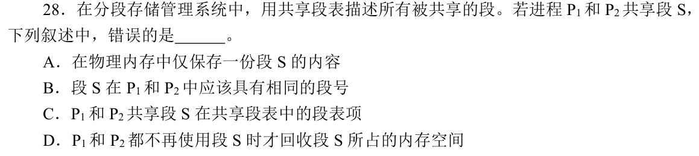

**新增**：共享段表与进程自己的段号（沿用 02：段号是各自地址的字段）。**起手**画 P1 段表、P2 段表，各有一行指向同一块物理内存，段号可不同 → 题问“错误的是”，**B**。

| 选项 | 题面说法 | 裁决 |
| --- | --- | --- |
| A | 物理内存只一份 | 共享的含义，对 |
| B | 在 P1、P2 中应具有相同段号 | 段号是各进程逻辑地址里的字段，两个段表各编各的；题面未要求相同，错 |
| C | 共享段表中有一个共享段的表项 | 与题干“用共享段表描述被共享的段”一致，对 |
| D | 都不再用时才回收 | 仍有进程在用就不能回收，对 |

<a id="q09"></a>
## 09｜2019-32：最佳适应切完留下的小孔最难再利用

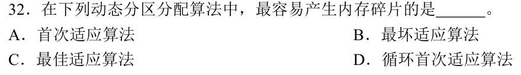

**新增**：外部碎片——空闲孔太小，请求装不下。**起手**取 03 的孔 {15,10}，请求 8，各策略切一次 → **C 最佳适应**。

```
最佳适应：取 10 → 剩 2
最坏适应：取 15 → 剩 7
首次适应：取地址最小够用孔 15 → 剩 7
```

最佳适应每次取“刚好够”的孔，留下的余量最小；03 的 2MB 孔就是例子。这是教材比较各策略时的口径，不是对任何序列都成立。循环首次适应是首次适应从上次位置继续找，剩余孔仍随位置而定，没有“取最小”的倾向。

<a id="q10"></a>
## 10｜2020-24：按“可增长”“可随机”两列看磁盘分配

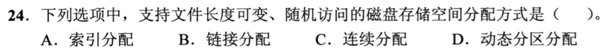

**新增**：磁盘文件的三种分配，各看两列。**起手**画一张 3 行 2 列表 → **A 索引分配**。

| 方式 | 长度可变 | 随机访问第 k 块 |
| --- | --- | --- |
| 索引 | 新块加入索引表即可 | 查索引表第 k 项，直达 |
| 链接 | 可以 | 必须沿指针走 k 步 |
| 连续 | 增长需后面有连续空闲，否则要搬 | 起始块+k，直达 |

D 动态分区分配是 03 的内存分配方式；题面问的是磁盘存储空间。

<a id="q11"></a>
## 11｜2023-30：共享数据——页号各自编，页框相同

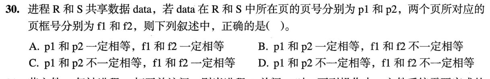

**新增**：页式下页号归各自页表，页框号是物理的（对应 08 的段号／物理段）。**起手**画 R、S 两张页表：R[p1]→f1，S[p2]→f2 → **C**。

- p1、p2 是各进程页表的下标，由各自地址空间安排，不必相等，所以 A、B 的“一定相等”不成立。
- data 是同一份物理数据，映射到同一个页框，f1=f2，所以 D 的“f1、f2 不一定相等”不成立。
- 读法：采用“共享＝同一份物理页”，这是题面“共享数据”的含义。

<a id="q12"></a>
## 12｜2024-27：伙伴算法只合并同阶、由同一块劈出的一对

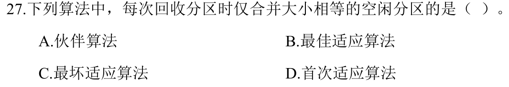

**新增**：伙伴系统——块大小为 2 的幂，空闲块只与自己的伙伴合并。**起手**画 [0,8)，劈成 [0,4)、[4,8)，再劈 [4,8) → **A 伙伴算法**。

```
[0,8) → [0,4)+[4,8)       互为伙伴（大小4）
[4,8) → [4,6)+[6,8)       互为伙伴（大小2）
回收 [4,6)：只有 [6,8) 空才合并回 [4,8)
[4,8) 与 [8,12) 相邻等大，但 [4,8) 的伙伴是 [0,4)，不合并
```

B、C、D 是 03、06 的动态分区策略；06 里相接的孔不要求大小相等就可以合并（40、140、200 并成 380），与题面“仅合并大小相等”不符。

[« 0827-answer-sonnet](0827-answer-sonnet.md)　　[0829-answer-gpt »](0829-answer-gpt.md)
